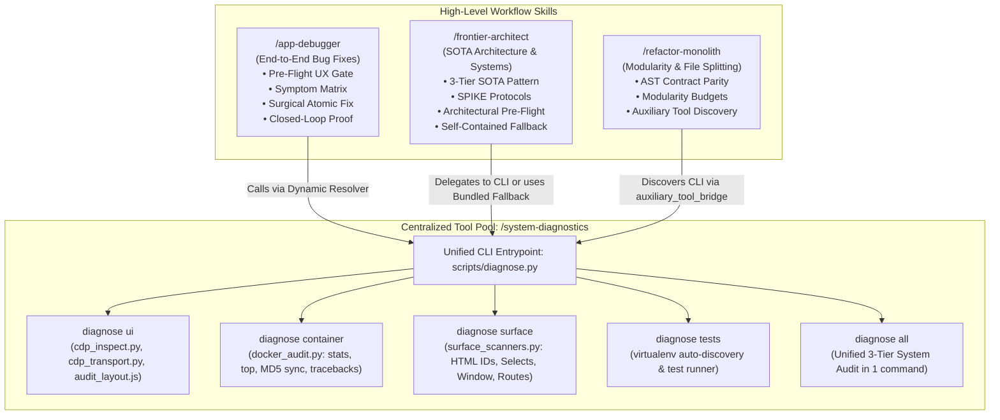

# Architectural Implementation Plan: Unified Diagnostics & Dedicated App Debugger Suite

## Executive Summary & Design Alignment

Following our design alignment and `/grill-me` specifications, this plan expands the step-by-step implementation for the centralized **`system-diagnostics`** tool engine and the dedicated **`app-debugger`** workflow skill, while guaranteeing:
1. **Zero Regressions & Backward Compatibility**: `frontier-architect` (20/20 tests) and `refactor-monolith` (42/42 tests) continue to pass 100% without breakage.
2. **Compliance with `/skill-creator`**: Anatomical structure, pushy triggering descriptions, progressive disclosure, under 500 lines per `SKILL.md`, structured `evals/evals.json`, and deterministic eval verification tests (`test_skill_evals.py`).
3. **Self-Containment & Dependency Shipping**: Every skill can be shipped standalone via `package_skill.py`. If `app-debugger` is shipped without `system-diagnostics`, dynamic discovery across sibling, global, workspace, and environment variable paths cleanly falls back with actionable installation instructions rather than hard-crashing. `frontier-architect` preserves self-contained bundled scripts so it can be installed or run independently.
4. **OS-Agnostic & Committable Standards**: Standard library Python 3.10+, zero `file:///` or machine-local absolute paths in committable files, and strict modularity budgets ($\le$ 350 lines soft / 500 lines hard ceiling).



---

## 1. Skill Architecture & Dependency Shipping Strategy

| Skill Directory | Primary Responsibility | Packaging & Dependency Strategy | Sibling Compatibility |
| :--- | :--- | :--- | :--- |
| **`skills/system-diagnostics/`** | Centralized Diagnostic Tool Engine (`diagnose.py` + subcommands: `ui`, `container`, `surface`, `tests`, `all`). | **100% Self-Contained**. Standard library Python 3.10+ only. Zero external dependencies. Can be shipped, installed, and run as an independent CLI tool. | Exposes clean Python API and CLI interface for all sibling skills. |
| **`skills/app-debugger/`** | 4-Step Bug & Regression Workflow (Pre-Flight Gate, Reproduce First, Symptom Matrix, Atomic Fix & Verify). | **Dependency-Aware with Dynamic Resolver & Graceful Fallback**. Bundles `scripts/run_diagnose.py` which dynamically searches for `system-diagnostics` in sibling directories, global config, workspace `.gemini/skills`, and `SYSTEM_DIAGNOSTICS_DIR`. If missing, provides clear installation one-liner and fallback checks. | Relies on `system-diagnostics` for deep evidence; remains cleanly decoupled from architecture and file-splitting skills. |
| **`skills/frontier-architect/`** | SOTA Product, Context & Verification Engine (3-Tier Proposals, SPIKEs, Flash-to-Opus Cognitive Harness). | **100% Self-Contained with Shared Delegation**. Retains fully functional bundled scripts (`cdp_inspect.py`, `docker_audit.py`, `cdp_transport.py`, `audit_layout.js`) while Phase 1B recommends `diagnose.py`. Passes all 20 existing unit tests whether `system-diagnostics` is installed or not. | Zero breaking changes. Existing test suite and external references remain 100% valid. |
| **`skills/refactor-monolith/`** | Modularity Budgets, AST Contract Snapshots, and Safe Monolith Decomposition. | **100% Self-Contained with Enhanced Discovery**. `auxiliary_tool_bridge.py` dynamically probes `system-diagnostics/scripts/diagnose.py` first, falling back to `frontier-architect` or skipping cleanly per Axiom 9. | Zero breaking changes. All 42 unit tests remain 100% green. |

---

## 2. Quantitative Modularity & Quality Budgets

All new and modified files must adhere to the engineering standards:

| Code Element | Target Line Budget | Max Method / Func Count | Modularity Strategy |
| :--- | :--- | :--- | :--- |
| `skills/system-diagnostics/scripts/diagnose.py` | 220 – 300 lines | Dispatcher functions $\le 30$ lines each | Delegates heavy lifting to modular sub-scripts (`cdp_inspect`, `docker_audit`, `surface_scanners`). |
| `skills/system-diagnostics/SKILL.md` | 250 – 350 lines | N/A (Markdown) | Progressive disclosure: points to scripts and test matrices. Under 500 lines limit. |
| `skills/system-diagnostics/tests/test_diagnose.py` | 200 – 300 lines | Fast mock-based unit tests | Runs in $< 1.0$s with zero external network or process dependencies. |
| `skills/app-debugger/SKILL.md` | 200 – 280 lines | N/A (Markdown) | Clear 4-step workflow, Symptom-to-Root-Cause Matrix format, and Pre-Flight Gate. |
| `skills/app-debugger/scripts/run_diagnose.py` | 80 – 120 lines | Resolver functions $\le 25$ lines | Standalone dynamic path resolver with actionable dependency error message. |

---

## 3. Compliance with `/skill-creator`

To ensure full compliance with `/skill-creator` standards and metrics:

1. **Anatomy of a Skill**:
   - Every skill has a `SKILL.md` with valid YAML frontmatter (`name`, `description`).
   - Pushy, intention-revealing descriptions that include both capability and negative/triggering boundary conditions.
   - Progressive disclosure: core workflow in `SKILL.md`, deterministic scripts in `scripts/`, test suites in `tests/`, and evals in `evals/`.
2. **Standard Evaluation Suite (`evals/evals.json`)**:
   - `skills/system-diagnostics/evals/evals.json`: Contains realistic user prompt scenarios (headless layout check, live Chrome debugging, Docker sync check, surface route scanning, and full 3-tier audit) with explicit, verifiable expectations.
   - `skills/app-debugger/evals/evals.json`: Contains multi-symptom bug scenarios, Pre-Flight gate choices, and Symptom-to-Root-Cause matrix validations.
3. **Automated Eval Expectation Test (`test_skill_evals.py`)**:
   - Automated unit test suite parsing `evals/evals.json` and asserting that `SKILL.md` satisfies 100% of expectations without regressions.
4. **Packaging Verification**:
   - Verified with `python -m scripts.package_skill` from `skills/skill-creator`.

---

## 4. Scenario Combinations Matrix

Per `executable_documentation.md`, this matrix pairs user intent with the exact copy-pasteable command:

| Real-World Scenario / Objective | Mode / Inputs | Key Parameters | Exact Runnable Command |
| :--- | :--- | :--- | :--- |
| **Quick Headless Health Audit** | Local dev server | Auto-probes port; background headless | `python skills/system-diagnostics/scripts/diagnose.py all` |
| **Inspect Active Buggy Chrome Tab** | Live visible tab | Connects via CDP to open tab | `python skills/system-diagnostics/scripts/diagnose.py ui --live --audit-layout` |
| **Capture Visual Proof of Bug** | Headless sandbox | Viewport render to file | `python skills/system-diagnostics/scripts/diagnose.py ui --screenshot scratch/bug.jpg` |
| **Verify Docker Container Sync & CPU** | Docker service | Auto-detects container + MD5 sync | `python skills/system-diagnostics/scripts/diagnose.py container --sync-check app.py static/app.js` |
| **Scan Surface for Broken IDs/Routes** | Source repository | AST parsing without running server | `python skills/system-diagnostics/scripts/diagnose.py surface --show-ids --show-routes` |
| **Run Test Suite with Local Virtualenv** | Test suite | Auto-detects `.venv` interpreter | `python skills/system-diagnostics/scripts/diagnose.py tests` |
| **App Debugger Pre-Flight Run** | Dynamic runner | Auto-resolves `system-diagnostics` | `python skills/app-debugger/scripts/run_diagnose.py all` |

---

## 5. Detailed Implementation Roadmap & Execution Gates

### Phase 1: Centralized Diagnostics Engine (`skills/system-diagnostics/`)
*(Completed - Verified with 44 Engine Unit Tests + 3 Eval Tests)*
- [x] Create `skills/system-diagnostics/scripts/` directory.
- [x] Consolidate scripts into `system-diagnostics/scripts/`:
  - `cdp_inspect.py` (Layout evaluation, viewport sizing, CDP inspect).
  - `cdp_transport.py` (Pure-Python RFC 6455 WebSocket transport).
  - `audit_layout.js` (DOM bounding-box measurement script).
  - `docker_audit.py` (Docker stats, top, MD5 sync, traceback scanner).
  - `surface_scanners.py` (AST/DOM inventory: HTML IDs, selects, globals, routes).
  - `css_inspector.py` (CSS layout, overflow, and specificity checks).
- [x] Author `skills/system-diagnostics/scripts/diagnose.py`:
  - Single entrypoint CLI with subcommands: `ui`, `container`, `surface`, `tests`, `all`.
  - Auto-discovery for open ports (`8000`, `3000`, `5000`, `8080`), active Docker containers via `docker ps`, and `.venv` virtualenvs.
  - Clean error codes and JSON/text reporting.
- [x] Port and author unit tests in `skills/system-diagnostics/tests/`:
  - `test_diagnose.py` (Subcommands `ui`, `container`, `surface`, `tests`, `all`, auto-discovery, parser, mocks).
  - `test_surface_scanners.py` (Ported from `refactor-monolith`: HTML IDs, selects, inline handlers, JS window.* exports, Python routes, CSS properties).
  - `test_css_inspector.py` (Ported from `refactor-monolith`: specificity audit, section banners, !important detection, directory ignores).
  - `test_engine_scripts.py` (Ported from `frontier-architect`: `docker_audit.py` MD5/CLI, `cdp_transport.py` RFC 6455 framing, `cdp_inspect.py` viewport/options).
  - Zero-dependency, runs with `python -m unittest discover skills/system-diagnostics/tests` (47 tests in 0.063s).
- [x] Author `skills/system-diagnostics/SKILL.md`:
  - Frontmatter, CLI manual, Pre-Run verification one-liners, and Scenario Combinations Matrix.
  - Under 350 lines (137 lines).

### Phase 2: Skill-Creator Compliance Harness for `system-diagnostics`
*(Completed - Verified with test_skill_evals.py)*
- [x] Create `skills/system-diagnostics/evals/evals.json` with 5 realistic scenarios and verifiable expectations.
- [x] Author `skills/system-diagnostics/tests/test_skill_evals.py` verifying 100% of expectations pass against `SKILL.md`.
- [x] Verify test suite passes cleanly: `python -m unittest discover skills/system-diagnostics/tests` (47 tests in 0.063s).

### Phase 3: Dedicated Bug Fixing Workflow (`skills/app-debugger/`)
*(Completed - Verified with 13 Unit & Eval Tests)*
- [x] Create `skills/app-debugger/scripts/run_diagnose.py`:
  - Dynamic resolver finding `system-diagnostics` across sibling, global, workspace, and env paths.
  - Graceful fallback with clear installation instructions and basic health probe (`--probe`).
- [x] Author `skills/app-debugger/SKILL.md`:
  - 4-step workflow: (1) Pre-Flight Gate (`ask_question`), (2) Reproduce First, (3) Symptom-to-Root-Cause Matrix, (4) Surgical Fix & Verify.
  - Dual output reporting rules (inline for simple, artifact for multi-symptom).
- [x] Author `skills/app-debugger/evals/evals.json` and `skills/app-debugger/tests/test_skill_evals.py`.
- [x] Verify unit and eval tests pass cleanly (`test_run_diagnose.py` + `test_skill_evals.py`: 13 tests in 0.017s).

### Phase 4: Sibling Skill Integration & Preservation
*(Completed - Verified with 20/20 frontier-architect & 43/43 refactor-monolith tests)*
- [x] Update `skills/frontier-architect/SKILL.md` (Phase 1B) to recommend `diagnose.py` while documenting the bundled fallback.
- [x] Update `skills/refactor-monolith/scripts/auxiliary_tool_bridge.py` to auto-discover `system-diagnostics/scripts/diagnose.py`.
- [x] Verify `frontier-architect` tests remain 100% passing (20/20).
- [x] Verify `refactor-monolith` tests remain 100% passing (43/43).

### Phase 5: Verification, Packaging Audit & Pre-Commit Sanitization
*(Deferred to Subsequent Turn / Milestone)*
- [ ] Run full test suite across all 4 skills.
- [ ] Audit all committable files for zero `file:///` URLs or local machine absolute paths.
- [ ] Verify modularity budgets ($\le$ 350-500 lines per file).
- [ ] Provide atomic git commit command.

---

## 6. Pre-Run Verification One-Liners

Before executing Phase 1, run these fast diagnostic commands:

```bash
# Verify existing frontier-architect tests
python -m unittest discover -s skills/frontier-architect/tests -p "test_*.py"

# Verify existing refactor-monolith tests
python -m unittest discover -s skills/refactor-monolith/tests -p "test_*.py"
```
