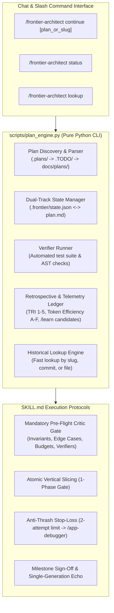
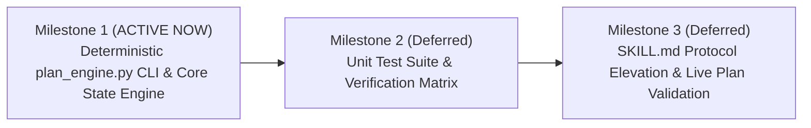

# Architectural Implementation Plan: Frontier Architect 'continue' Engine & Learning Protocol
> **Status: COMPLETED** | Signed off: 2026-11-08 | Verifier Baseline: 81 tests passing (100% eval coverage)

## 1. Executive Summary & Design Goals

The **Frontier Architect** skill excels at deep system design, 3-tier proposals, and plan formulation. However, executing multi-milestone campaigns across fresh chats currently requires manual re-prompting and human-driven scope gating.

This plan introduces a native, deterministic **Plan Execution & Continuation Engine** (`/frontier-architect continue`) modeled after the battle-tested principles of `/refactor-monolith`, elevated with:
1. **Dual-Track State Synchronization**: Human-readable markdown plans (`.plans/` or `.TODO/`) remain the Single Source of Truth (SSOT), while a machine-readable workspace ledger (`.frontier/state.json`) tracks active milestones, verification baselines, and historical plan registries.
2. **Deterministic Zero-Token CLI Helper (`plan_engine.py`)**: A 100% pure-Python, zero-dependency standard library tool in `skills/frontier-architect/scripts/` that handles plan discovery, milestone parsing, checkbox updates (`- [ ]` $\rightarrow$ `- [x]`), test execution, and retrospective logging without burning LLM context.
3. **Mandatory Pre-Flight Critic Gate**: A cognitive harness checkpoint before every code slice auditing public surface invariants, defensive edge cases, modularity line budgets, and concrete scenario verifiers.
4. **4-Dimensional Evaluation & Continuous Learning Loop**: Formal tracking of Token Efficiency (Grades A–F), Hypothesis Accuracy (Anti-Thrash Stop-Loss), Tool Reliability Index (TRI 1–5), and Architectural Defense, seamlessly feeding candidates to `/learn` and escalating multi-attempt bugs to `/app-debugger`.
5. **Historical Plan & Architectural Lookup Registry**: Instant retrieval of past decisions, trade-offs, and commits by plan name, slug, or commit SHA for post-feature requests and bug fixes.

---

## 2. Quantitative Modularity & File Budgets

All modifications strictly obey the repository modularity limits:

| Target File | Current Lines | Planned Mod / Lines | Soft Warning (350 L) | Hard Ceiling (500 L) | Compliance Strategy |
| :--- | :--- | :--- | :--- | :--- | :--- |
| `skills/frontier-architect/scripts/plan_engine.py` | *New file* | ~280–320 L | Safe (< 350 L) | Safe (< 500 L) | Pure modular helper functions with single-responsibility subcommands |
| `skills/frontier-architect/SKILL.md` | 296 L | +40 L $\rightarrow$ ~336 L | Clean (< 350 L) | Safe (< 500 L) | Integrate Phase 6 Continuation Protocol & Pre-Flight Critic Gate cleanly |
| `skills/frontier-architect/tests/test_plan_engine.py` | *New file* | ~220 L | Safe (< 350 L) | Safe (< 500 L) | Branch-complete unit test suite for all engine operations |

---

## 3. Architecture Specification & Components



### 3.1 Standardized Multi-Plan Workspace Architecture
To seamlessly support **multiple concurrent or sequential plans** without collisions, `.frontier/` uses a per-plan isolation structure:

```text
<workspace>/
├── .frontier/
│   ├── state.json             # Workspace manifest (points to currently active plan slug, global registry)
│   ├── .gitignore             # Auto-protects ephemeral telemetry while allowing git tracking
│   └── plans/
│       ├── camera_pipeline_detector_config/
│       │   ├── state.json     # Milestone progress, verifier baseline, commit SHAs
│       │   ├── retrospectives.json  # TRI scores, token grades, /learn candidates
│       │   └── artifacts/     # Temporary AST dumps, test logs, or contract diffs
│       └── another_feature_plan/
│           └── state.json
├── .plans/                    # Standardized active & completed architectural plans
│   ├── camera_pipeline_and_detector_configuration_plan.md
│   └── (completed plans remain with updated status header)
└── .TODO/                     # Fully supported backward-compatible plan location
```

### 3.1.1 Auto-Bootstrapping for Unindexed Plans
If `/frontier-architect continue <path_or_slug>` is called on a plan that has no existing state:
- The engine automatically computes a unique `plan_slug` (e.g. `camera_pipeline_and_detector_configuration_plan`).
- It extracts the title, all milestones (`### Milestone N`), task checkboxes (`- [ ]`), scenario matrices, and verifier commands.
- It creates `.frontier/plans/<plan_slug>/state.json` initialized to the first unchecked milestone.
- It updates `.frontier/state.json` to set this plan as `active_plan_slug`. Zero manual setup required.

### 3.2 Machine-Readable State Ledger (`.frontier/state.json`)
```json
{
  "version": "1.0.0",
  "active_plan": {
    "title": "Dynamic Detector & Pipeline Configuration",
    "slug": "camera_pipeline_and_detector_configuration_plan",
    "plan_path": ".TODO/camera_pipeline_and_detector_configuration_plan.md",
    "branch": "plan/camera-detector-config",
    "active_milestone_index": 1,
    "total_milestones": 3,
    "status": "in_progress",
    "last_checkpoint_at": "2026-11-08T22:00:00Z"
  },
  "verification_baseline": {
    "command": "python -m unittest discover tests",
    "last_exit_code": 0,
    "passed_tests": 61,
    "failed_tests": 0,
    "timestamp": "2026-11-08T22:00:00Z"
  },
  "retrospectives": [
    {
      "milestone_index": 1,
      "token_efficiency_grade": "A",
      "tool_reliability_scores": {
        "cdp_inspect.py": 5,
        "plan_engine.py": 5
      },
      "hypotheses_tested": 1,
      "root_causes_escalated": [],
      "learn_candidates": []
    }
  ],
  "plan_history": []
}
```

---

## 4. Vertical Milestones Roadmap

Following the **1-Phase-Per-Turn Execution Gate**, the implementation is divided into 3 atomic milestones:



### Milestone 1: Deterministic `plan_engine.py` CLI & Core State Engine (ACTIVE TURN)
- [x] **1.1 Engine Core & Discovery**: Implement `skills/frontier-architect/scripts/plan_engine.py` with:
  - Plan discovery scanning `.plans/`, `.TODO/`, and `docs/plans/`.
  - Markdown parser extracting title, milestones (`### Milestone N`), checkboxes (`- [ ]` vs `- [x]`), scenario matrices, and verification commands.
- [x] **1.2 Dual-Track State Machine**:
  - `status`: Returns compact JSON or markdown of active plan, active milestone, and next tasks.
  - `init`: Explicitly binds a plan file or auto-initializes the latest discovered plan into `.frontier/state.json`.
  - `next`: Emits the exact active milestone tasks and verification commands (0-token context lookup).
  - `advance`: Marks the current milestone tasks `- [x]` in the markdown file, updates `state.json`, logs commit SHA, and advances milestone index.
- [x] **1.3 Retrospective & Telemetry Engine**:
  - `retrospective`: Records Token Efficiency Grade (A–F), Tool Reliability Index (TRI 1–5), failed hypotheses, and `/learn` candidate proposals into `.frontier/state.json`.
- [x] **1.4 Architectural Lookup Engine**:
  - `lookup`: Searches past plans and milestones by slug, keyword, or commit SHA to instantly surface architectural decisions and trade-offs for bug fixes or post-feature requests.

### Milestone 2: Unit Test Suite & Verification Matrix (Deferred to Turn 2)
- [x] **2.1 Plan Parser Tests**: Verify robust parsing of varied markdown styles (nested lists, bold titles, scenario tables).
- [x] **2.2 State Transition Tests**: Verify state initialization, advance, checkpointing, and plan archiving.
- [x] **2.3 Markdown Checklist In-Place Patching**: Assert that advancing a milestone cleanly updates `- [ ]` to `- [x]` in the physical markdown file without corrupting other content.
- [x] **2.4 Zero-Dependency & Cross-Platform Integrity**: Assert 100% compatibility across Windows (`\`), macOS, and Linux (`/`).

### Milestone 3: SKILL.md Protocol Elevation & Live Plan Validation (Deferred to Turn 3)
- [x] **3.1 Update SKILL.md**:
  - Document `/frontier-architect continue [plan_or_slug]`, `status`, and `lookup`.
  - Embed the **Mandatory Pre-Flight Critic Gate** into Phase 6.
  - Embed the **3-Tier Continuous Learning Loop** and 4-dimensional evaluation rubric.
  - Detail the In-Flight Tool Elevation and Stop-Loss triggers.
- [x] **3.2 End-to-End Validation**: Test `/frontier-architect continue` against the user's exported plan: `c:\dev\projects\products\intelligent_tracker\.TODO\camera_pipeline_and_detector_configuration_plan.md`.

### 4.1 The Final Plan Completion Sign-Off & Pre-Merge Gate (Axiom 8 Safety)
When all milestones in a plan reach 100% completion (`- [x]`), the engine prevents rash actions (e.g. merging, deleting branches, force-pushing) by enforcing a mandatory sign-off workflow:
1. **Full Regression & Scenario Matrix Run**: Run the entire workspace test suite and all rows in the plan's Scenario Combinations Matrix.
2. **Pre-Commit Staging Audit**: Assert zero temporary files, zero `file:///` URIs, zero line budget violations (> 500 lines).
3. **Plan Header In-Place Update**: Update the top of the plan markdown with the completion metadata (`Status: COMPLETED | Signed off: YYYY-MM-DD | Commits: [...]`).
4. **Safe Review Hand-Off**: Emit a non-destructive PR / review command (`git diff main...plan/<slug>`), the Conventional Commit snippet, and mark the plan archived in `state.json`. Never auto-merge without explicit user command.

---

## 5. Verification Commands (OS-Agnostic)

```bash
# Execute plan_engine unit tests
python -m unittest discover -s skills/frontier-architect/tests -p "test_plan_engine.py"

# Verify CLI commands on sample plan
python skills/frontier-architect/scripts/plan_engine.py status
python skills/frontier-architect/scripts/plan_engine.py next

# Verify complete frontier-architect test suite remains green
python -m unittest discover -s skills/frontier-architect/tests -p "test_*.py"
```
