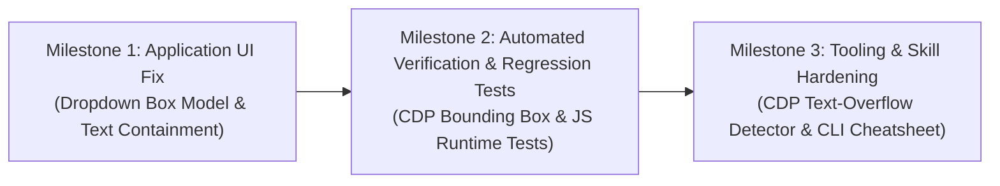

# Implementation Plan: Re-convert Button Layout Remediation & Skill Tooling Hardening

## Executive Context & Problem Statement

In conversations `f49f1b02`, `4816d847`, `c965836c`, and `c8eae3d7`, `/frontier-architect` guided a 3-milestone refactoring of video transcoding, report deletion, and playback scrubber persistence. While core functional milestones passed, two distinct problems emerged:
1. **Application UI Defect (`intelligent_tracker`)**:
   - The `↺ Re-convert` dropdown action button in the video recordings list (`.video-action-menu`) renders severely deformed: its width is squashed to a 28px box while the label text `↺ Re-convert` spans 80px (`btnScrollWidth: 80, btnClientWidth: 26`).
   - The text overflows 54px into open air, and because the button uses transparent `.btn-outline`, the words float without a background fill.
   - **Root Cause**: `.video-action-menu` carries `.glass-panel`. In `dashboard/static/css/responsive_patterns.css:94` (loaded after `styles.css`), `.glass-panel` enforces `min-width: 0; max-width: 100%;`. Because `.video-action-menu` is positioned inside `.video-action-dropdown` (width = 28px), `max-width: 100%` clamps the menu to 28px, overriding `scrubber.css`'s `min-width: 124px`.
2. **Skill & Tooling Gaps (`system-diagnostics` & `frontier-architect`)**:
   - Prior commit `342037d` unified diagnostic scripts into SSOT shims and added `--eval-file`, but the automated CDP layout audit (`cdp_inspect.py --audit-layout`) failed to catch this defect because it only verified sibling occlusion, not text overflow (`scrollWidth > clientWidth`).
   - Agents repeatedly burned tokens on Windows PowerShell by running `rg` (not installed), `&&` (invalid in PS 5.1), and bare `python` instead of `.venv\Scripts\python.exe`.

---

## Architectural Principles & Modularity Budgets

| Code Element | Current Budget | Target / Rule |
| :--- | :--- | :--- |
| `dashboard/static/css/scrubber.css` | 328 lines | Maintain $\le 350$ lines. Zero `!important`. |
| `dashboard/static/js/video_library.js` | 471 lines | Maintain $\le 480$ lines. Clean event delegation. |
| `tests/test_scrubber_ux_fixes.py` | 739 lines | Add targeted JS DOM unit tests for text containment. |
| `skills/system-diagnostics/scripts/cdp_inspect.py` | 361 lines | Enhance `--audit-layout` with text-overflow detection without breaking API. |
| `skills/frontier-architect/references/cli-cheatsheet.md` | 67 lines | Document strict Windows PowerShell hygiene rules (`no rg`, `no &&`, `.venv`). |

---

## Proposed Milestones



---

### Milestone 1: Re-convert Dropdown Box Model & Containment Fix (`intelligent_tracker`)

#### Goals & Contract
Isolate `.video-action-menu` from generic `.glass-panel` layout clamping, ensure the popup dropdown expands to intrinsic content size (`min-width: 130px; width: max-content`), give action buttons a solid dark glass background, and prevent viewport clipping.

#### Tasks:
- [x] **CSS Box Model Overrides (`dashboard/static/css/scrubber.css`)**:
  - [x] Add scoped selector `.video-action-menu.glass-panel` to override `min-width: 0; max-width: 100%` with:
    ```css
    .video-action-menu.glass-panel {
      min-width: 130px;
      width: max-content;
      max-width: calc(100vw - 32px);
      box-sizing: border-box;
    }
    ```
  - [x] Style `.video-action-menu .btn-xs` with explicit background, padding, and text containment:
    ```css
    .video-action-menu .btn-xs {
      width: 100%;
      min-height: 28px;
      padding: 5px 10px;
      background: rgba(30, 41, 59, 0.95);
      border: 1px solid var(--border-medium);
      color: var(--text-main);
      justify-content: flex-start;
      gap: 6px;
      white-space: nowrap;
    }
    .video-action-menu .btn-xs:hover {
      background: rgba(6, 182, 212, 0.18);
      border-color: var(--cyan);
      color: var(--cyan);
    }
    ```
- [x] **Dropdown Positioning Polish (`dashboard/static/js/video_library.js` & `scrubber.css`)**:
  - [x] Ensure `.video-action-menu` anchors cleanly below the toggle button without colliding with `▶ Switch to H.264`.
  - [x] Ensure the toggle button `▾` maintains `aria-expanded` and clean click-outside closing behavior.

---

### Milestone 2: Automated Verification & Regression Test Suite

#### Goals & Contract
Provide permanent regression tests in `tests/test_scrubber_ux_fixes.py` and run empirical headless CDP verification proving zero horizontal text overflow.

#### Tasks:
- [x] **Unit / Runtime Test Addition (`tests/test_scrubber_ux_fixes.py`)**:
  - [x] Add test case `test_reconvert_button_text_containment_and_dimensions()` using the existing Node/JSDOM runtime helper:
    - [x] Verifies that rendered `.video-action-menu` has `min-width >= 124px` and does not inherit `max-width: 100%` from `.glass-panel`.
    - [x] Verifies that `.btn-reconvert-video` contains text `↺ Re-convert` and has full-width layout without text truncation or clipping.
- [x] **Headless CDP Layout Audit**:
  - [x] Run headless Chrome via `system-diagnostics/scripts/cdp_inspect.py` against the running dashboard.
  - [x] Assert empirical values:
    - [x] `menuRect.width >= 120`
    - [x] `btnRect.width >= 120`
    - [x] `btnScrollWidth <= btnClientWidth + 2`
  - [x] Capture verification screenshot in `scratch/reconvert_fixed.jpg`.

---

### Milestone 3: System Diagnostics & Skill Hardening

#### Goals & Contract
Prevent future agents from suffering from false-positive CDP passes or Windows PowerShell command failures.

#### Tasks:
- [x] **CDP Layout Inspector Upgrade (`skills/system-diagnostics/scripts/cdp_inspect.py`)**:
  - [x] Enhance `--audit-layout` DOM script to detect **text overflow anomalies**:
    - [x] Iterate all interactive elements (`button`, `a`, `.badge`, `.menuitem`, `.video-action-menu`).
    - [x] Flag any element where `scrollWidth > clientWidth + 2` while `white-space: nowrap` or `overflow: visible` is set.
    - [x] Output layout warnings so future CDP audits fail if text spills out of buttons.
- [x] **CLI Cheatsheet & Skill Hygiene Guardrails (`skills/frontier-architect/references/cli-cheatsheet.md`)**:
  - [x] Add explicit Windows PowerShell hygiene guidelines:
    - [x] *No `rg`*: Always use `git grep -n` or `Select-String`.
    - [x] *No `&&`*: Chain with `; if ($LASTEXITCODE -ne 0) { throw "step failed" }`.
    - [x] *Virtualenv*: Always run `.venv\Scripts\python.exe`, never bare `python`.
    - [x] *Quotes*: Use `--eval-file` instead of nested inline double quotes.
- [x] **Run Skills Test Suite**:
  - [x] Execute `python -m unittest discover tests` in `skills/system-diagnostics` to verify all 368+ skill tests remain 100% green.

---

## Verification Plan

1. **Intelligent Tracker Workspace Verification**:
   - `c:\dev\projects\products\intelligent_tracker\.venv\Scripts\python.exe -m unittest tests/test_scrubber_ux_fixes.py`
   - `c:\dev\projects\products\intelligent_tracker\.venv\Scripts\python.exe -m unittest discover tests` (all 372 tests pass).
2. **Empirical CDP Layout Verification**:
   - Run `cdp_inspect.py --headless --url http://127.0.0.1:<PORT>/#videos --audit-layout` and confirm 0 layout warnings.
3. **Skills Workspace Verification**:
   - `python -m unittest discover tests` in `C:\Users\User\.gemini\config\skills\system-diagnostics`.
