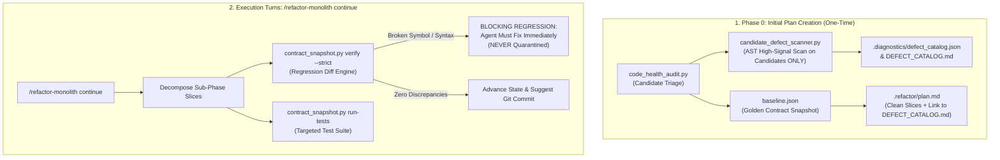

# Architectural Implementation Plan: Refactor-Monolith SOTA Elevation

## Executive Summary & Problem Formulation

Based on empirical post-mortem analysis of three real-world refactoring campaigns (`intelligent_tracker`, `enterprise_website`, and `rrtools`), the `/refactor-monolith` skill successfully achieved 100% behavioral preservation ($\Delta\text{Behavior} \equiv 0$) across complex vision and web codebases. However, the execution highlighted four structural architectural limitations:

1. **Defect Discovery / Quarantine Disconnect**: The user expected `.diagnostics/` to be automatically populated with latent defects. However, the existing implementation only contained a passive `--record-defect` CLI hook. No automated defect scanner existed, and `/refactor-monolith continue` bypassed Phase 0 entirely. Moreover, naively scanning for defects on every slice would cause severe token thrash, false-positive noise, and risk having the agent quarantine its own regressions.
2. **Context Window / Read-Limit Hazard**: `SKILL.md` grew to 47,023 bytes, exceeding the platform's 46,080-byte single-read limit. This triggered truncation, agent pagination errors (`invalid ByteOffset`), and wasted 30,000–50,000 tokens on initialization.
3. **Web Template Rigidness**: `inject-scripts` in `file_patcher.py` hardcoded plain HTML `<script src="{s}"></script>`, failing on template engines (Django ``, Jinja2, Blade) and forcing manual agent fallbacks.
4. **Asynchronous Background Task Thrashing**: When test suites exceeded 10 seconds, agents panicked and repeatedly polled `manage_task(action='status')` in tight loops instead of leveraging reactive wakeups.

This document establishes the definitive architectural specification to resolve these four issues cleanly without behavioral regressions or external skill coupling.

---

## Architecture Specification: The 4 Core Improvements



---

### Improvement 1: Option C (The Asymmetric Two-Tier Defect Protocol)

#### Architectural Intent
Establish a strict separation between **Preexisting Latent Defects** (quarantined in `.diagnostics/`) and **Refactoring Regressions** (blocking errors that must be fixed immediately). Avoid noise, duplicate reporting, and token burn by strictly scoping automated scans to the initial planning phase.

#### Architectural Caveats & Traps to Avoid
> [!CAUTION]
> 1. **Do NOT run automated defect scanning on every refactoring step**: Running a defect scan on each sub-phase causes token thrash, re-flags the same legacy issues turn after turn, and introduces the fatal risk of the agent treating its *own refactoring bugs* as "quarantined defects" rather than fixing them.
> 2. **Do NOT scan the entire repository**: Running linters across 100k lines of untouched legacy code creates an "avalanche of lint noise" that pollutes the catalog and distracts the agent. Scans MUST be strictly restricted to the candidate monolith files targeted in `plan.md`.
> 3. **Zero Plan Drift Invariant**: Never duplicate defect tables inside `.refactor/plan.md`. All latent defects reside in `.diagnostics/defect_catalog.json` and `.diagnostics/DEFECT_CATALOG.md`. `plan.md` maintains a single static reference link.

#### Concrete Implementation Specification

1. **Lightweight Candidate Defect Scanner (`scripts/language_analyzers.py`)**:
   Implement `scan_candidate_defects(candidate_paths: list[Path]) -> list[DefectEntry]` using standard library `ast` (with optional `pyflakes` fallback):
   - **Target Defect Types (High-Signal Only)**:
     - `MUTABLE_DEFAULT_ARG`: Function definitions with mutable defaults (`def f(x=[], y={})`).
     - `UNDEFINED_NAME`: Variable or symbol used without definition or import.
     - `UNREACHABLE_CODE`: Statements placed directly after terminal `return`, `raise`, or `break`.
     - `SYNTAX_ERROR`: Code that fails `ast.parse`.
   - **Exclusions**: Never flag stylistic issues (line length, PEP 8, missing docstrings, variable naming).

2. **Integration into Phase 0 (`campaign_manager.py:init_campaign`)**:
   - During `contract_snapshot.py plan` or `state --init`, after `code_health_audit.py` identifies candidates exceeding 350 lines:
     ```python
     if candidates:
         defects = scan_candidate_defects(candidates)
         if defects:
             record_campaign_defects(workspace_root, defects)
     ```
   - Automatically initializes `.diagnostics/defect_catalog.json` and renders `.diagnostics/DEFECT_CATALOG.md`.

3. **Strict Execution Quality Gate (Mode B / `continue`)**:
   - During execution turns, **zero automated defect discovery is executed**.
   - The agent relies exclusively on:
     - `contract_diff_engine.py verify --strict` (AST/DOM contract parity).
     - `contract_snapshot.py run-tests` (Functional test suite).
   - If an error occurs, the agent treats it as an immediate regression introduced by the refactoring, requiring rollback or fix.
   - The `--record-defect` flag remains in `campaign_manager.py` only as a manual, human-directed escape hatch for undeniable logic bugs discovered while reading code.

---

### Improvement 2: Context Hygiene & `SKILL.md` Distillation ($\le 32$ KB)

#### Architectural Intent
Ensure `SKILL.md` loads with 100% reliability in a single tool call without triggering the 46,080-byte read truncation boundary, while preserving all operational invariants and rules directly inline.

#### Architectural Caveats & Traps to Avoid
> [!WARNING]
> Do NOT strip critical operational invariants (such as the 1-Phase Gate, Anti-Micro-Audit Rule, No-Staging Invariant, or Facade Preservation Rule) into reference files. Subagents and fresh turns only read `SKILL.md`; if invariants are buried in external references, agents will suffer "rule amnesia".

#### Concrete Implementation Specification

1. **Strict Size Budget**:
   - Target size: **26,000–30,000 bytes** ($\le 450$ lines).
   - Maximum hard ceiling: **32,000 bytes** (leaves 14KB safety margin below 46,080 limit).

2. **Content Division**:
   - **Retain in `SKILL.md`**:
     - Frontmatter and skill description.
     - Core Operational Axioms (Behavior Preservation $\Delta\text{Behavior} \equiv 0$, 1-Phase Turn Gate, 2-Monolith Ceiling).
     - Execution Workflow Mermaid diagram.
     - Phase 0 to Phase 4 procedure outlines.
     - Anti-Micro-Audit Rule and Batch Audit Mandate.
     - Strict No-Staging Invariant (`git add`/`git rm` prohibition).
     - Asymmetric Defect Protocol (Option C).
     - Reactive Background Task Protocol.
     - Fast CLI Quick Reference Table.
   - **Offload to `references/language-playbooks.md`**:
     - Verbose multi-page code samples (Vanilla JS IIFE walkthroughs, CSS ITCSS directory blueprints, Go interface patterns, C# partial classes).
   - **Offload to `references/cli-reference.md`**:
     - Exhaustive flag permutations, debugging recipes, and legacy migration commands.

---

### Improvement 3: Universal Format String (`--format`) in `file_patcher.py`

#### Architectural Intent
Empower `contract_snapshot.py inject-scripts` to seamlessly patch HTML templates across all web frameworks (Django, Flask/Jinja2, Laravel/Blade, Ruby on Rails, Hugo) without hardcoding framework-specific regex logic or bloating the script.

#### Architectural Caveats & Traps to Avoid
> [!NOTE]
> Do NOT build a full HTML/template parser. Templating syntaxes evolve rapidly. A simple string substitution format (`{src}`) handles 100% of frameworks in 3 lines of code without maintenance overhead.
>
> If a template has complex conditional logic (``) or asset compressors (``), the skill must explicitly permit the agent to use standard surgical `edit_file` rather than forcing CLI execution.

#### Concrete Implementation Specification

1. **Update `scripts/file_patcher.py`**:
   Extend `inject_html_scripts`:
   ```python
   def inject_html_scripts(
       html_path: Path, 
       script_srcs: list[str], 
       before_script: str = "",
       tag_format: str = '<script src="{src}"></script>'
   ) -> tuple[bool, str]:
       ...
       # Generate formatted tags using universal substitution
       new_tags = [f'{indent}{tag_format.format(src=s)}' for s in scripts_to_add]
       ...
   ```

2. **Update `scripts/contract_cli.py`**:
   Add `--format` argument to `inject-scripts` subparser:
   ```python
   p_inj.add_argument(
       "--format",
       default='<script src="{src}"></script>',
       help="Tag format string with '{src}' placeholder (e.g. '<script src=\"{%% static \'{src}\' %%}\"></script>')"
   )
   ```

3. **Recipes in Documentation**:
   - Plain HTML: `--format '<script src="{src}"></script>'` (Default)
   - Django: `--format '<script src=""></script>'`
   - Flask / Jinja2: `--format '<script src="{{ url_for(\'static\', filename=\'{src}\') }}"></script>'`
   - Laravel Blade: `--format '<script src="{{ asset(\'{src}\') }}"></script>'`

---

### Improvement 4: Two-Tier Execution & Reactive Turn-Yield Protocol

#### Architectural Intent
Eliminate wasteful agent polling thrashing (`manage_task status` loops) when test suites or audits take longer than 10 seconds, while optimizing sync wait times for fast tests.

#### Architectural Caveats & Traps to Avoid
> [!IMPORTANT]
> The platform automatically resumes agent execution via reactive wakeup messages when background tasks complete. Polling `manage_task(action='status')` wastes turns, burns context tokens, and violates platform operational principles.

#### Concrete Implementation Specification

1. **Sync Wait Optimization (Tier 1)**:
   - For targeted, fast test runs ($\le 5\text{s}$), agents must specify `WaitMsBeforeAsync: 10000` (10 seconds) on `run_command` so the command completes synchronously in the same turn.
   - Instruct agents to avoid running full repository suites (300+ tests) on intermediate slices; run targeted sub-phase test files (`run-tests -p "test_matcher.py"`).

2. **The Reactive Turn-Yield Mandate (Tier 2)**:
   - If a test suite or command exceeds `WaitMsBeforeAsync` and returns:
     `Tool is running as a background task with task id: <task_id>`
   - The agent MUST execute the following protocol:
     1. **Do NOT call `manage_task(action='status')`.**
     2. **Do NOT run sleep or wait commands.**
     3. **Output a 1-line yield notification**:
        `"Verification command is executing in background task <task_id>. Yielding turn for reactive wakeup."`
     4. **STOP calling tools immediately and end the turn.**
   - When the task completes, the system injects a high-priority notification with exit code and output, waking the agent reactively with zero wasted tokens.

---

## Step-by-Step Implementation Slices & Verification Plan

| Slice | Target Components | Description | Empirical Verification |
| :--- | :--- | :--- | :--- |
| **Slice 1** | `scripts/file_patcher.py`<br>`scripts/contract_cli.py` | Add `--format` string substitution for `inject-scripts`. | Run unit test injecting Django `` tags; verify exact whitespace and EOL preservation. |
| **Slice 2** | `scripts/language_analyzers.py`<br>`scripts/campaign_manager.py` | Implement candidate-scoped AST defect scan (Option C) during Phase 0 plan initialization. | Run test initializing state on a candidate with mutable default args; verify `.diagnostics/defect_catalog.json` is generated. |
| **Slice 3** | `SKILL.md`<br>`references/language-playbooks.md` | Distill `SKILL.md` to $\le 30\text{ KB}$. Move verbose tutorials to `references/`. Embed Option C and Reactive Yield rules. | Audit file size (`<= 32,000 bytes`). Verify single `read_file` returns entire file with zero truncation. |
| **Slice 4** | `tests/test_contract_snapshot.py`<br>`tests/test_code_health_audit.py` | Update test suites to cover `--format`, candidate defect scanning, and plan generation. | Run `python -m unittest discover -s skills/refactor-monolith/tests` (100% green). |

---

## Execution Recommendation

Because this enhancement modifies the core skill definition (`SKILL.md`) and four foundational Python engine scripts across the skill package, **executing these slices in a dedicated fresh conversation** (using `/frontier-architect`) ensures pristine context, zero token pollution from past conversations, and branch-complete testing.
