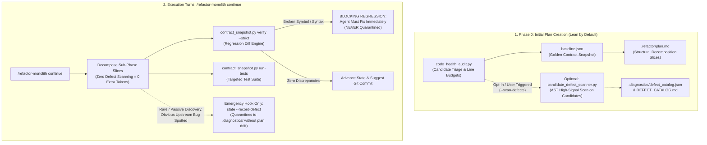

# Architectural Implementation Plan: Refactor-Monolith SOTA Elevation

## Executive Summary & Problem Formulation

Based on empirical post-mortem analysis of three real-world refactoring campaigns (`intelligent_tracker`, `enterprise_website`, and `rrtools`), the `/refactor-monolith` skill successfully achieved 100% behavioral preservation ($\Delta\text{Behavior} \equiv 0$) across complex vision and web codebases. However, the execution highlighted four structural architectural limitations:

1. **Defect Discovery / Quarantine Disconnect**: The user expected `.diagnostics/` to be automatically populated with latent defects. However, the existing implementation only contained a passive `--record-defect` CLI hook. No automated defect scanner existed, and `/refactor-monolith continue` bypassed Phase 0 entirely. Moreover, naively scanning for defects on every slice would cause severe token thrash, false-positive noise, and risk having the agent quarantine its own regressions.
2. **Context Window / Read-Limit Hazard**: `SKILL.md` grew to 47,023 bytes, exceeding the platform's 46,080-byte single-read limit. This triggered truncation, agent pagination errors (`invalid ByteOffset`), and wasted 30,000–50,000 tokens on initialization.
3. **Web Template Rigidness**: `inject-scripts` in `file_patcher.py` hardcoded plain HTML `<script src="{s}"></script>`, failing on template engines (Django ``, Jinja2, Blade) and forcing manual agent fallbacks.
4. **Asynchronous Background Task Thrashing**: When test suites exceeded 10 seconds, agents panicked and repeatedly polled `manage_task(action='status')` in tight loops instead of leveraging reactive wakeups.

This document establishes the definitive architectural specification to resolve these four issues cleanly without behavioral regressions or external skill coupling.

---

## Architecture Specification: The 4 Core Improvements



---

### Improvement 1: Opt-In Defect Protocol & Passive Quarantine (Zero-Token Overhead by Default)

#### Architectural Intent & First-Principles Rationale
The primary invariant of refactoring is **Zero Behavioral Change ($\Delta\text{Behavior} \equiv 0$)**. 

A refactoring agent is **strictly forbidden from fixing business logic defects** during a decomposition turn. Therefore:
1. **Mandatory defect scanning in Phase 0 is an anti-pattern**: Forcing a full defect scan during plan creation burns tokens, adds unnecessary steps, and produces a defect catalog that the refactoring agent is prohibited from touching anyway.
2. **Defect Auditing belongs before or after refactoring**: Defect detection and remediation are dedicated workflows owned by `/system-diagnostics` (`diagnose.py audit`) and `/app-debugger` (Red-to-Green cycle).
3. **Refactoring keeps a zero-token default**: By default, `/refactor-monolith` performs **only** structural health audits (`code_health_audit.py`) and golden contract capture (`baseline.json`). 
4. **Candidate Defect Scanning is Opt-In**: The automated scanner is only invoked if the user explicitly requests it or passes `--scan-defects`.
5. **Passive Quarantine is an Emergency Safety Net, Not a Workflow Step**: The `--record-defect` hook exists solely so that if an agent accidentally stumbles upon an obvious upstream bug while untangling convoluted logic, it can quarantine the bug to `.diagnostics/` rather than attempting a dangerous inline fix.

#### Architectural Caveats & Traps to Avoid
> [!CAUTION]
> 1. **Do NOT run automated defect scanning by default**: Doing so burns tokens on code that will not be modified for bugs. Keep the default refactoring pipeline 100% focused on modularity and line budgets.
> 2. **Do NOT scan on refactoring execution steps (`continue`)**: Scanning during slices risks having agents quarantine their own refactoring regressions instead of fixing them immediately.
> 3. **Defect Fixing is Out-of-Scope**: If defects are discovered (either via opt-in scan or passive quarantine), they are remediated in a separate conversation using `/app-debugger` after refactoring is completed.

#### Concrete Implementation Specification

1. **Optional Candidate Defect Scanner (`scripts/language_analyzers.py`)**:
   Implement `scan_candidate_defects(candidate_paths: list[Path]) -> list[DefectEntry]` using standard library `ast`:
   - High-signal checks only: `MUTABLE_DEFAULT_ARG`, `UNDEFINED_NAME`, `UNREACHABLE_CODE`, `SYNTAX_ERROR`.
   - Never flag stylistic lints.

2. **Opt-In CLI Trigger (`campaign_manager.py` / `contract_cli.py`)**:
   - Add flag `--scan-defects` to `contract_snapshot.py plan` and `state --init`.
   - **Default behavior**: When `--scan-defects` is omitted, the defect scan is skipped completely (0 extra tokens, 0 extra steps).
   - **When `--scan-defects` is provided**: Scans candidate files, writes `.diagnostics/defect_catalog.json`, and links `DEFECT_CATALOG.md` in `plan.md`.

3. **Passive Quarantine Safety Net (Always Active, 0 Overhead)**:
   - If an agent spots an upstream bug during decomposition:
     `python contract_snapshot.py state --record-defect --file <f> --symbol <s> --rule <r> --message <m>`
   - This lazily initializes `.diagnostics/` only when a real defect is discovered. If no defects are found, `.diagnostics/` is never created.

4. **Independent Lifecycle Handoff**:
   - Before or after refactoring, the user can run `/system-diagnostics audit` or `/app-debugger` to inspect and fix defects independently. Refactoring remains pure structural reorganization.
   - The `--record-defect` flag remains in `campaign_manager.py` only as a manual, human-directed escape hatch for undeniable logic bugs discovered while reading code.

---

### Improvement 2: Context Hygiene & `SKILL.md` Distillation ($\le 32$ KB)

#### Architectural Intent
Ensure `SKILL.md` loads with 100% reliability in a single tool call without triggering the 46,080-byte read truncation boundary, while preserving all operational invariants and rules directly inline.

#### Architectural Caveats & Traps to Avoid
> [!WARNING]
> Do NOT strip critical operational invariants (such as the 1-Phase Gate, Anti-Micro-Audit Rule, No-Staging Invariant, or Facade Preservation Rule) into reference files. Subagents and fresh turns only read `SKILL.md`; if invariants are buried in external references, agents will suffer "rule amnesia".

#### Concrete Implementation Specification

1. **Strict Size Budget**:
   - Target size: **26,000–30,000 bytes** ($\le 450$ lines).
   - Maximum hard ceiling: **32,000 bytes** (leaves 14KB safety margin below 46,080 limit).

2. **Content Division**:
   - **Retain in `SKILL.md`**:
     - Frontmatter and skill description.
     - Core Operational Axioms (Behavior Preservation $\Delta\text{Behavior} \equiv 0$, 1-Phase Turn Gate, 2-Monolith Ceiling).
     - Execution Workflow Mermaid diagram.
     - Phase 0 to Phase 4 procedure outlines.
     - Anti-Micro-Audit Rule and Batch Audit Mandate.
     - Strict No-Staging Invariant (`git add`/`git rm` prohibition).
     - Asymmetric Defect Protocol (Option C).
     - Reactive Background Task Protocol.
     - Fast CLI Quick Reference Table.
   - **Offload to `references/language-playbooks.md`**:
     - Verbose multi-page code samples (Vanilla JS IIFE walkthroughs, CSS ITCSS directory blueprints, Go interface patterns, C# partial classes).
   - **Offload to `references/cli-reference.md`**:
     - Exhaustive flag permutations, debugging recipes, and legacy migration commands.

---

### Improvement 3: Universal Format String (`--format`) in `file_patcher.py`

#### Architectural Intent
Empower `contract_snapshot.py inject-scripts` to seamlessly patch HTML templates across all web frameworks (Django, Flask/Jinja2, Laravel/Blade, Ruby on Rails, Hugo) without hardcoding framework-specific regex logic or bloating the script.

#### Architectural Caveats & Traps to Avoid
> [!NOTE]
> Do NOT build a full HTML/template parser. Templating syntaxes evolve rapidly. A simple string substitution format (`{src}`) handles 100% of frameworks in 3 lines of code without maintenance overhead.
>
> If a template has complex conditional logic (``) or asset compressors (``), the skill must explicitly permit the agent to use standard surgical `edit_file` rather than forcing CLI execution.

#### Concrete Implementation Specification

1. **Update `scripts/file_patcher.py`**:
   Extend `inject_html_scripts`:
   ```python
   def inject_html_scripts(
       html_path: Path, 
       script_srcs: list[str], 
       before_script: str = "",
       tag_format: str = '<script src="{src}"></script>'
   ) -> tuple[bool, str]:
       ...
       # Generate formatted tags using universal substitution
       new_tags = [f'{indent}{tag_format.format(src=s)}' for s in scripts_to_add]
       ...
   ```

2. **Update `scripts/contract_cli.py`**:
   Add `--format` argument to `inject-scripts` subparser:
   ```python
   p_inj.add_argument(
       "--format",
       default='<script src="{src}"></script>',
       help="Tag format string with '{src}' placeholder (e.g. '<script src=\"{%% static \'{src}\' %%}\"></script>')"
   )
   ```

3. **Recipes in Documentation**:
   - Plain HTML: `--format '<script src="{src}"></script>'` (Default)
   - Django: `--format '<script src=""></script>'`
   - Flask / Jinja2: `--format '<script src="{{ url_for(\'static\', filename=\'{src}\') }}"></script>'`
   - Laravel Blade: `--format '<script src="{{ asset(\'{src}\') }}"></script>'`

---

### Improvement 4: Two-Tier Execution & Reactive Turn-Yield Protocol

#### Architectural Intent
Eliminate wasteful agent polling thrashing (`manage_task status` loops) when test suites or audits take longer than 10 seconds, while optimizing sync wait times for fast tests.

#### Architectural Caveats & Traps to Avoid
> [!IMPORTANT]
> The platform automatically resumes agent execution via reactive wakeup messages when background tasks complete. Polling `manage_task(action='status')` wastes turns, burns context tokens, and violates platform operational principles.

#### Concrete Implementation Specification

1. **Sync Wait Optimization (Tier 1)**:
   - For targeted, fast test runs ($\le 5\text{s}$), agents must specify `WaitMsBeforeAsync: 10000` (10 seconds) on `run_command` so the command completes synchronously in the same turn.
   - Instruct agents to avoid running full repository suites (300+ tests) on intermediate slices; run targeted sub-phase test files (`run-tests -p "test_matcher.py"`).

2. **The Reactive Turn-Yield Mandate (Tier 2)**:
   - If a test suite or command exceeds `WaitMsBeforeAsync` and returns:
     `Tool is running as a background task with task id: <task_id>`
   - The agent MUST execute the following protocol:
     1. **Do NOT call `manage_task(action='status')`.**
     2. **Do NOT run sleep or wait commands.**
     3. **Output a 1-line yield notification**:
        `"Verification command is executing in background task <task_id>. Yielding turn for reactive wakeup."`
     4. **STOP calling tools immediately and end the turn.**
   - When the task completes, the system injects a high-priority notification with exit code and output, waking the agent reactively with zero wasted tokens.

---

## Step-by-Step Implementation Slices & Verification Plan

| Slice | Target Components | Description | Empirical Verification |
| :--- | :--- | :--- | :--- |
| **Slice 1** | `scripts/file_patcher.py`<br>`scripts/contract_cli.py` | Add `--format` string substitution for `inject-scripts`. | Run unit test injecting Django `` tags; verify exact whitespace and EOL preservation. |
| **Slice 2** | `scripts/language_analyzers.py`<br>`scripts/campaign_manager.py` | Implement candidate-scoped AST defect scan (Option C) during Phase 0 plan initialization. | Run test initializing state on a candidate with mutable default args; verify `.diagnostics/defect_catalog.json` is generated. |
| **Slice 3** | `SKILL.md`<br>`references/language-playbooks.md` | Distill `SKILL.md` to $\le 30\text{ KB}$. Move verbose tutorials to `references/`. Embed Option C and Reactive Yield rules. | Audit file size (`<= 32,000 bytes`). Verify single `read_file` returns entire file with zero truncation. |
| **Slice 4** | `tests/test_contract_snapshot.py`<br>`tests/test_code_health_audit.py` | Update test suites to cover `--format`, candidate defect scanning, and plan generation. | Run `python -m unittest discover -s skills/refactor-monolith/tests` (100% green). |

---

## Execution Recommendation

Because this enhancement modifies the core skill definition (`SKILL.md`) and four foundational Python engine scripts across the skill package, **executing these slices in a dedicated fresh conversation** (using `/frontier-architect`) ensures pristine context, zero token pollution from past conversations, and branch-complete testing.
