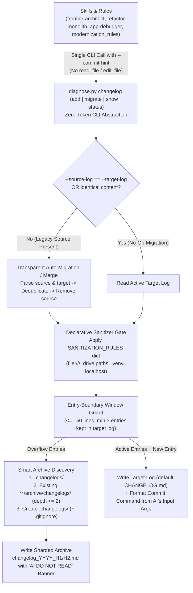

# Architectural Implementation Plan: Unified Changelog & Auto-Archiving Engine (`diagnose.py changelog`)

## 1. Architectural Overview & Objectives

To eliminate the **60,000+ token context bloat** and **historical context poisoning** caused by unbounded `MIGRATION_LOG.md` files (such as `intelligent_tracker/MIGRATION_LOG.md` at 2,783 lines / 243 KB), this plan introduces a centralized, zero-read-token CLI engine (`diagnose.py changelog`) inside `system-diagnostics` and aligns all skills and rules around a strict **File-Name & Path Abstraction Contract**.



---

## 2. Refinements from Architectural Review

### Refinement 1: Agent-Side Message Reuse (Zero Redundant Thinking or Re-Generation)
- **The Problem**: A Python script cannot invent a semantic commit message on its own, and if the AI agent generates a changelog summary for `diagnose.py changelog add` and then *separately* thinks up and types out a `git commit -m "..."` block in its final chat response, the AI pays **double output tokens** for the same milestone summary.
- **The Solution (Single-Generation Echo Protocol)**:
  1. When closing a milestone, the AI agent formulates its summary **once** inside the `diagnose.py changelog add` tool call (`--type`, `--title`, `--summary`, plus `--commit-hint`).
  2. `diagnose.py changelog add` writes the formatted entry into the changelog file **and** echoes a ready-to-copy `git commit -m "<type>: <title>" -m "<summary>"` snippet directly in the tool's stdout (along with the modified file list from `git status --short`).
  3. **Rule / Skill Contract**: Once `diagnose.py changelog add --commit-hint` has printed the commit command in the tool output, the AI agent **does NOT re-write or re-summarize** a second `git commit` block in its prose response—it simply references the commit command emitted by the tool (or copies the 1-line header). This cuts milestone-closing output tokens in half.

### Refinement 2: Declarative `SANITIZATION_RULES` Pattern Dictionary
- Instead of ad-hoc string replacements scattered across functions, `changelog_manager.py` defines a single, maintainable module-level dictionary `SANITIZATION_RULES: dict[str, tuple[str, Any]]` mapping rule names to `(regex_pattern, replacement)` pairs:
  ```python
  SANITIZATION_RULES: dict[str, tuple[str, Any]] = {
      "file_uri_windows": (r"file:///[A-Za-z]:/[^\s\)\"`]+", lambda m: _to_repo_relative(m.group(0))),
      "file_uri_posix": (r"file:///[^\s\)\"`]+", lambda m: _to_repo_relative(m.group(0))),
      "venv_windows": (r"(?:\.\\|\./)?\.?venv\\Scripts\\python(?:\.exe)?", "python"),
      "venv_posix": (r"(?:\./)?\.?venv/bin/python(?:3(?:\.\d+)?)?", "python"),
      "localhost_url": (r"https?://(?:localhost|127\.0\.0\.1|0\.0\.0\.0)(?::\d+)?(?=/|\b)", "$APP_URL"),
      "windows_user_path": (r"[A-Za-z]:\\Users\\[^\\]+\\[^\s\)\"`]+", "<local_path>"),
      "posix_user_path": (r"/(?:Users|home)/[^/]+/[^\s\)\"`]+", "<local_path>"),
  }
  ```
- Adding or tuning a sanitization rule in the future requires editing only a single dictionary entry.

### Refinement 3: Overridable Log Filenames, Identity Guard & Safe Merge
- Both the legacy source filename and active target filename are configurable via CLI flags (with sensible defaults):
  - `--source-log` (default: `MIGRATION_LOG.md`, or `AUTO` to detect legacy `*LOG*.md`)
  - `--target-log` (default: `CHANGELOG.md`)
- **Identity & Equality Guards (No-Op Short-Circuit)**:
  1. **Same Path Guard**: If `Path(source_log).resolve() == Path(target_log).resolve()` (for example, if a project overrides `--target-log MIGRATION_LOG.md`), the tool **skips file migration/deletion** and simply applies the 150-line rolling window rotation in-place.
  2. **Identical Content Guard**: If both `source_log` and `target_log` exist on disk and their normalized content/entries are already identical, the tool skips migration and safely removes the duplicate `source_log` (via `Path.unlink()`).
  3. **Coexistence Merge Guard**: If both `MIGRATION_LOG.md` and `CHANGELOG.md` exist with *different* entries, the tool merges and deduplicates entries chronologically by milestone header before rotating overflow entries to the archive, ensuring neither file is blindly overwritten with data loss.

---

## 3. Modularity & Quality Budgets ("Split-Before-You-Grow")

Per Rule 5 of Universal Security & Engineering Standards, file and class line limits are strictly enforced:

| File Path | Current Lines | Target Post-Implementation | Architectural Responsibility & Budget Boundary |
| :--- | :--- | :--- | :--- |
| `skills/system-diagnostics/scripts/diagnose.py` | **461 L** | **~468 L** *(strictly $< 500$L ceiling)* | **Unified CLI Router:** Imports `changelog_manager`, registers subparser via `changelog_manager.register_parser(sub)`, and dispatches `"changelog": changelog_manager.cmd_changelog`. |
| `skills/system-diagnostics/scripts/changelog_manager.py` | **0 L** *(New)* | **~280–320 L** *(target $\le 350$L)* | **Changelog & Archive Engine:** Declarative `SANITIZATION_RULES`, entry parser/compactor, smart archive directory discovery, identity/merge guards, and `add`/`migrate`/`show`/`status` CLI handlers. |
| `skills/system-diagnostics/tests/test_changelog_manager.py` | **0 L** *(New)* | **~220–260 L** *(target $\le 350$L)* | **Unit & Integration Test Suite:** Tests `SANITIZATION_RULES`, archive discovery priority, identity/coexistence guards, 150-line entry-boundary rotation, and `--commit-hint`. |

---

## 4. Atomic Vertical Slices & Execution Roadmap

### Slice 1: Build `skills/system-diagnostics/scripts/changelog_manager.py` & Wire `diagnose.py`
1. **Declarative Sanitizer (`SANITIZATION_RULES`)**:
   - Dictionary-driven regex sanitization stripping `file:///`, `.venv/Scripts`, `localhost` ports, and OS user paths.
2. **Smart Archive Directory Discovery (`resolve_archive_dir(root: Path)`)**:
   - Priority 1: `<workspace>/.changelogs/` if it already exists.
   - Priority 2: First existing `archive/changelogs/` directory found up to depth 2 (e.g., `docs/archive/changelogs/`, `documentation/archive/changelogs/`).
   - Priority 3 (Default): Create `<workspace>/.changelogs/` with a self-contained `.gitignore` (`*\n`) so the user controls whether archives stay local or move into `docs/`.
   - Prepend an explicit AI guard banner to every archive shard (`changelog_YYYY_H1.md` / `H2.md`):
     `<!-- AI AGENT NOTICE: Historical archive only. DO NOT read this file unless explicitly asked to research past migrations. -->`
3. **Configurable Migration, Identity Short-Circuit & Entry-Boundary Rotation**:
   - Support `--source-log` (default `MIGRATION_LOG.md`) and `--target-log` (default `CHANGELOG.md`).
   - If `source_log` and `target_log` resolve to the same file, skip migration and only enforce the `--max-lines 150` window in-place.
   - If both exist with distinct content, merge and deduplicate entries before rotating older entries into `<archive_dir>/changelog_YYYY_H1.md` / `H2.md`.
   - Compact legacy verbose entries ($\ge 25$ lines) for the active `CHANGELOG.md` window ($\le 15$ lines per entry, keeping the latest $\ge 3$ entries under 150 total lines) while archiving the full uncompacted text into the shard file.
4. **Subcommands (`add`, `migrate`, `show`, `status`)**:
   - `add`: `--path`, `--title`, `--type`, `--summary`, `--files` (auto-populated from `git status --porcelain` if omitted), `--verify`, `--source-log`, `--target-log`, `--max-lines` (default `150`), `--commit-hint` (default `True`, prints ready-to-copy `git commit` command reusing `--type`, `--title`, and `--summary`).
   - `migrate`: `--path`, `--source-log`, `--target-log`, `--max-lines` (default `150`).
   - `show`: `--path`, `--target-log`, `--recent` (default `3`), `--json`.
   - `status`: `--path`, `--source-log`, `--target-log`, `--json`.

### Slice 2: Unit Test Suite (`skills/system-diagnostics/tests/test_changelog_manager.py`)
- Test `SANITIZATION_RULES` dictionary patterns against Windows/POSIX paths, `file:///` URIs, `.venv` paths, and `localhost` URLs.
- Test archive discovery priority (`.changelogs/` > `docs/archive/changelogs/` > default `.changelogs/` creation with `.gitignore`).
- Test `--source-log` and `--target-log` overrides, same-file no-op guard, identical-content guard, and coexistence merge without data loss.
- Test entry-boundary rotation at 150 lines (never splitting an entry in half) and `--commit-hint` output formatting.

### Slice 3: Align Global Rules & Skills (`modernization_rules.md`, `system-diagnostics`, `frontier-architect`, `refactor-monolith`, `app-debugger`)
1. **`rules/modernization_rules.md`**:
   - Replace Section 2 (`MIGRATION_LOG.md` manual checkpointing) with the **Unified Changelog & Campaign State Protocol**:
     - Active in-flight refactoring state lives in `.refactor/state.json` & `.refactor/plan.md`.
     - Current architectural topology lives in `AGENTS.md` ($< 40$ lines, updated in-place).
     - Milestone completion is recorded via `python skills/system-diagnostics/scripts/diagnose.py changelog add ...` (agents never call `read_file`/`edit_file` on changelog files or hardcode log filenames, and reuse the tool's `--commit-hint` output instead of writing a duplicate commit message in chat).
2. **`skills/system-diagnostics/SKILL.md`**:
   - Add Capability #9 (`diagnose.py changelog`) and add 5 runnable rows to the Scenario Combinations Matrix.
3. **`skills/frontier-architect/SKILL.md`**, **`skills/refactor-monolith/SKILL.md`**, **`skills/app-debugger/SKILL.md`**:
   - Replace manual `MIGRATION_LOG.md` references with `diagnose.py changelog add` (or `run_diagnose.py changelog add`) and instruct agents to reuse the emitted commit snippet rather than regenerating commit prose.

### Slice 4: Live Migration Verification on `intelligent_tracker`
- Execute `python skills/system-diagnostics/scripts/diagnose.py changelog migrate --path <target_project_path> --max-lines 150` against `intelligent_tracker`.
- Verify that:
  1. `CHANGELOG.md` is created and is $\le 150$ lines.
  2. Full historical entries are archived in `.changelogs/` with `.gitignore` and the AI `DO NOT READ` header.
  3. `MIGRATION_LOG.md` is cleanly unlinked without `git add` or `git rm`.

---

## 5. Scenario Combinations Matrix

| Real-World Scenario / Objective | Mode / Inputs | Key Parameters | Exact Runnable Command |
| :--- | :--- | :--- | :--- |
| **Record Milestone & Emit Commit Snippet** | Any repo (auto-migrates legacy log) | `--title --type --summary --verify` | `python skills/system-diagnostics/scripts/diagnose.py changelog add --path . --type refactor --title "Stream Worker Split" --summary "Decomposed StreamManager into 4 services" --verify "pytest (306 passed)"` |
| **Auto-Migrate Oversized `MIGRATION_LOG.md`** | Legacy repo migration | `--path --max-lines 150` | `python skills/system-diagnostics/scripts/diagnose.py changelog migrate --path . --max-lines 150` |
| **Custom Source/Target Log Names** | Custom file override | `--source-log --target-log` | `python skills/system-diagnostics/scripts/diagnose.py changelog migrate --path . --source-log HISTORY.md --target-log CHANGELOG.md` |
| **Check Changelog & Archive Health** | Status inspection | `--path` | `python skills/system-diagnostics/scripts/diagnose.py changelog status --path .` |
| **Read Recent 3 Milestones (On Demand)** | Bounded context lookup | `--recent 3` | `python skills/system-diagnostics/scripts/diagnose.py changelog show --path . --recent 3` |

---

## 6. Verification Commands

```bash
# 1. Run unit tests for changelog_manager and full system-diagnostics suite
python -m unittest discover -s skills/system-diagnostics/tests -p "test_*.py"

# 2. Verify modularity budgets on new and modified files (all <= 350L / 500L ceiling)
python skills/refactor-monolith/scripts/code_health_audit.py --path skills/system-diagnostics/scripts/changelog_manager.py skills/system-diagnostics/scripts/diagnose.py --show-methods

# 3. Run sibling skill test suites for zero regression
python -m unittest discover -s skills/app-debugger/tests -p "test_*.py"
python -m unittest discover -s skills/frontier-architect/tests -p "test_*.py"
```

