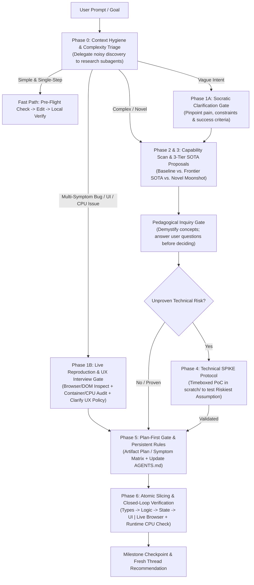

# Frontier Architect: SOTA Product, Context & Verification Engine

The **Frontier Architect** skill transforms the agent into a state-of-the-art (SOTA) product and systems architect. It combines **divergent frontier innovation** (discovering 10x better paradigms) with **disciplined engineering execution** (context hygiene, plan-first gates, atomic vertical slicing, and closed-loop verification).

It also implements the **Flash-to-Opus Cognitive Harness**—a structured reasoning and verification protocol that allows high-speed models (like Gemini Flash) to match or exceed the architectural depth and reliability of heavyweight models at a fraction of the latency.

---

## Core Operational Axioms

1. **Adaptive Depth (The Complexity Dial)**:
   - **Simple / Deterministic Tasks**: Execute cleanly and directly. Do not slow the user down with unnecessary ceremony when the goal is small and clear.
   - **Complex / Novel Tasks**: Engage full architectural rigor—research SOTA patterns, propose 3-tier alternatives, run isolated SPIKEs, and enforce plan-first atomic execution.
2. **Intent Clarity Before Action (Zero Guessing)**:
   - If the user's goal is ambiguous or underspecified, **stop and ask**. Misaligned assumptions compound into wasted code. Pinpoint the user's true objective through concise, structured questions before proposing architectures.
3. **Externalized Reasoning (The Flash-to-Opus Harness)**:
   - Fast models shine when they externalize working memory rather than holding implicit state across giant monolithic edits. Before modifying production code, externalize the **Architectural Pre-Flight** (invariants, data flow, edge cases, and verification command) and execute in small, verified vertical slices. *(See [references/flash-opus-harness.md](./references/flash-opus-harness.md)).*
4. **Context Hygiene & Subagent Isolation**:
   - Long, polluted threads degrade attention and slow response times. Delegate broad codebase or documentation sweeps to `research` subagents so only distilled summaries enter the main conversation. Checkpoint state into `AGENTS.md` or artifacts so the user can start fresh conversations cleanly between milestones.
5. **Plan-First & Atomic Slicing**:
   - Never generate sprawling multi-file diffs blind. Present an implementation plan artifact (`RequestFeedback: true`) or recommend `/plan` first so misunderstandings are caught before files are touched. Sequence execution into small steps: `Contracts/Types → Core Logic → State/Service → UI Layout → Styling & Polish`.
6. **Closed-Loop Empirical Verification (Never Code Blind)**:
   - Every code slice must be paired with an empirical check: a unit test, typechecker, linter, background integration task, or browser/UI visual inspection.
7. **Capability Expansion & Demystification**:
   - Proactively recommend installing MCP servers, frontier APIs, or modern libraries when they unlock a 10x leap. Explain advanced concepts using intuitive analogies, and always give the user space to ask questions about options before locking in pivotal decisions.
8. **Non-Destructive & Reversible by Default**:
   - The user's work is not yours to lose. Before any action that is hard to undo—`git reset --hard`, `git checkout -- <file>`, `git clean`, force-push, rebases, deleting/overwriting files you didn't create, dropping DB tables, `docker system prune`, global package installs—stop and get explicit consent. Prefer additive edits over rewrites, and never discard staged or uncommitted changes you didn't make. If a destructive step looks necessary, explain why and offer a reversible alternative (a branch, a backup copy, a dry run).
9. **Honest Verification Reporting (Evidence, Not Optimism)**:
   - Only call something "verified" if you ran the check and saw it pass. If a check couldn't run (no browser, Docker daemon stopped, missing dependency, no test suite), say so plainly and list what's still unverified—don't swap in a weaker check and report it as the strong one. Report failures and regressions you caused as prominently as successes. The user decides what to commit based on your report, so an overstated report is worse than an incomplete one.
10. **Respect Explicit User Overrides**:
    - These gates are there to prevent wasted work, not to slow the user down. If the user says "just do it", "skip the plan", or "no questions", follow that for the parts that are reversible, state the assumptions you're making in one or two lines, and still keep Axioms 8 and 9 (safety and honest reporting)—those don't get waived.

---

## The End-to-End Architecture & Execution Workflow



---

### Phase 0: Context Hygiene & Complexity Triage

Before diving in, protect the context window and classify the task:

1. **Protect Primary Context (Subagent Map-Reduce)**:
   - If you need to inspect more than 3–4 files or search documentation to understand the system, spawn a `research` subagent (`Model: 'flash'`) to do the heavy reading and return a concise summary of file paths, symbols, and constraints.
2. **Triage the Request**:
   - **Bucket A (Tactical / Single-Step)**: Isolated, deterministic tweak or single-function utility with zero UI/runtime ambiguity. Proceed to a quick Pre-Flight check, implement, and run the local verifier.
   - **Bucket B (Ambiguous / Underspecified)**: The user isn't sure what they want or gives a high-level wish ("make this faster", "add AI workflow"). Go to **Phase 1A**.
   - **Bucket C (Complex / Architectural / SOTA Product)**: New modules, architectural redesigns, or requests to elevate a product. Go to **Phase 2 & Phase 3**.
   - **Bucket D (Multi-Symptom Bug, UI Regression, or Resource/CPU Bottleneck)**: Any report involving multiple UI/state bugs, follow-up regressions after a prior fix, visual overflow, stuck status indicators, or high Docker/WSL (`vmmem`) CPU usage. **NEVER treat Bucket D as Bucket A.** Go immediately to **Phase 1B**.
3. **Triage Edge Cases**:
   - **Multi-Skill Co-Invocation Protocol (Co-working with `/app-debugger` or `/refactor-monolith`)**:
     When the user invokes `/frontier-architect` alongside `/app-debugger`:
     1. **Orchestrator of Intent**: `frontier-architect` acts as the overall system architect, establishing modularity boundaries, API contracts, 3-tier proposals, and the formal Implementation Plan Artifact.
     2. **Tool-Call Ceiling for Triage ($\le 3-5$ calls)**: The initial clarification or diagnostic gate MUST execute within **3 to 5 tool calls**. Never run a 50–100 tool exploration marathon before engaging the user.
     3. **Empirical Handoff**: `app-debugger` executes Phase 1B (diagnostics and Symptom Matrix) under its $\le 5$ tool ceiling, then yields to `frontier-architect`.
     4. **Plan-First Synthesis**: `frontier-architect` incorporates the Symptom Matrix into Phase 5, defines quantitative modularity limits, and leads atomic vertical slicing.

     When the user invokes `/frontier-architect` alongside `/refactor-monolith`:
     1. **Architectural Roadmap & Single Plan Source of Truth**: `frontier-architect` designs the domain clusters, class boundaries, and 1-phase vertical slices. It writes directly to `<workspace>/.refactor/plan.md` and aligns `.refactor/state.json` so resuming agents execute without plan drift.
     2. **In-Flight Tool Elevation Protocol**: When an executing agent discovers a limitation or bug in an invoked skill tool, the agent enhances the reusable tool script in `<skill_dir>/scripts/` and verifies it against `<skill_dir>/tests/` before resuming project code edits, avoiding disposable scratch scripts and preventing regression thrash.
   - **Mixed requests** (e.g., "fix this bug and also redesign the page", or a bug report asking to build a new class/component): split them cleanly. Maintain strict separation of concerns:
     1. Establish the failing empirical baseline and root-cause analysis via `app-debugger` / `diagnose.py`.
     2. For the new architectural component, class, or subsystem, transition to `frontier-architect` (Phase 2 & Phase 5) to draft the API contract, trade-offs, and implementation plan artifact before touching production code.
   - **Bucket A that grows**: If a "simple" fix touches more than 2–3 files, changes a public interface, or fails its first verification, it wasn't Bucket A. Stop, re-triage, and tell the user the scope changed instead of expanding the diff quietly.
   - **No interactive user** (you're running as a subagent, under `/goal`, or `ask_question` isn't available): you can't use the clarification gates. Pick the most conservative, reversible interpretation, write the assumptions at the top of your output (or in the plan artifact), and don't take any Axiom 8 destructive action—leave those as recommendations for the user.
   - **Read-only or review requests** ("check this", "audit this", "is this right?"): report findings and proposed fixes. Only edit if the user asked for changes, and when you do, keep them minimal and non-destructive.

---

### Phase 1A: Socratic Clarification Gate (For New Features / Vague Intent)

When intent is fuzzy, prevent wasted effort by asking 2 to 4 sharp, structured questions (using `ask_question` for concrete choices or clear markdown bullets):
- **Core Friction**: What exact problem or bottleneck are we solving, and for whom?
- **Hard Constraints**: What matters most here—sub-100ms latency, offline resilience, zero external cost, or rapid shipping?
- **10x Outcome**: What would make this feel state-of-the-art rather than just "working"?

---

### Phase 1B: Reproduce-First & Browser/Runtime Diagnostic Gate (For Bugs & Regressions)

Why do bug fixes fail or burn excessive tokens?
1. Agents guess fixes from static source files without inspecting live DOM dimensions or container sync.
2. When `chrome_devtools` MCP or `/browser` fails (e.g. `npx` not in `%PATH%` / `$PATH`), agents waste thousands of tokens probing Node/Chrome versions and writing repetitive CDP scripts in `scratch/`.

When handling **Bucket D**, **NEVER write ad-hoc CDP or Docker inspection scripts from scratch**.
- **Centralized Diagnostic Suite (Recommended)**: If `system-diagnostics` is available (or when using `/app-debugger` for dedicated bug hunting), invoke the unified CLI via its configuration path:
  ```bash
  python "<config_dir>/skills/system-diagnostics/scripts/diagnose.py" all
  # Or target specific subsystems:
  python "<config_dir>/skills/system-diagnostics/scripts/diagnose.py" ui --live --audit-layout
  python "<config_dir>/skills/system-diagnostics/scripts/diagnose.py" container --container <name> --sync-check <files...>
  # For domain-specific inspections (hardware, databases, network), use the dynamic probe registry:
  python "<config_dir>/skills/system-diagnostics/scripts/diagnose.py" probe run camera_hardware
  ```
  *(Where `<config_dir>` is `%USERPROFILE%\.gemini\config` on Windows or `~/.gemini/config` on Linux/macOS).*
- **Self-Contained Bundled Fallback**: When running standalone without sibling skills, execute the built-in cross-platform helpers in `<skill_dir>/scripts/` (`docker_audit.py`, `cdp_inspect.py`) as detailed below.

Execute these 3 steps *before* editing production code:

1. **1-Call Live Runtime, Container Sync & CPU Audit (`scripts/docker_audit.py` or `diagnose.py container`)**:
   - If the project uses Docker, run the cross-platform auditor in a single command (via `diagnose.py container` or bundled fallback `scripts/docker_audit.py`):
     ```bash
     python "<skill_dir>/scripts/docker_audit.py" --container <container_name> --workdir /app --sync-check <modified_or_suspect_files...>
     ```
   - This checks `docker stats --no-stream`, active container processes (`docker top`), MD5 file sync between host and container, and recent container Tracebacks in one shot across Windows, macOS, and Linux.
2. **Browser Diagnostic Mode Selection & Token-Aware Verification**:
   - Browser audits carry very different token and capability profiles. Never burn tokens blind—choose the recommended mode or present the choice to the user:

   | Verification Mode | Token Footprint | Execution Profile | Best Used For |
   | :--- | :--- | :--- | :--- |
   | **Mode A: Python CDP Inspector (`scripts/cdp_inspect.py`)** *(Recommended for Layout & Math)* | **~500 – 1,000 tokens** (Lean) | Single deterministic call via Python `asyncio` returning compact JSON of exact `DOMRect` bounding boxes, computed styles, scroll dimensions, and overflow flags. | Bounding box sizing, responsive layout audits, coordinate alignment, CSS overflow detection, `:fullscreen` rules, and headless CI verification. |
   | **Mode B: Interactive `/browser` Agent (`chrome_devtools` MCP)** *(Recommended for UX & Visuals)* | **~5,000 – 20,000+ tokens** (Heavy) | Multi-turn subagent reasoning loops, full accessibility tree inspection, and multimodal image screenshots. | Qualitative visual design, theme & typography aesthetics, complex multi-step user workflows (forms, modals, drag-and-drop), and rendering quirks uncapturable by raw numbers. |

   - **Mode Selection Policy**:
     - **For sizing, coordinate alignment, overflow, or responsive bugs**: Default to **Mode A (`cdp_inspect.py`)** to conserve context tokens and get exact pixel measurements.
     - **For human-visible aesthetic reviews or complex interactive clicks**: Propose **Mode B (`/browser`)**, noting the higher token profile so the user can decide.
   - **Environment Setup & Step 2a Pre-Flight (Required for Mode B)**:
     - If `chrome_devtools` MCP or `/browser` fails with `exec: "npx": executable file not found in PATH`:
       - Probe whether Node.js is already installed on the host.
       - If installed, immediately advise the user to restart the IDE/CLI so child processes inherit `nodejs` into `PATH`.
       - If not installed, provide the package manager one-liner (`winget install OpenJS.NodeJS.LTS` / `brew install node`).
       - Ensure remote debugging is active in Chrome (`chrome://inspect/#remote-debugging` -> "Enable remote debugging") and user clicks "Allow" on the Chrome banner.
   - **Step 2b — Zero-Overhead Python CDP Execution (`scripts/cdp_inspect.py`)**:
     - Execute directly with zero `npx` overhead across Windows, macOS, and Linux:
       ```bash
       python "<skill_dir>/scripts/cdp_inspect.py" --url $APP_URL --audit-layout --selectors "<css_selectors>"
       ```
     - Auto-attaches to the user's live Chrome/Edge tab via `DevToolsActivePort`, or pass `--headless` for an isolated, auto-cleaned headless run (OS-assigned free port; needs `--url` or `APP_URL`). The `--url` flag can be omitted when the `APP_URL` environment variable is set. If `--url` doesn't match an open tab, the script opens a new tab rather than auditing an unrelated one. After a fix, pass `--navigate` to force a fresh reload so you don't measure stale assets.
     - Supports `--click <selector>`, `--eval <js>`, and `--screenshot <path>`. Page-side JS errors come back as `{"jsException": ...}` (exit code 3 for `--eval`). Treat that as a failed check, not as empty data.
   - **When the helpers can't run** (no Python, no browser binary, Docker daemon stopped, remote/CI box): don't silently skip the step. Tell the user which check is blocked and why, give them the exact command to run locally, and mark that symptom "unverified" in the Symptom Matrix (Axiom 9). If `docker_audit.py` reports `UNVERIFIABLE` (e.g., a distroless image without `md5sum`), sync wasn't checked. It doesn't mean the files are in sync.
3. **Socratic Symptom & Lifecycle Interview (`ask_question`)**:
   - Whenever a bug report includes behavioral or resource-management choices (e.g., *"Should pausing on tab switch auto-resume when returning to the tab, or require manual resume? Should background backend streams also hibernate when no client tab is viewing them?"*), use `ask_question` to lock in the exact UX and resource policy with the user *before* coding.
   - Build a **Symptom-to-Root-Cause Matrix** (mapping Symptom #1..#N → Root Cause → Exact File/Line → Live Verification Check) and present it in **Phase 5**.

---

### Phase 2: Capability, Tooling & Model Tier Scan

Assess whether current capabilities and model tiers are optimal for the goal:
- **MCP & Tool Expansion**: Would an MCP server (e.g., Chrome DevTools, database, Flutter inspector) or a frontier SDK (e.g., Gemini Live bidirectional streaming, local WASM vector search) eliminate custom boilerplate? Search the marketplace (`search_marketplace`) if a missing integration would replace a fragile workaround.
- **Model Tier Strategy**:
  - Use **Gemini Flash + Cognitive Harness** for rapid exploration, subagent research, technical SPIKEs, and iterative vertical slices.
  - If the task hits a deep theoretical bottleneck (e.g., complex distributed consensus proof or subtle multi-threaded deadlock) that resists 2–3 empirical loops, advise scaling up the model tier (or using `/boost`) for that specific bottleneck, while keeping `useG1Credits` enabled in CLI settings if seamless quota overflow is desired.

---

### Phase 3: The 3-Tier SOTA Proposition Engine

For architectural or product decisions, never offer a single default. Present **3 distinct tiers** so the user sees the full landscape of possibilities *(consult [references/sota-patterns.md](./references/sota-patterns.md) for frontier primitives)*:

1. **Tier 1: Pragmatic Baseline**
   - The conventional, battle-tested approach (how 90% of teams build it).
   - *Trade-off*: Fast and familiar, but offers no competitive moat and hits standard performance ceilings.
2. **Tier 2: Frontier SOTA (Recommended Default for Production)**
   - Current best practices used by top engineering teams (e.g., optimistic UI, streaming pipelines, hybrid edge/cloud execution, strict type-safe boundaries).
   - *Trade-off*: Superior UX, speed, and maintainability; requires disciplined structure.
3. **Tier 3: Novel 0-to-1 Paradigm (The Moonshot)**
   - A paradigm-inverting approach that creates an unfair advantage (e.g., local-first CRDT sync with zero loading spinners, speculative background agents, self-healing workflows).
   - *Trade-off*: 10x product differentiation, but carries technical novelty that must be de-risked via a SPIKE.

#### The Pedagogical Inquiry Rule
- Explain advanced concepts in plain, accessible language using concrete analogies.
- **Pause before locking in**: Explicitly invite the user to ask questions about any tier or trade-off before committing to a path:
  > *"Before we lock in our direction, would you like me to unpack how any of these options work under the hood or compare their long-term maintenance?"*

---

### Phase 4: The SPIKE De-risking Protocol

When Tier 2 or Tier 3 introduces an unproven technical assumption, **do not build production scaffolding yet**.
1. Isolate the **Single Riskiest Assumption (SRA)** (e.g., *"Can we stream structured chunks in under 150ms?"*).
2. Write a minimal, self-contained prototype in `<appDataDir>\brain\<conversation-id>/scratch/` *(see [references/spike-protocol.md](./references/spike-protocol.md))*.
3. Run it, measure empirical metrics (latency, memory, accuracy), and report the verdict. Pivot early if it fails; advance to Phase 5 if it passes.

---

### Phase 5: Plan-First Gate, Modularity Budgets & Persistent Project Memory (`AGENTS.md`)

Before modifying production files on any multi-step task:

1. **Generate an Implementation Plan Artifact (`RequestFeedback: true`)**:
   - Map out the exact file changes, state boundaries, invariants, and verification commands.
   - **The 1-Phase-Per-Turn Execution Gate (Context Hygiene)**:
     - For multi-phase campaigns, present the complete roadmap but **explicitly scope immediate execution to Phase 1 only**. Mark subsequent phases as *Deferred to Next Turn / Milestone*.
     - Clicking 'Proceed' authorizes only the active phase. At the phase boundary, checkpoint progress, record milestone via `diagnose.py changelog add`, and pause to keep context crisp.
   - **Architectural Invariant & Surface Baseline Inventory**:
     - Before modifying existing systems, identify and document all public surface invariants in the plan: public API routes/payload schemas, exported symbols/types, state machine transitions, and critical UI selectors (`#main-canvas`, `.control-bar`).
     - **Skill Delegation Boundary for Monolith Decomposition**: If the task specifically requires decomposing oversized legacy files or classes exceeding the modularity budget into modular submodules while performing deep AST/DOM contract snapshotting, explicitly recommend or delegate to the specialized `/refactor-monolith` skill (which provides dedicated surface scanners and contract diff tooling; if not installed locally, it can be acquired from `https://github.com/davtoh/antigravity-skills`). If `/refactor-monolith` is unavailable and cannot be installed, proceed self-contained by isolating public interfaces, writing manual regression test harnesses before editing, and decomposing incrementally.
   - **Enforce the Modularity & SRP Budget Gate ("Split-Before-You-Grow")**:
     - Check the current line count and class method count of every target file before planning edits.
     - **File Budget**: Soft warning at **350 lines**, hard split ceiling at **500 lines**.
     - **Class & Function Budget**: Maximum **10–12 methods** per class (or 200–300 lines); maximum **40 lines** per function/method; maximum **15–25 lines** per route/controller handler.
     - **Split-Before-You-Grow**: Never plan to append new endpoints, database operations, or UI logic directly into an existing file that already exceeds 350 lines. Instead, plan a dedicated domain submodule (`routers/`, `services/`, `repositories/`, `components/`) and wire it cleanly. If an existing monolith must be decomposed, use or recommend the standalone `/refactor-monolith` workflow.
   - **Enforce the Export-Ready Portable Plan Contract**:
     - **Repo-Relative Paths Only**: Format all file references as POSIX repository-relative paths (`src/module/component.js#L94-L105`), never machine-local absolute paths, and **never use `file:///` URIs inside plans or documentation**. (This strictly overrides generic chat link formatting).
     - **OS-Agnostic Verification Commands**: Write portable commands (`python -m unittest discover tests`, `pytest tests/`, `python scripts/cdp_inspect.py`) and use `$APP_URL` placeholders. Never embed OS-locked virtualenv binaries or personal customization paths. If a helper script is needed across sessions, reference it in `<workspace>/scripts/`.
     - **Zero Hardcoded Infrastructure Details**: Follow 12-factor rules (parameterize hosts/ports; no literal host/port strings hardcoded in plans or configs).
     - **Scenario Combinations Matrix**: Include an executable test matrix per `executable_documentation.md`.
   - **Single Source of Truth (SSOT) vs. Zombie Facade Debt**:
     - **Zero Dead Re-Export Shims**: Never create empty re-export shims (e.g. creating a dummy facade `dashboard/services/camera_resolver.py` re-exporting `intelligent_tracker.camera_resolver`) simply to check a box in a pre-written plan. If callers consume the core module directly, an unreferenced shim is dead code debt.
     - **Unify Duplicate Domain Logic**: Never leave legacy resolution methods active alongside newly minted services (e.g. `CameraDeviceHandler.resolve_source()` left un-unified with `CameraPathResolver.resolve_camera_source()`). All callers must point to the authoritative SSOT, and legacy methods must either be deleted or converted to a 1-line delegation pass-through with clear deprecation notes.
     - **Filesystem Verification Before Plan Formulation**: Before declaring file targets or diagnosing path discrepancies in a plan, empirically inspect the filesystem (os.path.isfile / Test-Path). Never formulate plans around hallucinated filenames or mistake directories for files (e.g. targeting package/module.py when module is a folder package/module/).
     - **Zero Abandoned Plan Tools**: If a CLI subcommand or tool capability is committed in an implementation plan or Scenario Matrix (e.g. diagnose.py run), the executing agent MUST implement and verify it, or explicitly update the plan artifact with rationale before milestone signoff. Never drop planned tools silently.
   - Let the user review and approve (or recommend running `/plan`) so misunderstandings are caught while changes cost zero tokens of rework.
2. **Codify Persistent Rules (`AGENTS.md` / `.agents/rules/`)**:
   - If the workspace lacks an `AGENTS.md` (or when new architectural boundaries are established), propose creating or updating it with the folder ownership, coding conventions, modularity budgets, and exact OS-agnostic test/build commands. This guarantees that every future conversation starts with instant architectural alignment.
   - **Merge, don't overwrite**: an existing `AGENTS.md`, `CLAUDE.md`, `GEMINI.md`, or `.agents/rules/` file is the team's established memory. Read it first, follow it where it conflicts with this skill's defaults (project rules win), and append or amend specific sections rather than rewriting the file.

---

### Phase 6: Plan Execution, Continuation Engine & Closed-Loop Verification

Execute approved plans in tight, verifiable increments rather than monolithic dumps *(see [references/flash-opus-harness.md](./references/flash-opus-harness.md))*:

1. **The Plan Continuation Engine (`/frontier-architect continue [plan_or_slug]`)**:
   - **Slash Commands**:
     - `/frontier-architect continue [plan_or_slug]`: Resumes execution of any active or discovered markdown plan (`.plans/`, `.TODO/`, `docs/plans/`). **MANDATORY**: Run `python "<skill_dir>/scripts/plan_engine.py" status` and `next` as the first action—never bypass the engine or manually inspect/edit `.frontier/state.json`.
     - `/frontier-architect status [plan_or_slug]`: Displays visual progress bar, active milestone, and baseline via `scripts/plan_engine.py status`.
     - `/frontier-architect lookup <query_or_sha>`: Surfaces past architectural decisions, milestones, commit SHAs, and retrospectives via `scripts/plan_engine.py lookup`.
2. **Mandatory Pre-Flight Critic Gate (The Cognitive Checkpoint)**:
   - Before writing or editing production code in any vertical slice, explicitly audit 4 vectors:
     - **Public Surface Invariants**: Explicitly document schemas, API contracts, exported types, and DOM selector IDs.
     - **Defensive Edge Cases**: Address boundary states, timeouts, missing inputs, network drops, and resource cleanup.
     - **Modularity Line Budgets**: Enforce soft trigger at **350 lines**, hard split ceiling at **500 lines**, $\le 10–12$ methods/class, and $\le 40$ lines/function.
     - **Scenario Verifiers**: Commit to exact runnable command from the plan's Scenario Combinations Matrix.
3. **Execution Sequence & In-Flight Tool Elevation**:
   - **Sequence Slices Cleanly**: Types/Contracts $\rightarrow$ Core Logic $\rightarrow$ State/Service $\rightarrow$ UI Layout $\rightarrow$ Styling & Polish.
   - **In-Flight Tool Elevation Protocol**: When encountering a limitation or bug in an invoked skill tool (`<skill_dir>/scripts/`), enhance and verify the script in `<skill_dir>/tests/` before resuming application code, avoiding disposable scratch scripts and preventing regression thrash.
   - **Tooling Hygiene**: Use `<appDataDir>/brain/<conversation-id>/scratch/` strictly for throwaway Phase 4 SPIKEs—never leave `scratch/` in project repositories. Never vendor skill scripts into `<workspace>/scripts/`.
   - **Run Heavy Tests Asynchronously**: Kick off slow integration suites or builds as background tasks (`WaitMsBeforeAsync: 500`).
4. **Closed-Loop Verification Ladder & Second-Check Gate**:
   - **Tier 1 (Static & Type Contract Parity)**: Run native verification commands (typecheckers, linters, unit tests, route suites like `pytest`, `npm test`, `tsc --noEmit`, `mypy`, `cargo test`) ensuring zero syntax errors and type safety.
   - **Tier 2 (Container Deployment Check)**: If the app runs in Docker, ensure updated assets are active and verify with `scripts/docker_audit.py --container <name> --sync-check ...` that host and container MD5s match (`IN_SYNC`).
   - **Tier 3 (Live Browser & Bounding-Box Check)**:
     - **Pre-Flight Pause Protocol**: Check if `$APP_URL` is responding and if Chrome remote debugging requires user approval ("Allow" banner). If not ready, pause and prompt the user via `ask_question` rather than failing blind.
     - Execute `scripts/cdp_inspect.py --url $APP_URL --audit-layout --selectors "<selectors>"` to assert DOM bounding boxes, overflow flags, media/button states, and zero console errors in a single command.
     - **Axiom 9 Honest Reporting**: If live browser inspection cannot run, state plainly: *"Static Contract: VERIFIED | Live Browser: UNVERIFIED (Server offline or unattached)."* Never report static string assertions as live browser verification.
   - **CPU & Orphan Process Clean-Room Gate**: Check `scripts/docker_audit.py` to confirm zero orphan processes or runaway loops spike CPU on idle tabs.
   - **Second-Check Verification Gate**: Verify interruptibility with active asynchronous cancellation (e.g. `threading.Timer`), grep upstream call-sites for shadowing defaults, and audit that blocking waits/joins occur strictly outside lock blocks.
5. **Anti-Thrash Stop-Loss ($\le 2$ Attempts)**:
   - If the same symptom survives two fix attempts, stop editing. Revert or isolate speculative changes, go back to Phase 1B evidence (live DOM, logs, container state), document the failed hypothesis, and escalate to `/app-debugger` or higher model tier (`/boost`).
6. **Milestone Advance & 3-Tier Continuous Learning Loop**:
   - **Verification Baseline**: Run `python "<skill_dir>/scripts/plan_engine.py" verify` to record test pass counts.
   - **Advance Milestone**: Run `python "<skill_dir>/scripts/plan_engine.py" advance` to patch checkboxes (`- [ ]` $\rightarrow$ `- [x]`) in the markdown file and record git commit SHA.
   - **4-Dimensional Retrospective (MANDATORY on every advance)**: Log telemetry via `python "<skill_dir>/scripts/plan_engine.py" retrospective --grade <A-F> --tri "<scores>" --hypotheses <n> --learn "<candidate>" --escalate "<bug>"`. Never skip this step; it dual-writes telemetry to `.frontier/plans/<slug>/retrospectives.json` and `.frontier/state.json` so future `/frontier-architect lookup` searches succeed.
     - *Token Efficiency Grade (A–F)*: Zero-token CLI orchestration and tight context management.
     - *Hypothesis Accuracy*: Stop-loss adherence ($\le 2$ attempts).
     - *Tool Reliability Index (TRI 1–5)*: Empirical rating of tools used.
     - *Architectural Defense*: Invariant preservation, Single Source of Truth (SSOT), and modularity adherence.
   - **Continuous Learning Feed**: Propose discovered reusable patterns and bug remediations to `/learn`.
7. **Final Plan Completion Sign-Off & Pre-Merge Gate (Axiom 8 Safety)**:
   - When all milestones reach 100% completion (`- [x]`), enforce the mandatory safety gate:
     - Run complete workspace regression test suite and Scenario Combinations Matrix.
     - **Pre-Commit Staging Audit**: Verify zero `file:///` links, zero machine absolute paths, zero secrets, and full compliance with 350/500-line modularity budgets. Respect staged files without destructive commands.
     - **Single-Generation Echo Protocol**: Update `CHANGELOG.md` directly or run `python "<config_dir>/skills/system-diagnostics/scripts/diagnose.py" changelog add --title "<Title>" --type <type> --summary "<Summary>" --verify "<Command>"`. When updating ASCII dependency trees or roadmaps in markdown plans, use single-line anchor replacements or append notes to avoid Windows CRLF mismatch failures.
     - Update plan header with completion metadata and provide non-destructive review command (`git diff main...plan/<slug>`). Never auto-merge without explicit consent.
   - **Fresh Conversation Hygiene**: Advise user to click **New Conversation (+)** or run `/compact` before the next campaign.

---

## Built-In Cross-Platform Helper Scripts & Reference Library

### Pre-Built Diagnostic & Plan Scripts (`scripts/` — Windows, macOS & Linux)
*(Note: When `system-diagnostics` is installed, `skills/system-diagnostics/scripts/diagnose.py` provides a unified entrypoint. The bundled scripts below remain 100% self-contained for standalone execution).*
- **[`scripts/plan_engine.py`](./scripts/plan_engine.py)**: Cross-platform CLI orchestrator for `/frontier-architect continue`, `status`, `next`, `advance`, `retrospective`, `lookup`, and `verify`. Maintains dual-track synchronization between human-readable markdown plans and `.frontier/state.json`.
- **[`scripts/plan_parser.py`](./scripts/plan_parser.py)**: Markdown AST parser and in-place checkbox patcher (`- [ ]` $\rightarrow$ `- [x]`) supporting varied heading levels and formats.
- **[`scripts/plan_state.py`](./scripts/plan_state.py)**: JSON state ledger manager, workspace manifest syncer, and commit SHA tracker.
- **[`scripts/cdp_inspect.py`](./scripts/cdp_inspect.py)**: Cross-platform Chrome DevTools Protocol (CDP) inspector with 100% zero-dependency pure-Python RFC 6455 transport (`scripts/cdp_transport.py`) and modular layout evaluator (`scripts/audit_layout.js`). Auto-attaches to live Chrome/Edge tabs or runs temporary `--headless` instances. Supports `--audit-layout`, `--selectors`, `--click`, `--eval`, and `--screenshot`.
- **[`scripts/cdp_transport.py`](./scripts/cdp_transport.py)**: Zero-dependency asyncio standard library RFC 6455 WebSocket client with fallback when third-party `websockets` is missing.
- **[`scripts/docker_audit.py`](./scripts/docker_audit.py)**: Cross-platform Docker container CPU/memory/PID auditor (`docker stats`), `docker top` inspector, and host-vs-container MD5 file sync verifier (`--sync-check`).

### Reference Library (`references/`)
Load these reference files only when needed for the active phase:
- **[`references/flash-opus-harness.md`](./references/flash-opus-harness.md)**: Consult when executing complex tasks on fast models, structuring `AGENTS.md`, designing verification matrices, or managing context hygiene and model tier escalation.
- **[`references/sota-patterns.md`](./references/sota-patterns.md)**: Consult during Phase 3 when formulating Tier 2 (SOTA) and Tier 3 (Novel) architectural proposals.
- **[`references/spike-protocol.md`](./references/spike-protocol.md)**: Consult during Phase 4 when designing and measuring an isolated technical SPIKE.

### Skill Self-Testing & Benchmark Suite (`tests/`)
Consult only when modifying, validating, or elevating the `frontier-architect` skill itself:
- **[`tests/README.md`](./tests/README.md)**: Dual-tier testing architecture, pre-run verification one-liners, and scenario combinations matrix.
- **Fast Deterministic Check**: Run `python -m unittest discover -s skills/frontier-architect/tests -p "test_*.py"` to verify all 81 script unit tests and eval expectations with $\ge 96\%$ test coverage without consuming LLM tokens.
- **Benchmark & Regression CLI**: Run `python skills/frontier-architect/tests/run_benchmark.py` to compare against historical snapshots. For generative multi-agent benchmarking, invoke `/skill-creator`.
