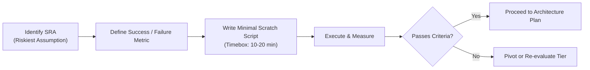

# Technical SPIKE Protocol: De-risking Novel Architectures

A **SPIKE** is an isolated, time-boxed technical investigation designed to answer a specific question or test an unproven hypothesis before committing to a full implementation.

---

## 1. The Core Philosophy of a SPIKE

When building state-of-the-art (SOTA) or novel products, conventional planning often fails because assumptions about emerging tools, latency, or API behaviors are unverified. 

- **Do NOT** build user interfaces, authentication, database migrations, or production scaffolding during a SPIKE.
- **DO** write throwaway code focused purely on validating the **Single Riskiest Assumption (SRA)**.

---

## 2. SPIKE Lifecycle

---

## 3. Defining the Single Riskiest Assumption (SRA)

Ask: *"If this one thing fails or is too slow/expensive/complex, does the entire novel approach collapse?"*

### Examples of SRAs:
- **Streaming Latency**: Can the bidirectional WebSocket connection deliver first audio token in <300ms?
- **Local Compute**: Can an in-browser WebAssembly vector index query 10,000 vectors within 15ms?
- **State Synchronization**: Can two clients resolve a simultaneous offline conflict without data loss?
- **LLM Reliability**: Can structured JSON schema extraction maintain 100% adherence over 50 varied test inputs?

---

## 4. SPIKE Execution Rules

1. **Location**: Place SPIKE code in `<appDataDir>\brain\<conversation-id>/scratch/` or an isolated test file (e.g. `spike_test.py` or `spike_test.ts`).
2. **Hardcoded Test Fixtures**: Do not connect real production databases. Use mock data, hardcoded JSON, or synthetic payloads.
3. **Instrumentation**: Print timestamps or log memory usage explicitly to gather empirical data.
4. **Summary Format**:
   Always report back to the user with:
   - **Hypothesis Tested**
   - **Observed Metrics** (e.g., Latency: 120ms, Memory: 14MB, Reliability: 100%)
   - **Verdict**: [Validated | Inconclusive | Failed]
   - **Next Step**: [Proceed to full plan | Pivot to alternative approach]
