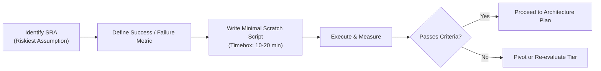

# Technical SPIKE Protocol: De-risking Novel Architectures

> *Antigravity vocabulary below; Claude Code users translate it with [`claude-adapter.md`](./claude-adapter.md).*

A **SPIKE** is an isolated, time-boxed technical investigation designed to answer a specific question or test an unproven hypothesis before committing to a full implementation.

---

## 1. The Core Philosophy of a SPIKE

When building state-of-the-art (SOTA) or novel products, conventional planning often fails because assumptions about emerging tools, latency, or API behaviors are unverified. 

- **Do NOT** build user interfaces, authentication, database migrations, or production scaffolding during a SPIKE.
- **DO** write throwaway code focused purely on validating the **Single Riskiest Assumption (SRA)**.

---

## 2. SPIKE Lifecycle

---

## 3. Defining the Single Riskiest Assumption (SRA)

Ask: *"If this one thing fails or is too slow/expensive/complex, does the entire novel approach collapse?"*

### Examples of SRAs:
- **Streaming Latency**: Can the bidirectional WebSocket connection deliver first audio token in <300ms?
- **Local Compute**: Can an in-browser WebAssembly vector index query 10,000 vectors within 15ms?
- **State Synchronization**: Can two clients resolve a simultaneous offline conflict without data loss?
- **LLM Reliability**: Can structured JSON schema extraction maintain 100% adherence over 50 varied test inputs?

---

## 4. SPIKE Execution Rules

1. **Location**: Place SPIKE code in `.frontier/scratch/<slug>/` (Antigravity: `<appDataDir>/brain/<conversation-id>/scratch/`) or an isolated test file (e.g. `spike_test.py` or `spike_test.ts`).
2. **Hardcoded Test Fixtures**: Do not connect real production databases. Use mock data, hardcoded JSON, or synthetic payloads.
3. **Instrumentation**: Print timestamps or log memory usage explicitly to gather empirical data.
4. **Summary Format**:
   Always report back to the user with:
   - **Hypothesis Tested**
   - **Observed Metrics** (e.g., Latency: 120ms, Memory: 14MB, Reliability: 100%)
   - **Verdict**: [Validated | Inconclusive | Failed]
   - **Next Step**: [Proceed to full plan | Pivot to alternative approach]

---

## 5. SPIKE Spec (required whenever a plan or proposal mentions a SPIKE)

A SPIKE that is only *named* cannot be judged later. Whenever a proposal, plan or answer proposes a SPIKE (even one that will not run this turn), write all six lines:

1. **Riskiest assumption (SRA)**: one sentence, falsifiable ("X runs under Y within Z").
2. **Metric**: what is measured and how (latency p95, bundle size, adoption rate, error rate).
3. **Pass threshold / fail threshold**: concrete numbers, with a stated gap or "inconclusive" band between them.
4. **Fixture and timebox**: synthetic data or replayed logs, plus a time limit.
5. **Decision rule**: *if pass → proceed with Tier N; if fail → pivot to Tier M* (name both).
6. **Where it lives**: `.frontier/scratch/<slug>/` (Claude Code) so no production files are touched.

*Non-technical assumptions count too:* for "will customers adopt this?", the metric is a proxy you can measure (for example "N of the top 20 customers accept a pull-feed pilot within 2 weeks"), with the same pass/fail lines.

Example: *SRA: Yjs applies a 100 KB-note update on Hermes in under 50 ms. Metric: update-apply time p95 over 2,000 edits on a mid-range phone. Pass < 50 ms, fail > 120 ms, between = inconclusive. Fixture: synthetic 5k-word note, one-day timebox. Decision: pass → CRDT body in Milestone 2; fail → keep conflict-copy LWW. Lives in `.frontier/scratch/yjs-rn/`.*
