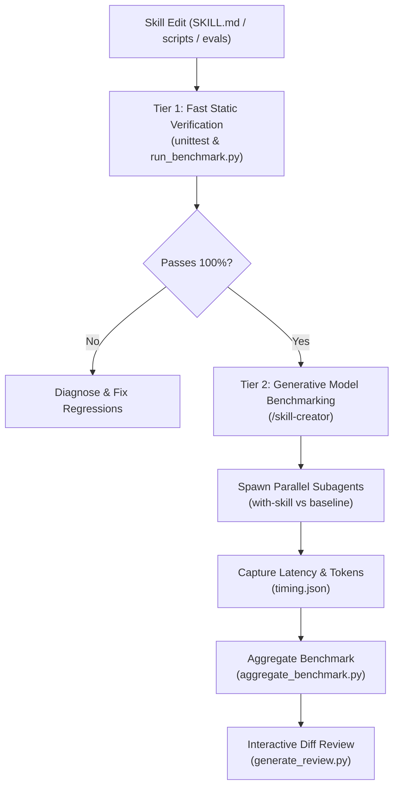

# Frontier Architect Test & Benchmark Guide

This directory provides a dual-tier testing and verification architecture for the `frontier-architect` skill.

---

## Testing Architecture



1. **Tier 1: Fast Deterministic CI/CD Checks (Local & Offline)**:
   - Validates schema and structural integrity of `evals/evals.json`.
   - Asserts that all 14 evaluation scenarios and 68 assertions are satisfied by `SKILL.md`.
   - Asserts that bundled Python scripts (`cdp_inspect.py`, `cdp_transport.py`, `docker_audit.py`, `plan_engine.py`, `plan_parser.py`, `plan_state.py`) pass 81 unit tests with $\ge 96\%$ code coverage.
   - Dynamically checks against historical snapshot (`skill-snapshot/SKILL.md`) to guarantee zero regressions.
   - **Cost**: 0 LLM tokens, executes in $\approx 2$ seconds.

2. **Tier 2: Generative Multi-Agent Benchmarking (`/skill-creator`)**:
   - For evaluating actual model behavioral variance, token cost, and latency across Gemini Flash/Pro.
   - Driven via `/skill-creator` in chat: spawns parallel subagents (`with_skill` vs `without_skill`), grades outputs with `grader.md`, and serves the interactive review UI.
   - **Acquiring `skill-creator`**: If `/skill-creator` is not installed locally, it can be acquired from the official Anthropic Claude Plugins repository: [claude-plugins-official/plugins/skill-creator](https://github.com/anthropics/claude-plugins-official/tree/main/plugins/skill-creator/skills/skill-creator).

---

## Pre-Run Verification One-Liners

Before opening a PR or committing changes, verify health and test coverage:

```bash
# 1. Run all 81 automated unit and eval regression tests (100% self-contained, no external plugins needed)
python -m unittest discover -s skills/frontier-architect/tests -p "test_*.py" -v

# 2. Check full code coverage across all bundled scripts and test suites
python -m coverage run -m unittest discover -s skills/frontier-architect/tests -p "test_*.py" && python -m coverage report -m

# 3. Check skill metadata and YAML frontmatter validity (if skill-creator is installed)
python skills/skill-creator/scripts/quick_validate.py skills/frontier-architect
```

---

## Scenario Combinations Matrix

| Scenario / Objective | Mode / Inputs | Key Parameters | Exact Runnable Command |
| :--- | :--- | :--- | :--- |
| **Quick Health Check** | All unit tests | Standard discovery | `python -m unittest discover -s skills/frontier-architect/tests -p "test_*.py"` |
| **Comprehensive Test Coverage** | Coverage tool | Branch & line report | `python -m coverage run -m unittest discover -s skills/frontier-architect/tests -p "test_*.py" && python -m coverage report -m` |
| **CDP Inspector Tests** | Browser CDP suite | Mocked Chrome/CDP | `python -m unittest skills/frontier-architect/tests/test_cdp_inspect.py` |
| **CDP Transport Tests** | RFC 6455 framing | Async stdlib WS | `python -m unittest skills/frontier-architect/tests/test_cdp_transport.py` |
| **Docker Auditor Tests** | Container runtime | Sync & error audit | `python -m unittest skills/frontier-architect/tests/test_docker_audit.py` |
| **Plan Engine & Parser Tests** | Plan CLI & State suite | Markdown & State | `python -m unittest skills/frontier-architect/tests/test_plan_engine.py` |
| **Eval Regression Tests** | All 14 scenarios | 68 expectations | `python -m unittest skills/frontier-architect/tests/test_skill_evals.py` |
| **Benchmark Summary CLI** | Current vs Snapshot | Live pass-rate table | `python skills/frontier-architect/tests/run_benchmark.py` |
| **Update Workspace Artifacts** | Iteration export | `--generate-artifacts` | `python skills/frontier-architect/tests/run_benchmark.py --generate-artifacts` |
| **Generative Agent Benchmark** | Live model runs | Full eval suite | Prompt in chat: `/skill-creator run to benchmark /frontier-architect` |
| **Interactive HTML Review** | Visual diff viewer | Iteration workspace | `python skills/skill-creator/eval-viewer/generate_review.py skills/frontier-architect-workspace/iteration-2 --static review.html` |

---

## Adding New Evals

When extending `frontier-architect` to support new paradigms:
1. Append the new test case to `evals/evals.json` with an incremented `id`, descriptive `prompt`, and $\ge 4$ verifiable `expectations`.
2. Add corresponding keyword/structural patterns to `test_skill_evals.py`.
3. Run `python skills/frontier-architect/tests/run_benchmark.py` to confirm 100% pass rate.
4. For empirical validation across models, trigger `/skill-creator` to run the generative benchmark loop.
