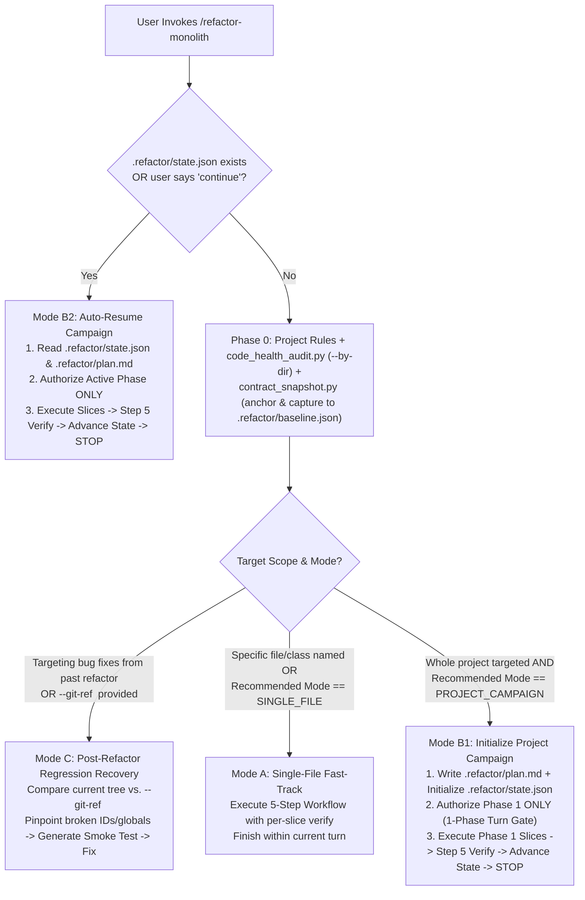

# Refactor Monolith: Adaptive Decomposition, Parity & Modularity Engine

The **Refactor Monolith** skill provides a deterministic, 100% self-contained workflow for auditing codebase modularity, decomposing oversized "God Files" and "God Classes", and guaranteeing **zero behavioral regressions** ($\Delta\text{Behavior} \equiv 0$) across backend routes, services, and frontend DOM interactions.

---

## 1. Quantitative Modularity Budgets

| Code Element | Healthy Target | Soft Warning (Refactor Trigger) | Hard Ceiling (Mandatory Split) | Remediation Strategy |
| :--- | :--- | :--- | :--- | :--- |
| **Source File** | 150 – 300 SLOC | **350 SLOC** | **500 SLOC** | Extract domain submodules (`routers/`, `services/`, `repositories/`, `components/`). |
| **Class / Struct / Group** | 50 – 180 lines | **10 methods** (or 200 lines) | **12 methods** (or 300 lines) | Decompose into focused collaborator classes, domain services, or cohesive mixins. |
| **Function / Method / Rule** | 10 – 25 lines | **30 lines** | **40 lines** | Extract pure helper functions; replace deep nesting with guard clauses or strategy tables. |
| **Route / Controller** | 5 – 15 lines | **15 lines** | **25 lines** | Keep handlers thin: parse request, call a domain service, and return the response. |

> [!NOTE]
> **Heuristic Interpretation of Budgets**:
> - **SLOC-First Measurement**: Budgets are measured against **Source Lines of Code (SLOC)**, discounting blank lines, docstrings, and comments to avoid penalizing well-documented code.
> - **Soft Warning (350 SLOC)**: Acts as a **heuristic trigger** to inspect if cohesive domain submodules can be extracted. If a file is ~350–450 lines, highly cohesive, and has no clean Single Responsibility split, **leave it intact** and accept the soft warning.
> - **Hard Ceiling (500 SLOC)**: Requires architectural decomposition into domain submodules. It NEVER permits cosmetic compression or code-golfing.

---

## 2. Standardized `.refactor/` Workspace Architecture

All persistent refactoring metadata lives in `<workspace>/.refactor/` so campaigns seamlessly resume across fresh chats:

```text
<workspace>/.refactor/
├── state.json          # Machine-readable campaign state (active phase, plan path, commit SHAs)
├── plan.md             # Multi-phase architectural roadmap (resumable across fresh chats)
├── baseline.json       # Pre-refactor golden contract snapshot (DOM IDs, selects, routes, CSS)
├── scripts/            # Temporary project refactor helpers (NEVER placed in repo scripts/)
├── artifacts/          # Intermediate scratch notes, AST dumps, or post-mortems
└── .gitignore          # Self-contained gitignore protecting ephemeral artifacts and helpers (*)
```

> [!IMPORTANT]
> **Zero-Pollution & Anti-Vendoring Mandate**:
> 1. **NEVER copy skill scripts** into the user's `<workspace>/scripts/`. Run them directly from `<skill_dir>/scripts/...` during the agent's turn.
> 2. Custom scratch scripts or one-off extraction helpers must be placed in `.refactor/scripts/`.
> 3. Never modify the target repository's root `.gitignore` to add `.refactor/`. The directory manages its own self-contained `.gitignore`.

---

## 3. Fast CLI Quick Reference

```bash
# 1. Campaign state & planning
python "<skill_dir>/scripts/contract_snapshot.py" state --show
python "<skill_dir>/scripts/contract_snapshot.py" plan --path <target_dir> --phases 4 [--scan-defects]
python "<skill_dir>/scripts/contract_snapshot.py" state --init --target <dir> --plan .refactor/plan.md --phases 4 [--scan-defects]
python "<skill_dir>/scripts/contract_snapshot.py" state --checkpoint --note "Completed Slices X-Y"
python "<skill_dir>/scripts/contract_snapshot.py" state --advance --phase 1

# 2. Golden contract baseline & verification
python "<skill_dir>/scripts/contract_snapshot.py" anchor --path <target_dir>
python "<skill_dir>/scripts/contract_snapshot.py" capture --path <target_dir>
python "<skill_dir>/scripts/contract_snapshot.py" format --files <slice_file1> <slice_file2>
python "<skill_dir>/scripts/contract_snapshot.py" verify --path <target_dir> --strict [--format]

# 3. Virtualenv-isolated automated tests (headless guards, CI=true)
# Passes test runner flags (-k, -v, -p) transparently without CLI parser errors:
python "<skill_dir>/scripts/contract_snapshot.py" run-tests --path <dir> -- discover tests -p "test_*.py" -v -k "test_feature"
python "<skill_dir>/scripts/contract_snapshot.py" run-tests --path <dir> --runner pytest -- tests/ -v -k "test_unit"

# 4. Batch modularity audits
python "<skill_dir>/scripts/code_health_audit.py" --path <target1> <target2> ... --show-methods
python "<skill_dir>/scripts/code_health_audit.py" --path <dir> --by-dir

# 5. Cross-platform patching & template script injection
python "<skill_dir>/scripts/contract_snapshot.py" normalize-eol --path <dir> --to lf
python "<skill_dir>/scripts/contract_snapshot.py" patch --file <f> --find "<target>" --replace "<replacement>"
python "<skill_dir>/scripts/contract_snapshot.py" inject-scripts --html <f> --before <target> --scripts <srcs...> [--format '<script src="{src}"></script>']

# 6. Passive defect quarantine hook (zero plan.md drift)
python "<skill_dir>/scripts/contract_snapshot.py" state --record-defect --file <f> --symbol <s> --rule <r> --message "<m>"
```
*(For all flag permutations and template recipes, see [`references/cli-reference.md`](./references/cli-reference.md)).*

---

## 4. Execution Workflow & Turn-Boundary Discipline



### Mode A: Single-File Fast-Track (`SINGLE_FILE`)
- **Trigger**: Specific file/class named OR $\le 2$ critical files.
- **Action**: Outline cohesion clusters, extract submodules sequentially, verify per slice, finish in current turn.

### Mode B1: Initialize Project Campaign (`PROJECT_CAMPAIGN`)
- **Effort-Weighted Phase Sizing & The 25-Tool-Call Turn Ceiling Gate**:
  - **Effort-Based Sizing**: Size campaign phases by cumulative restructuring effort rather than a rigid file count:
    - Target $\sim 600 - 1,000$ lines of code actively slated for restructuring per phase/turn (or 1 major monolith $\ge 600$L, or 2–3 minor over-budget files $\le 400$L that share domain cohesion).
    - If candidate files in a phase exceed this cumulative volume, partition into atomic sub-phases (e.g. Sub-Phase 1.1, Sub-Phase 1.2).
  - **Domain & Runtime Affinity Isolation**:
    - Group files sharing the same runtime, test tooling, and mental model into the same phase.
    - Never mix disparate operational boundaries in the same turn (e.g. backend test suite de-crufting should NOT be bundled with browser DOM controllers).
  - **Turn Ceiling Gate**:
    - When verified or approaching 20–25 tool calls, save checkpoint:
      ```bash
      python "<skill_dir>/scripts/contract_snapshot.py" state --checkpoint --note "Completed Slices X-Y"
      ```
      Present a clean commit command and **STOP**. Advise running `/refactor-monolith continue` in a fresh chat.
  - Clicking 'Proceed' on the implementation plan authorizes **Phase 1 (or Sub-Phase 1.1) only**. Subsequent phases are *Deferred to Next Turn*.
  - Write `.refactor/plan.md` as the single canonical plan on disk. When presenting in chat, mirror the exact same content without divergence.

### Mode B2: Auto-Resume Campaign (`CAMPAIGN_RESUME`)
- **Trigger**: User runs `/refactor-monolith continue` or starts a fresh chat with active `state.json`.
- **Action**: Read `state.json` and `plan.md`, report resumption, extract the active phase within the $\sim 600-1,000$ line effort budget, run Step 5 verification, save checkpoint, advance state, and stop.

### Mode C: Post-Refactor Regression Recovery (`REGRESSION_RECOVERY`)
- **Action**: Run 1-command unified diagnostic:
  ```bash
  python "<skill_dir>/scripts/contract_snapshot.py" diagnose --path <target_dir> [--git-ref <sha>] [--url $APP_URL] [--container <name>]
  ```
  Pinpoint broken element IDs, missing globals, or route discrepancies. Apply surgical fixes with `patch` or `inject-scripts`, verify with `--strict`, and resolve regressions cleanly.

---

## 5. Phase 0: Project Rules Check, Scope Detection & Baseline Anchor

1. **Check for Existing Campaign**: If `<workspace>/.refactor/state.json` exists, run `state --show` and jump to Mode B2.
2. **Respect Project Memory & Rules**: Check for `AGENTS.md` or `.agents/rules/`. Do NOT treat running project tests as a blocking prerequisite during planning or audit. If tests fail due to missing host dependencies (e.g. system OpenCV, CUDA), note it in the baseline log and proceed with static AST analysis. Never run `pip install` into arbitrary host environments.
3. **Run Multi-Language Structural Auditor**:
   `python "<skill_dir>/scripts/code_health_audit.py" --path <target_dir> --by-dir`
4. **Anchor Git State & Capture Pre-Refactor Contract**:
   `python "<skill_dir>/scripts/contract_snapshot.py" anchor --path <target_dir>`
   `python "<skill_dir>/scripts/contract_snapshot.py" capture --path <target_dir>` (snapshots golden baseline to `.refactor/baseline.json`).

---

## 6. The 5-Step Zero-Regression Decomposition Workflow

### Step 1: Zero-Token Structural & Directory Audit
- Audit target files with `code_health_audit.py --show-methods` or `--split-preview <file>:<line>[:window]`.
- **The Batch Audit Mandate (Anti-Micro-Audit Rule)**: Never audit extracted submodules one-by-one with individual tool calls. Write all cohesive submodules for the current slice, then audit them together in a single tool call:
  `python "<skill_dir>/scripts/code_health_audit.py" --path <file1> <file2> ... --show-methods`

### Step 2: Cohesion Clustering, Surface Map & Facade Design
1. **Interactive Surface Map**: Run `contract_snapshot.py inspect --path <target_dir> --show-routes` to inventory element IDs, interactive dropdowns, global exports, and API routes.
2. **Stylesheet & Specificity Audit**: For CSS/SCSS, run `contract_snapshot.py inspect-css --path <css_path>` to audit `@import` chains, section banners, CRLF endings, and `!important` occurrences.
3. **Load On-Demand References**:
   - Python DAG routes & Bidirectional Proxy Pattern: [`references/decomposition-patterns.md`](./references/decomposition-patterns.md).
   - Non-Python Playbooks (JS/TS, CSS, Dart, Go, Rust, C#): [`references/language-playbooks.md`](./references/language-playbooks.md).
4. **Zero-Breaking-Import & Zero-Broken-DOM Invariant**:
   - Python: Retain original module path as a re-export facade; use Bidirectional Proxy if tests monkeypatch module globals.
   - JavaScript: Never rename DOM element IDs; preserve all `window.<Namespace>` exports; ensure `<script>` order satisfies dependencies.

### Step 3: Atomic Slice Extraction (One Cluster at a Time)
1. Keep new modules below **350 lines** (classes $\le 10$–$12$ methods, functions $\le 40$ lines).
2. **Preserve Comments & Math**: Retain mathematical algorithms, OpenCV matrices, and business rationale verbatim.
3. **CRLF Line-Ending & Cross-Platform Tooling**:
   - Normalize to LF before editing: `contract_snapshot.py normalize-eol --path <target_dir> --to lf`
   - Line-ending agnostic patching: `contract_snapshot.py patch --file <f> --find "<target>" --replace "<replacement>"`
   - Safe HTML script injection: `contract_snapshot.py inject-scripts --html <f> --before <target> --scripts <srcs...> [--format '...']`

> [!WARNING]
> **Anti-Mega-Batch Rule (Atomic Slicing Gate)**:
> Never generate more than 1–2 files/routers in a single step without testing imports or contract parity. Sequence:
> `Slice 1 (Dependencies / Schemas) -> Verify Contract -> Slice 2 (Routers 1-2) -> Verify Contract -> Wire Facade & Parity`.

### Step 4: Wire Facade & Per-Slice Contract Verification
1. Re-export extracted symbols in the monolith facade.
2. Enforce strict acyclic DAG (`Facade -> Routers/UI -> Services -> Repositories -> Leaf Utils`).
3. **Immediate Slice Verification**:
   `python "<skill_dir>/scripts/contract_snapshot.py" verify --path <target_dir> --strict`
   If any DOM ID was dropped or global export lost, fix it immediately before starting the next slice.

### Step 5: 3-Tier Closed-Loop Verification Ladder

Order verification strictly complying with **Axiom 9 (Honest Verification Reporting)**:

```text
Tier 1: Static Contracts & Automated Tests (Always, 100% Self-Contained)
  ├── 1. Automated test suite via virtualenv:
  │      python "<skill_dir>/scripts/contract_snapshot.py" run-tests --path <dir> -- discover tests -p "test_*.py"
  ├── 2. Structural line budgets (code_health_audit.py --path <target_dir> --strict)
  ├── 3. DOM & API contract parity (contract_snapshot.py verify --path <target_dir> --strict)
  └── 4. Generate permanent regression test (contract_snapshot.py generate-smoke-test --path <target_dir>)

Tier 2: Container Sync Audit (If Containerized)
  └── python "<skill_dir>/scripts/contract_snapshot.py" audit-container --path <dir> --container <name> --sync-check <files...>

Tier 3: Live Browser Verification (If UI Touched)
  ├── 1. Layout audit via headless CDP: python "<skill_dir>/scripts/contract_snapshot.py" verify-ui --url $APP_URL
  └── 2. Axiom 9 Reporting: If server is offline, report:
         "Tier 1: VERIFIED | Tier 2: SKIPPED | Tier 3: SKIPPED (Server offline / URL unset)"
```

---

## 7. Two-Tier Execution & Reactive Turn-Yield Protocol

Long-running verification suites or audits must never cause agent polling thrashing:

1. **Sync Wait Optimization (Tier 1)**:
   - For targeted, fast test runs ($\le 5$s), specify `WaitMsBeforeAsync: 10000` (10 seconds) on `run_command` so tests complete synchronously in the same turn. Fast commands return immediately.
   - Run targeted sub-phase test files rather than 300+ test repository suites on intermediate slices.
2. **The Reactive Turn-Yield Mandate (Tier 2)**:
   - If a test suite exceeds 10s and transitions to a background task:
     `Tool is running as a background task with task id: <task_id>`
   - The agent MUST execute the following protocol:
     1. **Do NOT call `manage_task(action='status')`.**
     2. **Do NOT run sleep or wait commands** (strictly ban `time.sleep` and `Start-Sleep`).
     3. **Output a 1-sentence handoff**:
        `"Verification command is executing in background task <task_id>. Yielding turn for reactive notification."`
     4. **STOP calling tools immediately and end the turn.**
   - The platform will reactively resume execution with the complete command output upon completion.

---

## 8. Asymmetric Defect Protocol & Passive Quarantine Safety Net

The fundamental **Refactoring Invariant** ($\Delta(\text{Observable Behavior}) \equiv 0$) and **behavior preservation** mandate require restructuring code without altering observable runtime behavior. Refactoring agents are strictly forbidden from modifying production business logic to fix bugs during decomposition turns.

1. **Zero-Token Default Pipeline**: By default, `/refactor-monolith` performs only structural line audits and contract capture. Candidate defect scanning is completely bypassed during regular decomposition turns (`continue`), consuming **0 extra tokens**.
2. **Opt-In Candidate Defect Scan**: During planning (`contract_snapshot.py plan` or `state --init`), passing `--scan-defects` triggers an AST scan of candidate files for high-signal issues (`SYNTAX_ERROR`, `MUTABLE_DEFAULT_ARG`, `UNREACHABLE_CODE`, `UNDEFINED_NAME`). Discovered defects are saved to `.diagnostics/defect_catalog.json` and `.diagnostics/DEFECT_CATALOG.md`, and linked in `plan.md`.
3. **Passive Quarantine Safety Net**: If an agent spots an upstream bug while untangling logic during a decomposition turn, it quarantines the defect rather than making a dangerous inline fix:
   ```bash
   python "<skill_dir>/scripts/contract_snapshot.py" state --record-defect \
     --file <f> --symbol <s> --rule <r> --message "<m>"
   ```
   This records the defect in `.diagnostics/defect_catalog.json` with **zero modifications to `plan.md`**.
4. **Independent Lifecycle Handoff**: Upon campaign completion, `campaign_manager.py` summarizes quarantined defects with copy-pasteable commands for `/app-debugger` (Tactical Red-to-Green cycle) or `/frontier-architect` (Architectural Elevation).
5. **Phase-Isolation & Targeted Verification Rules**:
   - **Hermetic Environment Invariant**: **NEVER** run bare `python -m unittest` or `pytest` against the host/system Python. **ALWAYS** execute tests via `python <skill_path>/scripts/contract_snapshot.py run-tests --path . -- <args>`, ensuring virtualenv binaries, `QT_QPA_PLATFORM=offscreen`, and `MPLBACKEND=Agg` are injected automatically.
   - **Targeted Slicing (Tests)**: Intermediate test execution during a decomposition phase must target the active slice's test suite:
     - Check if tests exist before guessing patterns (e.g. `run-tests --path . -- discover tests -p "test_<slice>*.py"`).
     - If no matching test file exists, inspect `tests/` before assuming regression.
   - **Targeted Slicing (Contract Verification)**: **Always** run `contract_snapshot.py verify --path <target_slice> --strict` during sub-phase iterations (e.g. `--path static/scss` or `--path intelligent_tracker/cli`).
     - **DO NOT** run repo-wide `verify --path .` during intermediate slices, as it exposes the agent to pre-existing, dormant discrepancies in unrelated subsystems (e.g., legacy HTML/JS DOM mismatches during SCSS refactoring). Reserve repo-wide verification strictly for final campaign closeout.
   - **Targeted Slicing (EOL Normalization)**: Run `normalize-eol` strictly targeting the active slice (e.g. `contract_snapshot.py normalize-eol --path <active_slice> --to lf`). **NEVER** run global `normalize-eol` across the entire repository root during intermediate slices, as this dirties untouched files with CRLF/LF changes in `git status`.
   - **Environment Defect Quarantining**: If testing a GUI or hardware-dependent module in a headless or partial environment (e.g., missing `PyQt`, `cv2`, `pyqtgraph`), do NOT keep failing test files. Record the environment gap with `contract_snapshot.py state --record-defect --file <path> --category ENVIRONMENT` and proceed.
   - **Out-of-Phase Failures**: If a whole-repo test suite is executed and a failure occurs in an un-refactored file scheduled for a future phase (e.g. `dashboard/stream_manager.py` during Phase 5):
     - The agent **MUST NOT** expand turn scope to refactor or fix the unrelated file inline.
     - Verify against the pre-refactor baseline. If pre-existing, record the failure as a quarantined defect (`state --record-defect`) and proceed with the active phase.
   - **Safe Deprecated Script Facades**: When relocating legacy, thesis, or experimental monoliths to a `deprecated/` subfolder, do NOT use eager `from .deprecated.module import *` if the legacy module executes side-effects (e.g. file reads, hardware/display initialization) or imports legacy packages (e.g. `past`, `future`) at top-level. Wrap imports in `try...except ImportError` or lazy attribute lookups to isolate legacy execution traps from active test discovery.

---

## 9. Strict No-Staging Invariant & Working Tree Discipline

- **NEVER run `git add` or `git rm` during a refactoring turn.**
- When deleting a superseded monolith file, delete it via filesystem tools (`Remove-Item` or `os.remove`), NOT `git rm`.
- Leave all created, modified, and deleted files unstaged in the working tree so the user can inspect diffs via `git diff`.
- **Strict Ban on Destructive Git Cleanup**: NEVER run `git checkout --`, `git reset`, or `git clean` to hide EOL differences or clean up `git status`. If files show line-ending modifications, leave them unstaged or let the user review them. Destructive commands risk discarding user work or uncommitted changes.
- Run `git status --short` before composing suggested `git add` and `git commit` commands for the user.

---

## 10. Anti-Thrash Stop-Loss & "Best Working Version" Safe Bailout

1. **Performance Guard ("Do No Harm")**: Never artificially split a hot path (NumPy array mutations, frame loops, DSP). Apply the **Hot/Cold Split**: keep hot loops cohesive, extract only cold helpers.
2. **Anti-Thrash Stop-Loss**: If a slice fails tests or contract parity twice in a row, stop editing immediately.
3. **"Leave at Best Working Version" Bailout**:
   - If a complex split resists clean extraction without fragile hacks:
     1. Revert unstable edits immediately (`git checkout -- <files>` or remove partial submodules).
     2. Restore the last verified working version.
     3. Explain the structural invariant to the user and recommend keeping the file at its best working version.
4. **The Structural vs. Cosmetic Refactoring Invariant (Anti-Code-Golfing)**:
   - Refactoring is strictly architectural: decomposing responsibilities, decoupling dependencies, and creating cohesive submodules ($\Delta \text{Behavior} \equiv 0$).
   - Never squash lines, strip comments/blank lines, combine variable declarations, or compress statement formatting to artificially beat line budgets.
   - Line budgets measure logical modularity (SLOC), not typographical compaction. Cosmetic compaction reduces readability, degrades DevTools stepping, complicates git diffs, and violates lint standards. If a file cannot be naturally decomposed into a domain submodule, accept the soft warning or leave it at its best working version. (For language-specific rules, see [`references/language-playbooks.md`](./references/language-playbooks.md)).

---

## 11. Pre-Run Verification & Built-In References

### Pre-Run Verification One-Liners
```bash
python "<skill_dir>/scripts/code_health_audit.py" --help
python "<skill_dir>/scripts/contract_snapshot.py" --help
python "<skill_dir>/scripts/code_health_audit.py" --path "<skill_dir>" --strict
python -m unittest discover -s "<skill_dir>/tests"
```

### Reference Library
- **[`references/cli-reference.md`](./references/cli-reference.md)**: Exhaustive flag reference, template injection recipes, and the complete 36-row Scenario Combinations Matrix.
- **[`references/decomposition-patterns.md`](./references/decomposition-patterns.md)**: Web routers, God classes, Bidirectional Proxy Pattern for monkeypatched globals, and circular dependency rules.
- **[`references/language-playbooks.md`](./references/language-playbooks.md)**: Vanilla JS invariants, ITCSS stylesheet decomposition, Go/Rust/Dart/C# playbooks, and safe rollback recipes.

---

## 12. In-Flight Tool Elevation Protocol

When an executing agent discovers a bug or missing capability in a skill script:
1. **Improve Reusable Skill Tools**: Enhance `<skill_dir>/scripts/` directly rather than writing disposable scratch scripts.
2. **Respect Repository Boundaries**: Never run git commands targeting `<skill_dir>` from the workspace repo. Use standard file tools (`edit_file`, `read_file`).
3. **Reproduce via Isolated Skill Test**: Add a reproducing test in `<skill_dir>/tests/`.
4. **Zero-Regression Gate**: Verify all skill tests pass (`python -m unittest discover -s "<skill_dir>/tests"`) before resuming project refactoring.
