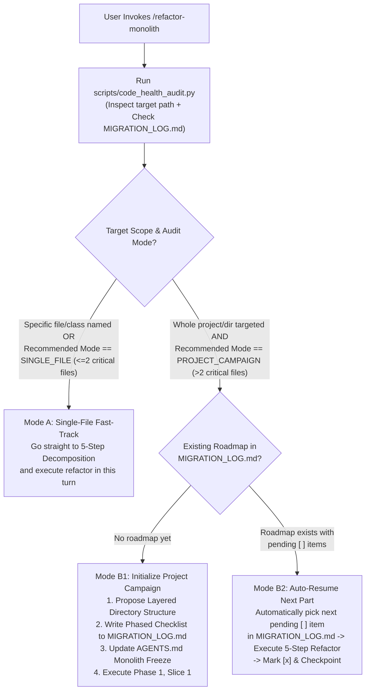

# Refactor Monolith: Adaptive Decomposition & Modularity Engine

The **Refactor Monolith** skill provides a deterministic, zero-regression workflow for auditing codebase modularity and decomposing oversized "God Files" and "God Classes" into cohesive, maintainable modules—whether the user wants to **refactor a single file immediately** or **migrate an entire multi-monolith project part-by-part**.

Why do naive file-splitting attempts fail?
1. **Broken Import Graphs**: Moving classes or functions to new files without leaving backward-compatible re-export facades breaks downstream callers and test suites across the repository.
2. **Big-Bang Rewrite Risk**: Splitting a 2,000-line file—or 12 monolithic files across a project—in a single unverified pass introduces circular imports, state-sharing bugs, and context exhaustion.
3. **Lost Domain Knowledge**: Hasty copy-pasting strips mathematical docstrings, edge-case comments, and historical context.

This skill eliminates those risks by combining **Adaptive Scope Routing (Single-File vs. Project Campaign)**, the **Strangler-Fig Facade Protocol**, and a built-in cross-platform AST auditor (`scripts/code_health_audit.py`).

---

## Quantitative Modularity Budgets

Use these default thresholds (customizable via CLI flags) when auditing or decomposing any repository:

| Code Element | Healthy Target | Soft Warning (Refactor Trigger) | Hard Ceiling (Mandatory Split) | Remediation Strategy |
| :--- | :--- | :--- | :--- | :--- |
| **Source File** | 150 – 300 lines | **350 lines** | **500 lines** | Extract domain submodules (`routers/`, `services/`, `repositories/`, `components/`). |
| **Class** | 50 – 180 lines | **10 methods** (or 200 lines) | **12 methods** (or 300 lines) | Decompose into focused collaborator classes, domain services, or cohesive mixins. |
| **Function / Method** | 10 – 25 lines | **30 lines** | **40 lines** | Extract pure helper functions; replace deep nesting with guard clauses or strategy tables. |
| **Route / Controller** | 5 – 15 lines | **15 lines** | **25 lines** | Keep handlers thin: parse request, call a domain service, and return the response. |

---

## Phase 0: Adaptive Scope Detection (Single-File vs. Project Campaign)

Users should **never** be forced to manually micromanage file-by-file prompts across a large repository, nor suffer heavy roadmap ceremony when splitting a single file. Always begin by running `scripts/code_health_audit.py` and routing to the matching mode:



### Mode A: Single-File / Small-Scope Fast-Track (`SINGLE_FILE`)
- **Trigger**: The user names a specific file/class (e.g., *"split `server.py`"*, *"refactor `DataStore`"*) **OR** `code_health_audit.py` reports `Recommended Mode: SINGLE_FILE` ($\le 2$ critical files).
- **Action**: Do **not** generate multi-file project roadmaps. Immediately run `code_health_audit.py --path <target_file> --show-methods`, outline the cohesion clusters and facade re-export plan concisely, and **execute the 5-Step Decomposition Workflow directly**.

### Mode B: Project-Wide Phased Campaign & Auto-Resume (`PROJECT_CAMPAIGN`)
- **Trigger**: The user targets an entire repository/directory or asks to *"refactor the project"* / *"continue the migration"*, **AND** `code_health_audit.py` reports `Recommended Mode: PROJECT_CAMPAIGN` ($> 2$ critical files).
- **Action**:
  1. **Check `MIGRATION_LOG.md` First (Zero-Prompt Auto-Resume)**:
     - If `MIGRATION_LOG.md` already contains a Monolith Decomposition Roadmap with unchecked `[ ]` milestones, **automatically select the next unchecked milestone** without asking the user which file to do next. Announce the selected milestone and execute it via the 5-Step Workflow.
  2. **Initialize the Project Architecture & Roadmap (If Not Yet Created)**:
     - Establish or improve the project's **Recommended Layered Structure** (adapting idioms to the project's language/framework):
       - **Level 0 — Leaf Models, Schemas & Pure Utils** (`models/`, `schemas/`, `utils/`): Zero internal service/router imports.
       - **Level 1 — Persistence & External Adapters** (`repositories/`, `clients/`): Focused data access modules or domain mixins ($\le 10$–$12$ methods per class).
       - **Level 2 — Domain Services & Core Workers** (`services/`, `core/`, `workflows/`): Business orchestration and state machines decoupled from HTTP/UI.
       - **Level 3 — Transport, Routers & UI Components** (`routers/`, `controllers/`, `views/`, `static/js/modules/`, `static/css/components/`): Thin handlers ($\le 15$–$25$ lines) and modular frontend assets.
       - **Level 4 — Entrypoints & Facades** (`app.py`, `__init__.py`, `main.ts`): App factory, router mounting, and backward-compatible re-exports.
     - Group all breached files from `code_health_audit.py` into **4 Dependency-Ordered Phases** (Phase 1: Persistence & Leaf Primitives $\rightarrow$ Phase 2: Core Domain & Workers $\rightarrow$ Phase 3: API Routers & Entrypoints $\rightarrow$ Phase 4: Frontend Scripts & Styles) and write the checklist to `MIGRATION_LOG.md`.
     - Update `AGENTS.md` with a **Monolith Freeze & Target Directory Map** so concurrent feature work never re-bloats frozen files.
     - **Execute Phase 1, Slice 1 immediately** (or pause for user approval if major architectural ambiguity exists), verify all tests pass, and mark `[x]` in `MIGRATION_LOG.md`.

---

## The 5-Step Zero-Regression Decomposition Workflow

Whether executing a single file in **Mode A** or the active milestone slice in **Mode B**, follow these 5 steps rigorously:

### Step 1: Automated Modularity & AST Audit
Run the standalone cross-platform auditor in `<skill_dir>/scripts/code_health_audit.py`:

```bash
# Audit repository and detect Recommended Mode (SINGLE_FILE vs PROJECT_CAMPAIGN)
python "<skill_dir>/scripts/code_health_audit.py" --path <target_repo_or_dir> --top 15

# Inspect exact class method counts and oversized functions inside the active target file
python "<skill_dir>/scripts/code_health_audit.py" --path <target_file> --show-methods
```

### Step 2: Cohesion Clustering & Facade Design
Before moving code, group the file's functions, routes, or methods into **cohesive domain clusters** *(see [references/decomposition-patterns.md](./references/decomposition-patterns.md) for concrete blueprints)*:

1. **Identify Responsibility Clusters**:
   - *Web / API Monoliths*: Group endpoints by resource noun (`auth`, `users`, `streams`, `system`, `metrics`) and separate HTTP transport (`routers/`) from business orchestration (`services/`).
   - *Data / Persistence Monoliths*: Separate connection lifecycle/schema init from domain-specific CRUD queries (`repositories/` or cohesive domain mixins).
   - *Core / Domain Monoliths*: Separate pure mathematical/geometric primitives, data models/DTOs, state machines, and I/O adapters.
   - *Frontend Script & Style Monoliths*: Split by UI feature or component (`modules/`, `components/`) and extract shared state/API clients.
2. **Enforce the Zero-Breaking-Import Contract**:
   - External modules and existing unit tests almost certainly import symbols from the original file path (e.g., `from pkg.module import MainClass, helper_fn`).
   - **Rule**: Always keep the original module path (or convert `module.py` into a package `module/__init__.py`) and **re-export** moved classes/functions in `__all__` (or `export * from ...` in TypeScript/ES6) so 100% of existing imports continue working without modification.

### Step 3: Atomic Slice Extraction (One Cluster at a Time)
Never shatter a 2,000-line file into 10 files in one unverified jump. Extract **one cohesive cluster per slice**:
1. Create the new focused module (e.g., `services/metrics_service.py` or `repositories/user_repo.py`).
2. Move the cohesive functions/methods and their required imports into the new module.
3. **Strictly Preserve Comments & Docstrings**: Carry over every single docstring, mathematical formula annotation, edge-case explanation, and reference URL verbatim.
4. Keep every newly created file below the **350-line soft limit**, every class $\le$ **10–12 methods**, and every function $\le$ **40 lines**.

### Step 4: Wire Facade & Guard Against Circular Imports
1. Import the extracted module back into the original facade file (or register the router/blueprint/mixin).
2. **Prevent Circular Dependencies**:
   - Enforce a strict Directed Acyclic Graph (DAG): `Facade/Entrypoint -> Routers/UI -> Services -> Repositories -> Leaf Models/Utils`.
   - Submodules must **never** import back from the top-level monolith facade; shared constants, types, or base classes must live in a Level 0 leaf module (`types.py`, `base.py`, `constants.py`).

### Step 5: Closed-Loop Test, Budget & Checkpoint Verification
After **each extraction slice**:
1. Run the project's automated test suite (`pytest`, `python -m unittest discover tests`, `npm test`, `dart test`, `go test ./...`) to confirm zero regressions.
2. Re-run `code_health_audit.py` on the modified file and newly extracted submodules to verify line and method counts are within budget.
3. In **Mode B (`PROJECT_CAMPAIGN`)**, mark the completed slice `[x]` in `MIGRATION_LOG.md` with before/after line counts and note the next pending `[ ]` slice so the user can continue effortlessly in the next turn or session.

---

## Pre-Run Verification & Scenario Combinations Matrix

### Pre-Run Verification One-Liners
```bash
# 1. Verify auditor CLI readiness
python "<skill_dir>/scripts/code_health_audit.py" --help

# 2. Run a strict self-check on the refactor-monolith skill directory itself
python "<skill_dir>/scripts/code_health_audit.py" --path "<skill_dir>" --strict

# 3. Run the automated unit test suite
python -m unittest discover -s "<skill_dir>/tests" -v
```

### Scenario Combinations Matrix
| Scenario / Objective | Mode / Target | Key Parameters | Exact Runnable Command |
| :--- | :--- | :--- | :--- |
| **Project Triage & Mode Detection** | Detect `SINGLE_FILE` vs `PROJECT_CAMPAIGN` | `--path <dir> --top 15` | `python "<skill_dir>/scripts/code_health_audit.py" --path . --top 15` |
| **Deep Single-File Inspection** | Method & function breakdown (`Mode A`) | `--path <file> --show-methods` | `python "<skill_dir>/scripts/code_health_audit.py" --path src/app.py --show-methods` |
| **Custom Strictness Thresholds** | Stricter file & class caps | `--warn-file-lines 250 --max-class-methods 8` | `python "<skill_dir>/scripts/code_health_audit.py" --path src --warn-file-lines 250 --max-class-methods 8` |
| **Machine-Readable CI Output** | JSON report with `recommended_mode` | `--path <dir> --json` | `python "<skill_dir>/scripts/code_health_audit.py" --path src --json` |
| **Pre-Commit Enforcement Gate** | Non-zero exit code on hard breach | `--path <dir> --strict` | `python "<skill_dir>/scripts/code_health_audit.py" --path src --strict` |

---

## Built-In Scripts, Tests & Reference Library

- **[`scripts/code_health_audit.py`](./scripts/code_health_audit.py)**: Standalone, zero-dependency, cross-platform (Windows, macOS, Linux) modularity and AST auditor. Automatically detects `SINGLE_FILE` vs. `PROJECT_CAMPAIGN` mode, measures file line counts across `.py`, `.js`, `.ts`, `.tsx`, `.jsx`, `.css`, `.scss`, `.dart`, `.go`, `.rs`, and `.cs`, and performs deep Python AST analysis for class method counts and function lengths.
- **[`tests/test_code_health_audit.py`](./tests/test_code_health_audit.py)**: Automated regression test suite covering AST parsing, classification thresholds, `recommend_mode` routing, directory pruning, and CLI execution.
- **[`evals/evals.json`](./evals/evals.json)**: Verification scenarios covering both Mode A (Single-File Fast-Track) and Mode B (Project-Wide Phased Campaign & Auto-Resume).
- **[`references/decomposition-patterns.md`](./references/decomposition-patterns.md)**: Consult during Step 2 and Step 3 for concrete, language-agnostic architectural patterns to split monolithic web routers, God classes, persistence layers, and frontend bundles without breaking callers.
