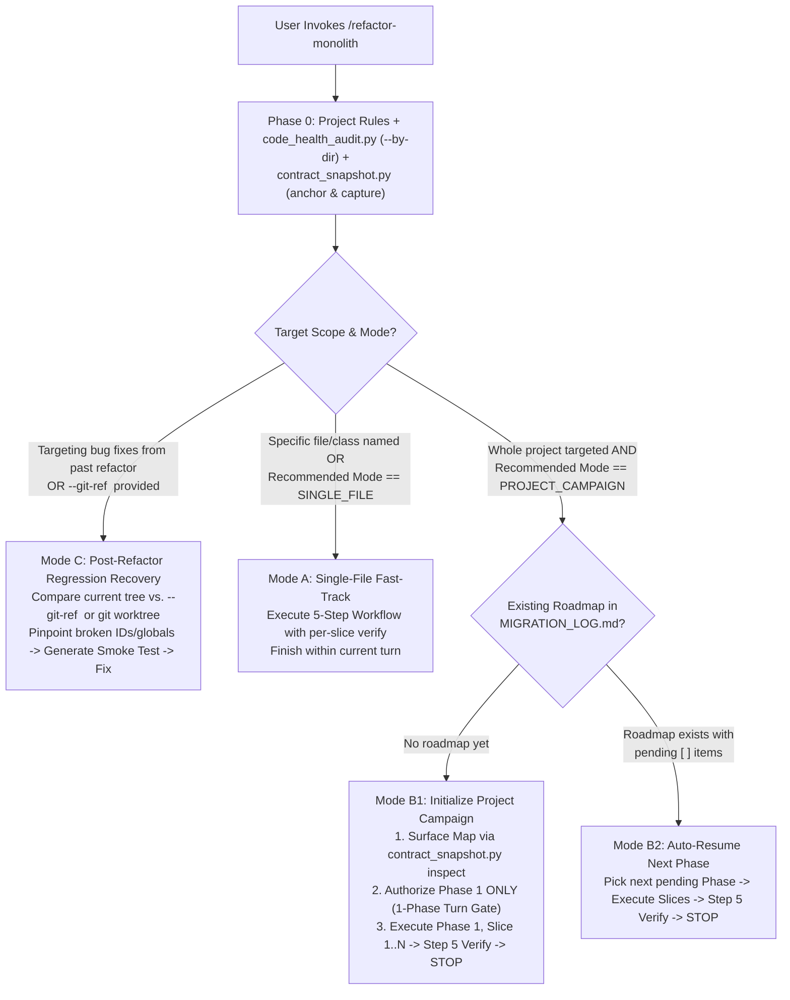

# Refactor Monolith: Adaptive Decomposition, Parity & Modularity Engine

The **Refactor Monolith** skill provides a deterministic, 100% self-contained workflow for auditing codebase modularity, decomposing oversized "God Files" and "God Classes", and guaranteeing **zero behavioral regressions** across both backend endpoints and frontend DOM interactions.

Why do naive file-splitting attempts fail?
1. **The Frontend Test Blindspot**: Backend unit tests pass 100% while subtle UI behaviors break because element IDs (`getElementById`), global `window.*` exports, inline `on*=` handlers, or `<script>` load orders are silently dropped or renamed during decomposition.
2. **Context-Exhausting Single Turns**: Attempting to execute an entire 4-phase, 15-slice migration in a single turn burns millions of tokens and causes attention degradation.
3. **Broken Import Graphs & Circular Dependencies**: Moving classes or routes without backward-compatible re-export facades breaks downstream callers.
4. **Ad-Hoc Shell Line-Counting Thrashing**: Abandoning structured audit CLIs for fragile inline PowerShell/Python commands causes quoting and syntax failures.

This skill eliminates those risks with **Zero-Token Structural Auditing** (`scripts/code_health_audit.py`), **Full-Surface Contract Snapshots** (`scripts/contract_snapshot.py`), **1-Phase Turn Gates**, **Git Worktree Recipes**, and the **"Best Working Version" Bailout Guarantee**.

---

## Quantitative Modularity Budgets

| Code Element | Healthy Target | Soft Warning (Refactor Trigger) | Hard Ceiling (Mandatory Split) | Remediation Strategy |
| :--- | :--- | :--- | :--- | :--- |
| **Source File** | 150 – 300 lines | **350 lines** | **500 lines** | Extract domain submodules (`routers/`, `services/`, `repositories/`, `components/`). |
| **Class / Struct / Group** | 50 – 180 lines | **10 methods** (or 200 lines) | **12 methods** (or 300 lines) | Decompose into focused collaborator classes, domain services, or cohesive mixins. |
| **Function / Method / Rule** | 10 – 25 lines | **30 lines** | **40 lines** | Extract pure helper functions; replace deep nesting with guard clauses or strategy tables. |
| **Route / Controller** | 5 – 15 lines | **15 lines** | **25 lines** | Keep handlers thin: parse request, call a domain service, and return the response. |

---

## Phase 0: Project Rules Check, Scope Detection & Baseline Anchor

Always execute these three zero-overhead steps before modifying any code:

1. **Respect Project Memory & Rules (`AGENTS.md` / `.agents/rules/`)**:
   - Check if the workspace has an `AGENTS.md`, `CLAUDE.md`, `GEMINI.md`, or `.agents/rules/` directory. Honor established conventions.
2. **Run the Multi-Language Structural Auditor (`scripts/code_health_audit.py`)**:
   - Run `python "<skill_dir>/scripts/code_health_audit.py" --path <target_dir> --by-dir` to inspect lines grouped by directory.
   - Use `--compact` for quick file status, or `--split-preview <file>:<line>[:window]` to preview lines around extraction points.
   - **Strict Rule**: Never write ad-hoc PowerShell or Python inline scripts to count lines; always use `code_health_audit.py`.
3. **Anchor Git State & Capture Pre-Refactor Contract (`scripts/contract_snapshot.py`)**:
   - Run `python "<skill_dir>/scripts/contract_snapshot.py" anchor --path <target_dir>` to record the clean Git SHA and worktree recipe.
   - Run `python "<skill_dir>/scripts/contract_snapshot.py" capture --path <target_dir> --out .refactor_baseline.json` to lock in all DOM element IDs, `<select>` dropdowns, `window.*` exports, inline handlers, and API routes before a single line is edited.



---

## Execution Modes & Turn-Boundary Discipline

### Mode A: Single-File Fast-Track (`SINGLE_FILE`)
- **Trigger**: Specific file/class named **OR** `code_health_audit.py` reports `Recommended Mode: SINGLE_FILE` ($\le 2$ critical files).
- **Action**: Outline cohesion clusters concisely, extract submodules one by one, run `contract_snapshot.py verify` after each slice, and complete in the current turn.

### Mode B: Project Campaign with 1-Phase Turn Gates (`PROJECT_CAMPAIGN`)
- **Trigger**: Entire project targeted **AND** `code_health_audit.py` reports `Recommended Mode: PROJECT_CAMPAIGN` ($> 2$ critical files).
- **The 1-Phase-Per-Turn Execution Rule**:
  - **Never execute all 4 phases in a single turn.** Attempting mega-executions burns context and compounds regressions.
  - In the implementation plan, present the full 4-phase roadmap but **explicitly state that clicking 'Proceed' authorizes only Phase 1**. Mark Phases 2–4 as *Deferred to Next Turn*.
  - When Phase 1 completes Step 5 verification, update `MIGRATION_LOG.md`, present the clean commit command, and **stop**. Advise the user to commit and start a fresh turn (or run `/compact`) before proceeding to Phase 2.

### Mode C: Post-Refactor Regression Recovery (`REGRESSION_RECOVERY`)
- **Trigger**: The user reports that a previous refactor broke functionality (e.g. dropdowns, modals, event listeners), or asks to diagnose/remedy refactoring regressions.
- **Workflow**:
  1. Identify the pre-refactor golden commit SHA (e.g. `HEAD~1` or pre-refactor commit).
  2. Run `python "<skill_dir>/scripts/contract_snapshot.py" verify --path . --git-ref <pre_refactor_sha>` to immediately pinpoint every renamed ID, dropped `window.*` export, and broken handler.
  3. Optionally spin up a parallel worktree (`git worktree add ../pre_refactor <sha>`) for side-by-side behavioral comparison.
  4. Generate a permanent contract smoke test (`contract_snapshot.py generate-smoke-test`) to lock in the required invariants.
  5. Apply surgical fixes to restore all missing IDs, `window.*` exports, and event bindings.

---

## The 5-Step Zero-Regression Decomposition Workflow

### Step 1: Zero-Token Structural & Directory Audit
```bash
# Check directory-level line aggregation and breach summary
python "<skill_dir>/scripts/code_health_audit.py" --path <target_dir> --by-dir

# Inspect class/method/rule details of the active file
python "<skill_dir>/scripts/code_health_audit.py" --path <target_file> --show-methods
```

### Step 2: Cohesion Clustering, Surface Map & Facade Design
1. **Interactive Surface Map**: Run `contract_snapshot.py inspect --path <target_dir>` to list all `<select>` IDs, modals, inline handlers, and global exports that must remain intact.
2. **Load On-Demand References**:
   - Web routes, God classes, and DAG rules: [`references/decomposition-patterns.md`](./references/decomposition-patterns.md).
   - Non-Python files (`.js`, `.ts`, `.css`, `.dart`, `.go`, `.rs`, `.cs`): [`references/language-playbooks.md`](./references/language-playbooks.md).
3. **The Zero-Breaking-Import & Zero-Broken-DOM Invariant**:
   - Python: Keep original module path as a re-export facade; use the **Bidirectional Proxy Pattern** in `dependencies.py` if tests monkeypatch module globals.
   - JavaScript (Vanilla): Never rename DOM element IDs; preserve all `window.<Namespace>` exports; ensure `<script src="...">` load order satisfies dependencies.

### Step 3: Atomic Slice Extraction (One Cluster at a Time)
1. Create the new module below the **350-line target** (classes $\le 10$–$12$ methods, functions $\le 40$ lines).
2. Move cohesive logic and imports. Use `--split-preview <file>:<line>` to check boundaries safely.
3. **Preserve Comments & Math**: Carry over all mathematical formulas, OpenCV coordinates, and rationale verbatim.

### Step 4: Wire Facade & Per-Slice Contract Verification
1. Re-export extracted symbols in the monolith facade.
2. Guard against circular imports: enforce strict DAG (`Facade -> Routers/UI -> Services -> Repositories -> Leaf Utils`).
3. **Immediate Slice Verification**:
   ```bash
   python "<skill_dir>/scripts/contract_snapshot.py" verify --path <target_dir> --before .refactor_baseline.json --strict
   ```
   If any DOM ID was dropped or global export lost, fix it *now* before starting the next slice.

### Step 5: 3-Tier Closed-Loop Verification Ladder

Execute verification in three strictly ordered tiers:

```text
Tier 1: Static Contracts & Automated Tests (Always, 100% Self-Contained)
  ├── 1. Automated unit test suite (pytest, python -m unittest discover tests, npm test)
  ├── 2. Structural line budgets (code_health_audit.py --path <target_dir> --strict)
  ├── 3. DOM & API contract parity (contract_snapshot.py verify --before .refactor_baseline.json --strict)
  └── 4. Generate permanent regression test (contract_snapshot.py generate-smoke-test)

Tier 2: Container Sync Audit (If Docker / Containerized)
  └── Probe docker_audit.py (via probe-tools) to verify host-to-container MD5 sync and zero CPU runaway.

Tier 3: Live Browser Verification & Remote Debugging Protocol (If UI Touched)
  ├── 1. Check if cdp_inspect.py is discovered via probe-tools.
  ├── 2. Probe if $APP_URL is reachable.
  └── 3. Pre-Flight Pause Protocol: If unreachable or Chrome remote debugging requires authorization ("Allow" banner):
         Pause and prompt the user via ask_question:
         - Option 1: "I have started the server and approved the remote debugging prompt — proceed with live check."
         - Option 2: "Proceed using self-contained static contract verification."
  └── 4. Axiom 9 Honest Reporting: If Option 2 is chosen, explicitly state:
         "Static Contract: VERIFIED | Live Browser: UNVERIFIED (Server offline / remote debugging unattached)."
```

---

## Anti-Thrash Stop-Loss & "Best Working Version" Safe Bailout

1. **Performance Guard ("Do No Harm")**: Never artificially split a hot path (NumPy array mutations, video frame loops, tight DSP). Apply the **Hot/Cold Split**: keep the hot loop cohesive, extract only cold helpers.
2. **Anti-Thrash Stop-Loss**: If a slice fails tests or contract parity twice in a row, stop editing immediately.
3. **The "Leave at Best Working Version" Bailout**:
   - If a complex split resists clean extraction without fragile hacks:
     1. Revert unstable edits immediately (`git checkout -- <files>` or remove partial submodules).
     2. Restore the last verified working version.
     3. Explain the structural invariant to the user and recommend keeping the file at its best working version.

---

## Pre-Run Verification & Scenario Combinations Matrix

### Pre-Run Verification One-Liners
```bash
# 1. Verify auditor and snapshot CLI readiness
python "<skill_dir>/scripts/code_health_audit.py" --help
python "<skill_dir>/scripts/contract_snapshot.py" --help

# 2. Run self-check on skill directory itself
python "<skill_dir>/scripts/code_health_audit.py" --path "<skill_dir>" --strict
python -m unittest discover -s "<skill_dir>/tests" -v
```

### Scenario Combinations Matrix
| Scenario / Objective | Mode / Target | Key Parameters | Exact Runnable Command |
| :--- | :--- | :--- | :--- |
| **Directory-Level Triage** | Group line counts by subfolder | `--path <dir> --by-dir` | `python "<skill_dir>/scripts/code_health_audit.py" --path . --by-dir` |
| **Split Point Preview** | View lines around split safely | `--split-preview <file>:<line>[:window]` | `python "<skill_dir>/scripts/code_health_audit.py" --split-preview src/app.py:280:10` |
| **Record Reference Anchor & Worktree** | Git commit anchor & parallel worktree recipe | `anchor --path <dir>` | `python "<skill_dir>/scripts/contract_snapshot.py" anchor --path .` |
| **Capture Baseline Contract** | Snapshot before refactoring | `capture --path <dir> --out <file>` | `python "<skill_dir>/scripts/contract_snapshot.py" capture --path . --out .refactor_baseline.json` |
| **Interactive Surface Map** | Inventory of selects, modals, globals, routes | `inspect --path <dir>` | `python "<skill_dir>/scripts/contract_snapshot.py" inspect --path .` |
| **Per-Slice & Checkpoint Verification** | Diff against baseline contract | `verify --path <dir> --before <file> --strict` | `python "<skill_dir>/scripts/contract_snapshot.py" verify --path . --before .refactor_baseline.json --strict` |
| **Post-Refactor Regression Audit** | Diff live tree directly against pre-refactor Git SHA | `verify --path <dir> --git-ref <sha> --strict` | `python "<skill_dir>/scripts/contract_snapshot.py" verify --path . --git-ref HEAD~1 --strict` |
| **Generate Permanent Contract Test** | Emit unittest regression suite | `generate-smoke-test --path <dir>` | `python "<skill_dir>/scripts/contract_snapshot.py" generate-smoke-test --path . --out tests/test_refactor_contract.py` |
| **Discover Optional Tools** | Probe cdp_inspect & docker_audit | `probe-tools` | `python "<skill_dir>/scripts/contract_snapshot.py" probe-tools` |
| **Pre-Commit Strict Gate** | Exit 1 on critical breach | `--path <dir> --strict` | `python "<skill_dir>/scripts/code_health_audit.py" --path src --strict` |

---

## Built-In Scripts, Tests & On-Demand Reference Library

- **[`scripts/code_health_audit.py`](./scripts/code_health_audit.py)**: Standalone multi-language structural auditor. Supports `--by-dir`, `--compact`, `--split-preview`, and prunes vendor/minified assets.
- **[`scripts/surface_scanners.py`](./scripts/surface_scanners.py)**: Zero-dependency surface scanners extracting DOM IDs, interactive selects, inline handlers, `window.*` globals, Python routes, mutable globals, and CSS custom properties.
- **[`scripts/contract_snapshot.py`](./scripts/contract_snapshot.py)**: Baseline contract snapshotter, Git worktree anchor, regression diff engine, and automated contract smoke-test generator.
- **[`tests/test_code_health_audit.py`](./tests/test_code_health_audit.py)**: Automated regression test suite for structural parsing.
- **[`tests/test_contract_snapshot.py`](./tests/test_contract_snapshot.py)**: Automated regression tests for DOM ID parity, lost globals, and regression detection.
- **[`references/decomposition-patterns.md`](./references/decomposition-patterns.md)**: Web routers, God classes, Bidirectional Proxy Pattern for monkeypatched globals, and circular dependency rules.
- **[`references/language-playbooks.md`](./references/language-playbooks.md)**: Vanilla JS invariants, ITCSS stylesheet decomposition, Go/Rust/Dart/C# playbooks, and safe rollback recipes.
