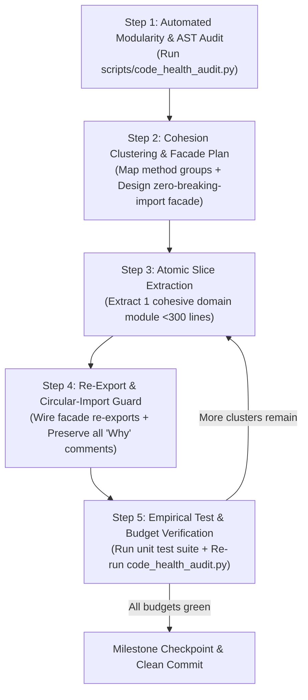

# Refactor Monolith: Safe Decomposition & Modularity Engine

The **Refactor Monolith** skill provides a deterministic, zero-regression workflow for auditing codebase modularity and decomposing oversized "God Files" and "God Classes" into cohesive, maintainable modules.

Why do naive file-splitting attempts fail?
1. **Broken Import Graphs**: Moving classes or functions to new files without leaving backward-compatible re-export facades breaks downstream callers and test suites across the repository.
2. **Big-Bang Rewrite Risk**: Splitting a 2,000-line file into 8 files in a single unverified pass introduces subtle scope, circular import, and state-sharing bugs.
3. **Lost Domain Knowledge**: Hasty copy-pasting strips mathematical docstrings, edge-case comments, and historical context.

This skill eliminates those risks using the **Strangler-Fig Facade Protocol** and a built-in, zero-dependency cross-platform auditor (`scripts/code_health_audit.py`).

---

## Quantitative Modularity Budgets

Use these default thresholds (customizable via CLI flags) when auditing or decomposing any repository:

| Code Element | Healthy Target | Soft Warning (Refactor Trigger) | Hard Ceiling (Mandatory Split) | Remediation Strategy |
| :--- | :--- | :--- | :--- | :--- |
| **Source File** | 150 – 300 lines | **350 lines** | **500 lines** | Extract domain submodules (`routers/`, `services/`, `repositories/`, `components/`). |
| **Class** | 50 – 180 lines | **10 methods** (or 200 lines) | **12 methods** (or 300 lines) | Decompose into focused collaborator classes, domain services, or cohesive mixins. |
| **Function / Method** | 10 – 25 lines | **30 lines** | **40 lines** | Extract pure helper functions; replace deep nesting with guard clauses or strategy tables. |
| **Route / Controller** | 5 – 15 lines | **15 lines** | **25 lines** | Keep handlers thin: parse request, call a domain service, and return the response. |

---

## The 5-Step Zero-Regression Decomposition Workflow



### Step 1: Automated Modularity & AST Audit
Never guess which files or classes exceed budgets. Run the standalone cross-platform auditor in `<skill_dir>/scripts/code_health_audit.py`:

```bash
# Audit top oversized files, classes, and functions in any repository
python "<skill_dir>/scripts/code_health_audit.py" --path <target_repo_or_dir> --top 15

# Inspect exact class method counts and oversized functions inside a specific file
python "<skill_dir>/scripts/code_health_audit.py" --path <target_file> --show-methods
```

### Step 2: Cohesion Clustering & Facade Design (Plan-First)
Before moving a single line of code, inspect the target file and group its functions, routes, or methods into **cohesive domain clusters** *(see [references/decomposition-patterns.md](./references/decomposition-patterns.md) for language- and layer-specific blueprints)*:

1. **Identify Responsibility Clusters**:
   - *Web / API Monoliths*: Group endpoints by resource noun (`auth`, `users`, `streams`, `system`, `metrics`) and separate HTTP transport (`routers/`) from business orchestration (`services/`).
   - *Data / Persistence Monoliths*: Separate connection lifecycle/schema migrations from domain-specific CRUD queries (`repositories/` or cohesive domain mixins).
   - *Core / Domain Monoliths*: Separate pure mathematical/geometric primitives, data models/DTOs, state machines, and I/O adapters.
   - *Frontend Script & Style Monoliths*: Split by UI feature or component (`modules/`, `components/`) and extract shared state/API clients.
2. **Enforce the Zero-Breaking-Import Contract**:
   - External modules and existing unit tests almost certainly import symbols from the original file path (e.g., `from pkg.module import MainClass, helper_fn`).
   - **Rule**: Always keep the original module path (or convert `module.py` into a package `module/__init__.py`) and **re-export** moved classes/functions in `__all__` (or `export * from ...` in TypeScript/ES6) so 100% of existing imports continue working without modification.
3. **Present an Implementation Plan**:
   - For multi-file decompositions, present a concise plan showing the source monolith, the proposed target submodules (each targeted at 150–300 lines), the re-export facade strategy, and the verification command.

### Step 3: Atomic Slice Extraction (One Cluster at a Time)
Never shatter a 2,000-line file into 10 files simultaneously. Extract **one cohesive cluster per slice**:
1. Create the new focused module (e.g., `services/metrics_service.py` or `repositories/user_repo.py`).
2. Move the cohesive functions/methods and their required imports into the new module.
3. **Strictly Preserve Comments & Docstrings**: Carry over every single docstring, mathematical formula annotation, edge-case explanation, and reference URL verbatim.
4. Keep every newly created file well below the **350-line soft limit** and every class $\le$ **10–12 methods**.

### Step 4: Wire Facade & Guard Against Circular Imports
1. Import the extracted module back into the original facade file (or register the router/blueprint/mixin).
2. **Prevent Circular Dependencies**:
   - Dependency flow must be strictly unidirectional: `Routers / UI -> Services / Use-Cases -> Repositories / Models -> Pure Utils / Types`.
   - Submodules must **never** import back from the top-level monolith facade; shared constants, types, or base classes must live in a leaf module (`types.py`, `base.py`, `constants.py`).

### Step 5: Closed-Loop Test & Budget Verification
After **each individual extraction slice**:
1. Run the project's automated test suite (`pytest`, `python -m unittest discover tests`, `npm test`, `dart test`, `go test ./...`) to confirm zero regressions.
2. Re-run `code_health_audit.py` on the modified directory to verify line counts and method counts are trending down and no newly created file breaches the 350-line warning threshold.

---

## Pre-Run Verification & Scenario Combinations Matrix

### Pre-Run Verification One-Liners
```bash
# 1. Verify auditor CLI readiness
python "<skill_dir>/scripts/code_health_audit.py" --help

# 2. Run a self-check on the refactor-monolith skill directory itself
python "<skill_dir>/scripts/code_health_audit.py" --path "<skill_dir>" --strict

# 3. Run the automated unit test suite
python -m unittest discover -s "<skill_dir>/tests" -v
```

### Scenario Combinations Matrix
| Scenario / Objective | Mode / Target | Key Parameters | Exact Runnable Command |
| :--- | :--- | :--- | :--- |
| **Quick Repository Triage** | Top 15 largest files & God classes | `--path <dir> --top 15` | `python "<skill_dir>/scripts/code_health_audit.py" --path . --top 15` |
| **Deep Single-File Inspection** | Method & function breakdown | `--path <file> --show-methods` | `python "<skill_dir>/scripts/code_health_audit.py" --path src/app.py --show-methods` |
| **Custom Strictness Thresholds** | Stricter file & class caps | `--warn-file-lines 250 --max-class-methods 8` | `python "<skill_dir>/scripts/code_health_audit.py" --path src --warn-file-lines 250 --max-class-methods 8` |
| **Machine-Readable CI Output** | JSON report for automation | `--path <dir> --json` | `python "<skill_dir>/scripts/code_health_audit.py" --path src --json` |
| **Pre-Commit Enforcement Gate** | Non-zero exit code on hard breach | `--path <dir> --strict` | `python "<skill_dir>/scripts/code_health_audit.py" --path src --strict` |

---

## Built-In Scripts, Tests & Reference Library

- **[`scripts/code_health_audit.py`](./scripts/code_health_audit.py)**: Standalone, zero-dependency, cross-platform (Windows, macOS, Linux) modularity and AST auditor. Measures source file line counts across `.py`, `.js`, `.ts`, `.tsx`, `.jsx`, `.css`, `.scss`, `.dart`, `.go`, `.rs`, and `.cs`, and performs deep AST analysis on Python files to report class method counts, class line spans, and oversized functions.
- **[`tests/test_code_health_audit.py`](./tests/test_code_health_audit.py)**: Full automated regression test suite covering AST parsing, classification thresholds, directory pruning, and CLI execution.
- **[`evals/evals.json`](./evals/evals.json)**: Verification scenarios and expected outputs for continuous quality benchmarking.
- **[`references/decomposition-patterns.md`](./references/decomposition-patterns.md)**: Consult during Step 2 and Step 3 for concrete, language-agnostic architectural patterns to split monolithic web routers, God classes, persistence layers, and frontend bundles without breaking callers.
