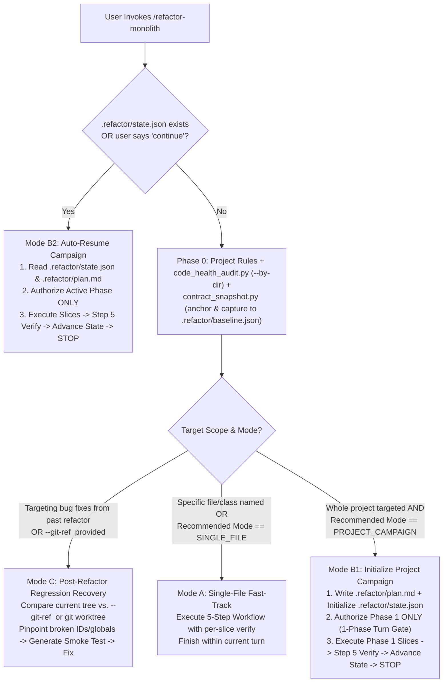

# Refactor Monolith: Adaptive Decomposition, Parity & Modularity Engine

The **Refactor Monolith** skill provides a deterministic, 100% self-contained workflow for auditing codebase modularity, decomposing oversized "God Files" and "God Classes", and guaranteeing **zero behavioral regressions** across both backend endpoints and frontend DOM interactions.

Why do naive file-splitting attempts fail?
1. **The Frontend Test Blindspot**: Backend unit tests pass 100% while subtle UI behaviors break because element IDs (`getElementById`), global `window.*` exports, inline `on*=` handlers, or `<script>` load orders are silently dropped or renamed during decomposition.
2. **Context-Exhausting Single Turns**: Attempting to execute an entire 4-phase, 15-slice migration in a single turn burns millions of tokens and causes attention degradation.
3. **Broken Import Graphs & Circular Dependencies**: Moving classes or routes without backward-compatible re-export facades breaks downstream callers.
4. **Ad-Hoc Shell Line-Counting Thrashing**: Abandoning structured audit CLIs for fragile inline PowerShell/Python commands causes quoting and syntax failures.
5. **The Cross-Chat Context Gap**: Writing plans exclusively to ephemeral session artifact folders forces users to manually download and re-paste plans in subsequent chats.
6. **Workspace Tooling Pollution**: Copying internal skill audit scripts into the target project's `scripts/` directory pollutes git repositories with non-domain tools.

This skill eliminates those risks with **Zero-Token Structural Auditing** (`scripts/code_health_audit.py`), **Full-Surface Contract Snapshots** (`scripts/contract_snapshot.py`), **Standardized In-Repo `.refactor/` State Anchoring**, **1-Phase Turn Gates**, **Git Worktree Recipes**, and the **"Best Working Version" Bailout Guarantee**.

---

## Quantitative Modularity Budgets

| Code Element | Healthy Target | Soft Warning (Refactor Trigger) | Hard Ceiling (Mandatory Split) | Remediation Strategy |
| :--- | :--- | :--- | :--- | :--- |
| **Source File** | 150 – 300 lines | **350 lines** | **500 lines** | Extract domain submodules (`routers/`, `services/`, `repositories/`, `components/`). |
| **Class / Struct / Group** | 50 – 180 lines | **10 methods** (or 200 lines) | **12 methods** (or 300 lines) | Decompose into focused collaborator classes, domain services, or cohesive mixins. |
| **Function / Method / Rule** | 10 – 25 lines | **30 lines** | **40 lines** | Extract pure helper functions; replace deep nesting with guard clauses or strategy tables. |
| **Route / Controller** | 5 – 15 lines | **15 lines** | **25 lines** | Keep handlers thin: parse request, call a domain service, and return the response. |

---

## The Standardized `.refactor/` Workspace Architecture

To guarantee zero workspace pollution and instant continuation across fresh conversation chats, all persistent refactoring metadata lives in `<workspace>/.refactor/`:

```text
<workspace>/.refactor/
├── state.json          # Machine-readable campaign state (active phase, plan path, commit SHAs)
├── plan.md             # The multi-phase architectural roadmap (resumable across fresh chats)
├── baseline.json       # Pre-refactor golden contract snapshot (DOM IDs, selects, routes, CSS)
├── scripts/            # Temporary project-specific refactor helpers (NEVER placed in repo scripts/)
├── artifacts/          # Intermediate refactoring scratch notes, AST dumps, or post-mortems
└── .gitignore          # Auto-created gitignore protecting ephemeral artifacts and helpers (*, !.gitignore)
```

> [!IMPORTANT]
> **Zero-Pollution & Anti-Vendoring Mandate**:
> 1. **NEVER copy skill scripts** (`code_health_audit.py`, `contract_snapshot.py`, `surface_scanners.py`) into the user's `<workspace>/scripts/` directory. Run them directly from `<skill_dir>/scripts/...` during the agent's turn.
> 2. Any custom scratch scripts or one-off extraction helpers created during refactoring must be placed in `.refactor/scripts/` (if needed for the refactor process but not to be committed).
> 3. Any intermediate artifacts, AST dumps, or refactor logs should be placed in `.refactor/artifacts/`.
> 4. In committed project documentation (`MIGRATION_LOG.md`, `README.md`, `milestone_plan.md`), only reference OS-agnostic native project test commands (`python -m unittest discover tests`, `pytest tests/`).

---

## Phase 0: Project Rules Check, Scope Detection & Baseline Anchor

Always execute these four zero-overhead steps before modifying any code:

1. **Check for Existing Campaign (`.refactor/state.json`)**:
   - Check if `<workspace>/.refactor/state.json` exists or if the user invoked `/refactor-monolith continue` or `resume`.
   - If active campaign exists: run `python "<skill_dir>/scripts/contract_snapshot.py" state --show` to read the active phase and jump directly to **Mode B2 (Auto-Resume Next Phase)**.
2. **Respect Project Memory & Rules (`AGENTS.md` / `.agents/rules/`)**:
   - Check if the workspace has an `AGENTS.md`, `CLAUDE.md`, `GEMINI.md`, or `.agents/rules/` directory. Honor established conventions.
3. **Run the Multi-Language Structural Auditor (`scripts/code_health_audit.py`)**:
   - Run `python "<skill_dir>/scripts/code_health_audit.py" --path <target_dir> --by-dir` to inspect lines grouped by directory.
   - Use multi-target syntax `--path <dir1> <dir2> ...` to audit multiple subdirectories or files simultaneously.
   - Use `--compact` for quick file status, or `--split-preview <file>:<line>[:window]` to preview lines around extraction points.
   - **Strict Rule**: Never write ad-hoc PowerShell or Python inline scripts to count lines; always use `code_health_audit.py`.
4. **Anchor Git State & Capture Pre-Refactor Contract (`scripts/contract_snapshot.py`)**:
   - Run `python "<skill_dir>/scripts/contract_snapshot.py" anchor --path <target_dir>` to record the clean Git SHA and worktree recipe.
   - Run `python "<skill_dir>/scripts/contract_snapshot.py" capture --path <target_dir>` (defaults automatically to `.refactor/baseline.json`) to lock in all DOM element IDs, `<select>` dropdowns, `window.*` exports, inline handlers, and API routes before a single line is edited.



---

## Execution Modes & Turn-Boundary Discipline

### Mode A: Single-File Fast-Track (`SINGLE_FILE`)
- **Trigger**: Specific file/class named **OR** `code_health_audit.py` reports `Recommended Mode: SINGLE_FILE` ($\le 2$ critical files).
- **Action**: Outline cohesion clusters concisely, extract submodules one by one, run `contract_snapshot.py verify` after each slice, and complete in the current turn.

### Mode B1: Initialize Project Campaign (`PROJECT_CAMPAIGN`)
- **Trigger**: Entire project targeted **AND** `code_health_audit.py` reports `Recommended Mode: PROJECT_CAMPAIGN` ($> 2$ critical files).
- **The 1-Phase-Per-Turn Execution Rule**:
  - **Never execute all 4 phases in a single turn.** Attempting mega-executions burns context and compounds regressions.
  - In the implementation plan, present the full 4-phase roadmap but **explicitly state that clicking 'Proceed' authorizes only Phase 1**. Mark Phases 2–4 as *Deferred to Next Turn*.
  - Save the plan to `.refactor/plan.md` (or workspace root `dashboard_refactor_plan.md`) so it survives chat resets.
  - Initialize campaign tracking:
    ```bash
    python "<skill_dir>/scripts/contract_snapshot.py" state --init --target <target_dir> --plan .refactor/plan.md --phases 4 --phase-title "<Phase 1 Title>"
    ```
  - When Phase 1 completes Step 5 verification:
    ```bash
    python "<skill_dir>/scripts/contract_snapshot.py" state --advance --phase 1
    ```
  - Update `MIGRATION_LOG.md`, present the clean commit command, and **stop**. Advise the user to commit and start a fresh turn:
    > *"To proceed with Phase 2 in a fresh conversation, start a new chat and run: `/refactor-monolith continue`"*

### Mode B2: Auto-Resume Campaign (`CAMPAIGN_RESUME`)
- **Trigger**: User starts a fresh chat and runs `/refactor-monolith continue`, `/refactor-monolith resume`, or invokes the skill with an active `.refactor/state.json`.
- **Workflow**:
  1. Inspect campaign state: `python "<skill_dir>/scripts/contract_snapshot.py" state --show`.
  2. Read `.refactor/plan.md` to load the objectives and file targets for the active phase.
  3. Report resumption to the user: *"Resuming refactoring campaign for `<target>` at Phase X (`<Title>`). Authorizing Phase X only."*
  4. Execute active phase slices -> run Step 5 verification ladder -> advance state via `state --advance` -> present commit command and stop.

### Mode C: Post-Refactor Regression Recovery (`REGRESSION_RECOVERY`)
- **Trigger**: The user reports that a previous refactor broke functionality (e.g. dropdowns, modals, event listeners), or asks to diagnose/remedy refactoring regressions.
- **Workflow**:
  1. Identify the pre-refactor golden commit SHA (e.g. `HEAD~1` or pre-refactor commit).
  2. Run `python "<skill_dir>/scripts/contract_snapshot.py" verify --path . --git-ref <pre_refactor_sha> --strict` to immediately pinpoint every renamed ID, dropped `window.*` export, and broken handler.
  3. Optionally spin up a parallel worktree (`git worktree add ../pre_refactor <sha>`) for side-by-side behavioral comparison.
  4. Generate a permanent contract smoke test (`contract_snapshot.py generate-smoke-test --path <target_dir>`) to lock in the required invariants.
  5. Apply surgical fixes to restore all missing IDs, `window.*` exports, and event bindings.

---

## The 5-Step Zero-Regression Decomposition Workflow

### Step 1: Zero-Token Structural & Directory Audit
```bash
# Check directory-level line aggregation and breach summary
python "<skill_dir>/scripts/code_health_audit.py" --path <target_dir> --by-dir

# Inspect class/method/rule details of the active file
python "<skill_dir>/scripts/code_health_audit.py" --path <target_file> --show-methods

# Audit multiple targets simultaneously
python "<skill_dir>/scripts/code_health_audit.py" --path <file1> <dir2>
```

### Step 2: Cohesion Clustering, Surface Map & Facade Design
1. **Interactive Surface Map**: Run `python "<skill_dir>/scripts/contract_snapshot.py" inspect --path <target_dir>` (or pass `--show-routes` to list all backend endpoints with line ranges and handlers) to catalog all `<select>` IDs, modals, inline handlers, global exports, and API routes before modifying code.
2. **Load On-Demand References**:
   - Web routes, God classes, and DAG rules: [`references/decomposition-patterns.md`](./references/decomposition-patterns.md).
   - Non-Python files (`.js`, `.ts`, `.css`, `.dart`, `.go`, `.rs`, `.cs`): [`references/language-playbooks.md`](./references/language-playbooks.md).
3. **The Zero-Breaking-Import & Zero-Broken-DOM Invariant**:
   - Python: Keep original module path as a re-export facade; use the **Bidirectional Proxy Pattern** in `dependencies.py` if tests monkeypatch module globals.
   - JavaScript (Vanilla): Never rename DOM element IDs; preserve all `window.<Namespace>` exports; ensure `<script src="...">` load order satisfies dependencies.

### Step 3: Atomic Slice Extraction (One Cluster at a Time)
1. Create the new module below the **350-line target** (classes $\le 10$–$12$ methods, functions $\le 40$ lines).
2. Move cohesive logic and imports. Use `--split-preview <file>:<line>` to check boundaries safely.
3. **Preserve Comments & Math**: Carry over all mathematical formulas, OpenCV coordinates, and rationale verbatim.
4. **CRLF Line-Ending Resilience on Windows**: If modifying existing files on Windows, beware of CRLF (`\r\n`) line endings that cause `edit_file` target mismatches. Keep edits focused or normalize file line endings cleanly.

> [!WARNING]
> **Anti-Mega-Batch Rule (Atomic Slicing Gate)**:
> Never write or generate more than 1–2 files/routers in a single step without testing imports or contract parity.
> Writing 8–12 files in a single uninterrupted burst introduces massive compound risk: if any import or signature fails, diagnosing across 12 newly created files simultaneously burns tens of thousands of tokens in backtracking.
> Always sequence slices:
> `Slice 1 (Dependencies / Schemas) -> Verify Contract -> Slice 2 (Router 1-2) -> Verify Contract -> Slice 3 (Remaining Routers) -> Wire Facade & Parity`.

### Step 4: Wire Facade & Per-Slice Contract Verification
1. Re-export extracted symbols in the monolith facade.
2. Guard against circular imports: enforce strict DAG (`Facade -> Routers/UI -> Services -> Repositories -> Leaf Utils`).
3. **Immediate Slice Verification**:
   ```bash
   python "<skill_dir>/scripts/contract_snapshot.py" verify --path <target_dir> --strict
   ```
   If any DOM ID was dropped or global export lost, fix it *now* before starting the next slice.

### Step 5: 3-Tier Closed-Loop Verification Ladder

Execute verification in three strictly ordered tiers:

```text
Tier 1: Static Contracts & Automated Tests (Always, 100% Self-Contained)
  ├── 1. Automated unit test suite (pytest, python -m unittest discover tests, npm test)
  ├── 2. Structural line budgets (code_health_audit.py --path <target_dir> --strict)
  ├── 3. DOM & API contract parity (contract_snapshot.py verify --path <target_dir> --strict)
  └── 4. Generate permanent regression test (contract_snapshot.py generate-smoke-test --path <target_dir>)

Tier 2: Container Sync Audit (If Docker / Containerized)
  └── Probe docker_audit.py (via probe-tools) to verify host-to-container MD5 sync and zero CPU runaway.

Tier 3: Live Browser Verification & Remote Debugging Protocol (If UI Touched)
  ├── 1. Check if cdp_inspect.py is discovered via probe-tools.
  ├── 2. Probe if $APP_URL is reachable.
  └── 3. Pre-Flight Pause Protocol: If unreachable or Chrome remote debugging requires authorization ("Allow" banner):
         Pause and prompt the user via ask_question:
         - Option 1: "I have started the server and approved the remote debugging prompt — proceed with live check."
         - Option 2: "Proceed using self-contained static contract verification."
  └── 4. Axiom 9 Honest Reporting: If Option 2 is chosen, explicitly state:
         "Static Contract: VERIFIED | Live Browser: UNVERIFIED (Server offline / remote debugging unattached)."
```

> [!IMPORTANT]
> **Reactive Wakeup & Anti-Polling Mandate**:
> When running long-running verification suites or builds asynchronously via `run_command` (`WaitMsBeforeAsync`), **NEVER poll `manage_task(Action='status')` in a loop**. Polling burns tens of thousands of context tokens while holding the execution thread.
> - Either proceed with independent static work (documentation drafts, auditing other directories).
> - Or simply **end your turn by calling no more tools** and let the system reactively notify you when the background task completes.

> [!TIP]
> **Virtual Environment Awareness**:
> Run `python "<skill_dir>/scripts/contract_snapshot.py" probe-tools --path <target_dir>` to check for local `.venv`, `venv`, or `env` interpreters. If a virtual environment is detected, invoke its Python interpreter (e.g. `.\\.venv\\Scripts\\python.exe` or `./.venv/bin/python`) when running local test suites to prevent `ModuleNotFoundError` on workspace packages.

---

## Anti-Thrash Stop-Loss & "Best Working Version" Safe Bailout

1. **Performance Guard ("Do No Harm")**: Never artificially split a hot path (NumPy array mutations, video frame loops, tight DSP). Apply the **Hot/Cold Split**: keep the hot loop cohesive, extract only cold helpers.
2. **Anti-Thrash Stop-Loss**: If a slice fails tests or contract parity twice in a row, stop editing immediately.
3. **The "Leave at Best Working Version" Bailout**:
   - If a complex split resists clean extraction without fragile hacks:
     1. Revert unstable edits immediately (`git checkout -- <files>` or remove partial submodules).
     2. Restore the last verified working version.
     3. Explain the structural invariant to the user and recommend keeping the file at its best working version.

---

## Pre-Run Verification & Scenario Combinations Matrix

### Pre-Run Verification One-Liners
```bash
# 1. Verify auditor and snapshot CLI readiness
python "<skill_dir>/scripts/code_health_audit.py" --help
python "<skill_dir>/scripts/contract_snapshot.py" --help

# 2. Run self-check on skill directory itself
python "<skill_dir>/scripts/code_health_audit.py" --path "<skill_dir>" --strict
python -m unittest discover -s "<skill_dir>/tests" -v
```

### Scenario Combinations Matrix
| Scenario / Objective | Mode / Target | Key Parameters | Exact Runnable Command |
| :--- | :--- | :--- | :--- |
| **Directory-Level Triage** | Group line counts by subfolder | `--path <dir> --by-dir` | `python "<skill_dir>/scripts/code_health_audit.py" --path . --by-dir` |
| **Multi-Target Audit** | Multiple files/dirs in one run | `--path <f1> <d2>` | `python "<skill_dir>/scripts/code_health_audit.py" --path src/main.py src/services/` |
| **Split Point Preview** | View lines around split safely | `--split-preview <file>:<line>[:window]` | `python "<skill_dir>/scripts/code_health_audit.py" --split-preview src/app.py:280:10` |
| **Record Reference Anchor & Worktree** | Git commit anchor & parallel worktree recipe | `anchor --path <dir>` | `python "<skill_dir>/scripts/contract_snapshot.py" anchor --path .` |
| **Capture Baseline Contract** | Snapshot to .refactor/baseline.json | `capture --path <dir>` | `python "<skill_dir>/scripts/contract_snapshot.py" capture --path .` |
| **Interactive Surface Map** | Inventory of selects, modals, globals, routes | `inspect --path <dir>` | `python "<skill_dir>/scripts/contract_snapshot.py" inspect --path .` |
| **Init Campaign State** | Track campaign in .refactor/state.json | `state --init` | `python "<skill_dir>/scripts/contract_snapshot.py" state --init --target <dir> --plan .refactor/plan.md --phases 4` |
| **Show Campaign Progress** | Check active phase and status | `state --show` | `python "<skill_dir>/scripts/contract_snapshot.py" state --show` |
| **Advance Campaign Phase** | Mark phase complete and advance | `state --advance` | `python "<skill_dir>/scripts/contract_snapshot.py" state --advance --phase 1` |
| **Per-Slice & Checkpoint Verification** | Diff against baseline contract | `verify --path <dir> --strict` | `python "<skill_dir>/scripts/contract_snapshot.py" verify --path <dir> --strict` |
| **Post-Refactor Regression Audit** | Diff live tree directly against pre-refactor Git SHA | `verify --path <dir> --git-ref <sha> --strict` | `python "<skill_dir>/scripts/contract_snapshot.py" verify --path . --git-ref HEAD~1 --strict` |
| **Generate Scoped Contract Test** | Emit unittest regression suite scoped to target | `generate-smoke-test --path <dir>` | `python "<skill_dir>/scripts/contract_snapshot.py" generate-smoke-test --path <dir> --out tests/test_refactor_contract.py` |
| **Discover Optional Tools** | Probe cdp_inspect & docker_audit | `probe-tools` | `python "<skill_dir>/scripts/contract_snapshot.py" probe-tools` |
| **Pre-Commit Strict Gate** | Exit 1 on critical breach | `--path <dir> --strict` | `python "<skill_dir>/scripts/code_health_audit.py" --path src --strict` |

---

## Built-In Scripts, Tests & On-Demand Reference Library

- **[`scripts/code_health_audit.py`](./scripts/code_health_audit.py)**: Standalone multi-language structural auditor. Supports multi-target `--path`, `--by-dir`, `--compact`, `--split-preview`, and prunes vendor/minified assets and `.refactor`.
- **[`scripts/surface_scanners.py`](./scripts/surface_scanners.py)**: Zero-dependency surface scanners extracting DOM IDs, interactive selects, inline handlers, `window.*` globals, Python routes, mutable globals, and CSS custom properties.
- **[`scripts/contract_snapshot.py`](./scripts/contract_snapshot.py)**: Baseline contract snapshotter, Git worktree anchor, regression diff engine, and auxiliary tool probe.
- **[`scripts/campaign_manager.py`](./scripts/campaign_manager.py)**: Persistent cross-turn `.refactor/state.json` campaign manager and directory provisioner.
- **[`scripts/smoke_test_generator.py`](./scripts/smoke_test_generator.py)**: Automated regression-locking unittest generator enforcing DOM and CSS contract invariants.
- **[`scripts/language_analyzers.py`](./scripts/language_analyzers.py)**: Multi-language AST, brace, and stylesheet parsers for Python, JS/TS, Dart, Go, Rust, and C#.
- **[`tests/test_code_health_audit.py`](./tests/test_code_health_audit.py)**: Automated regression test suite for structural parsing, multi-target audit, and `.refactor` pruning.
- **[`tests/test_contract_snapshot.py`](./tests/test_contract_snapshot.py)**: Automated regression tests for DOM ID parity, campaign state lifecycle, scoped smoke tests, and regression detection.
- **[`references/decomposition-patterns.md`](./references/decomposition-patterns.md)**: Web routers, God classes, Bidirectional Proxy Pattern for monkeypatched globals, and circular dependency rules.
- **[`references/language-playbooks.md`](./references/language-playbooks.md)**: Vanilla JS invariants, ITCSS stylesheet decomposition, Go/Rust/Dart/C# playbooks, and safe rollback recipes.
