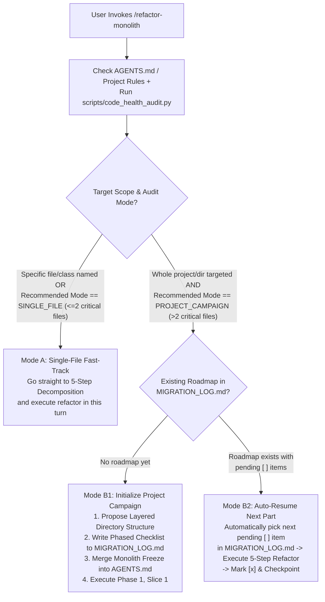

# Refactor Monolith: Adaptive Decomposition & Modularity Engine

The **Refactor Monolith** skill provides a deterministic, 100% self-contained workflow for auditing codebase modularity and decomposing oversized "God Files" and "God Classes" into cohesive, maintainable modules—whether the user wants to **refactor a single file immediately** or **migrate an entire multi-language project part-by-part**.

Why do naive file-splitting attempts fail?
1. **Broken Import Graphs**: Moving classes, functions, or components without backward-compatible re-export facades breaks downstream callers and test suites.
2. **Vendor & Compiled Asset Traps**: Blindly refactoring third-party libraries (`slick.js`, `bootstrap.css`) or compiled outputs (`main.css` generated from `scss/`) wastes tokens and corrupts upstream dependencies.
3. **Big-Bang Rewrite Risk**: Splitting a 2,000-line file—or 12 files across a repo—in one unverified pass introduces circular dependencies, cascade regressions, and context exhaustion.
4. **Lost Domain Knowledge**: Hasty copy-pasting strips mathematical docstrings, edge-case comments, and historical rationale.

This skill eliminates those risks with **Zero-Token Multi-Language Structural Auditing** (`scripts/code_health_audit.py`), **Adaptive Scope Routing**, **On-Demand Language Playbooks**, and the **"Best Working Version" Bailout Guarantee**.

---

## Quantitative Modularity Budgets

Use these default thresholds (customizable via CLI flags or project `AGENTS.md`) when auditing or decomposing any repository:

| Code Element | Healthy Target | Soft Warning (Refactor Trigger) | Hard Ceiling (Mandatory Split) | Remediation Strategy |
| :--- | :--- | :--- | :--- | :--- |
| **Source File** | 150 – 300 lines | **350 lines** | **500 lines** | Extract domain submodules (`routers/`, `services/`, `repositories/`, `components/`). |
| **Class / Struct / Group** | 50 – 180 lines | **10 methods** (or 200 lines) | **12 methods** (or 300 lines) | Decompose into focused collaborator classes, domain services, or cohesive mixins. |
| **Function / Method / Rule** | 10 – 25 lines | **30 lines** | **40 lines** | Extract pure helper functions; replace deep nesting with guard clauses or strategy tables. |
| **Route / Controller** | 5 – 15 lines | **15 lines** | **25 lines** | Keep handlers thin: parse request, call a domain service, and return the response. |

---

## Phase 0: Project Rules Check & Adaptive Scope Detection

Always begin with two zero-overhead checks before touching any code:

1. **Respect Project Memory & Rules (`AGENTS.md` / `.agents/rules/`)**:
   - Check if the workspace has an `AGENTS.md`, `CLAUDE.md`, `GEMINI.md`, or `.agents/rules/` directory.
   - **Project rules win**: Honor established directory conventions, test commands, linter rules, and modularity overrides. When updating `AGENTS.md`, **merge** new section maps cleanly—never overwrite existing team rules.
2. **Run the Multi-Language Auditor (`scripts/code_health_audit.py`)**:
   - The auditor automatically filters out third-party vendor/minified/generated files (`slick.js`, `*.min.js`, `bootstrap/`, `migrations/`) and extracts structural metrics using four zero-dependency modes:
     - `ast`: Deep Python AST class/method/function analysis (`.py`).
     - `brace`: Zero-token class, struct, `impl`, React component, and method span analysis (`.js`, `.ts`, `.tsx`, `.jsx`, `.dart`, `.go`, `.rs`, `.cs`).
     - `stylesheet`: CSS/SCSS section header, `:root`, `@media`/`@keyframes`, and selector prefix cluster analysis (`.css`, `.scss`, `.less`).
     - `fallback`: Heuristic keyword/block span detection for unfamiliar languages.



### Mode A: Single-File / Small-Scope Fast-Track (`SINGLE_FILE`)
- **Trigger**: The user names a specific file/class (e.g., *"split `server.py`"*, *"refactor `DataStore`"*) **OR** `code_health_audit.py` reports `Recommended Mode: SINGLE_FILE` ($\le 2$ critical files).
- **Action**: Do **not** generate multi-file project roadmaps. Immediately run `code_health_audit.py --path <target_file> --show-methods`, outline the cohesion clusters and facade re-export plan concisely, and **execute the 5-Step Decomposition Workflow directly**.

### Mode B: Project-Wide Phased Campaign & Auto-Resume (`PROJECT_CAMPAIGN`)
- **Trigger**: The user targets an entire repository/directory or asks to *"refactor the project"* / *"continue the migration"*, **AND** `code_health_audit.py` reports `Recommended Mode: PROJECT_CAMPAIGN` ($> 2$ critical files).
- **Action**:
  1. **Check `MIGRATION_LOG.md` First (Zero-Prompt Auto-Resume)**:
     - If `MIGRATION_LOG.md` already contains a Monolith Decomposition Roadmap with unchecked `[ ]` milestones, **automatically select the next unchecked milestone** without asking the user which file to do next. Announce the selected milestone and execute it via the 5-Step Workflow.
  2. **Initialize the Project Architecture & Roadmap (If Not Yet Created)**:
     - Establish or refine the project's **Recommended Layered Structure** (adapting idioms to the project's language/framework):
       - **Level 0 — Leaf Models, Schemas & Pure Utils** (`models/`, `schemas/`, `utils/`): Zero internal service/router imports.
       - **Level 1 — Persistence & External Adapters** (`repositories/`, `clients/`): Focused data access modules or domain mixins ($\le 10$–$12$ methods per class).
       - **Level 2 — Domain Services & Core Workers** (`services/`, `core/`, `workflows/`): Business orchestration and state machines decoupled from HTTP/UI.
       - **Level 3 — Transport, Routers & UI Components** (`routers/`, `controllers/`, `views/`, `components/`, `static/css/components/`): Thin handlers ($\le 15$–$25$ lines) and modular frontend assets.
       - **Level 4 — Entrypoints & Facades** (`app.py`, `__init__.py`, `index.ts`, `mod.rs`): App factory, router mounting, and backward-compatible re-exports.
     - Group first-party breached files (excluding compiled outputs that have upstream sources like `scss/` $\rightarrow$ `main.css`) into **4 Dependency-Ordered Phases** (Phase 1: Persistence & Leaf Primitives $\rightarrow$ Phase 2: Core Domain & Workers $\rightarrow$ Phase 3: API Routers & Entrypoints $\rightarrow$ Phase 4: Frontend Scripts & Styles) and write the checklist to `MIGRATION_LOG.md`.
     - Merge a **Monolith Freeze & Target Directory Map** into `AGENTS.md` so concurrent feature work never re-bloats frozen files.
     - **Execute Phase 1, Slice 1 immediately** (or pause for user approval if major architectural ambiguity exists), verify all tests pass, and mark `[x]` in `MIGRATION_LOG.md`.

---

## The 5-Step Zero-Regression Decomposition Workflow

Whether executing a single file in **Mode A** or the active milestone slice in **Mode B**, follow these 5 steps rigorously:

### Step 1: Zero-Token Structural Audit
Run `scripts/code_health_audit.py` to get the structural outline without reading thousands of raw lines into context:

```bash
# Audit repository (auto-prunes vendor/minified files) and detect Recommended Mode
python "<skill_dir>/scripts/code_health_audit.py" --path <target_repo_or_dir> --top 15

# Inspect exact class/struct/selector clusters and oversized functions inside the target file
python "<skill_dir>/scripts/code_health_audit.py" --path <target_file> --show-methods
```

### Step 2: Cohesion Clustering, Language Playbook Selection & Facade Design
1. **Load Only the Needed Reference (Token Hygiene)**:
   - For general architecture, routers, God classes, and DAG rules: consult [`references/decomposition-patterns.md`](./references/decomposition-patterns.md).
   - **Only when the active file is non-Python** (`.js`, `.ts`, `.tsx`, `.jsx`, `.css`, `.scss`, `.dart`, `.go`, `.rs`, `.cs`) or `Parser: fallback`: load [`references/language-playbooks.md`](./references/language-playbooks.md) for language-native facade idioms and compiled-asset checks. Do **not** load it for Python-only tasks.
2. **Identify Responsibility Clusters**:
   - *Web / API Monoliths*: Group endpoints by resource noun and separate HTTP transport (`routers/`) from business orchestration (`services/`).
   - *Data / Persistence Monoliths*: Separate connection lifecycle/schema init from domain-specific CRUD queries (`repositories/` or cohesive domain mixins).
   - *Frontend Script & Style Monoliths*: Verify the file is not a compiled output of an upstream `.scss`/`.ts` source first; then split by UI component, custom hook, or ITCSS layer (`tokens`, `layout`, `components/`).
3. **Enforce the Zero-Breaking-Import Contract**:
   - Always keep the original module path (or convert `module.py` $\rightarrow$ `module/__init__.py`, `api.ts` $\rightarrow$ barrel `export *`, Rust `pub use`, Dart `export`/`part`, or Go/C# same-package/partial files) so 100% of existing imports and tests continue working unmodified.

### Step 3: Atomic Slice Extraction (One Cluster at a Time)
Extract **one cohesive cluster per slice**:
1. Create the new focused module below the **350-line soft limit**, with classes $\le$ **10–12 methods** and functions $\le$ **40 lines**.
2. Move the cohesive functions/methods/rules and their required imports.
3. **Strictly Preserve Comments & Docstrings**: Carry over every docstring, mathematical formula annotation, edge-case explanation, and reference URL verbatim.

### Step 4: Wire Facade & Guard Against Circular Imports
1. Re-export the extracted symbols in the original facade file (or mount the router/mixin/partial).
2. **Prevent Circular Dependencies**: Enforce a strict Directed Acyclic Graph (`Facade/Entrypoint -> Routers/UI -> Services -> Repositories -> Leaf Models/Utils`). Submodules must **never** import back from the top-level monolith facade.

### Step 5: Closed-Loop Test, Budget & Checkpoint Verification
After **each extraction slice**:
1. Run the project's automated test suite (`pytest`, `python -m unittest discover tests`, `npm test`, `dart test`, `go test ./...`, `cargo test`, `dotnet test`) to confirm zero regressions.
2. Re-run `code_health_audit.py` on the modified file and extracted submodules to verify line and method counts are within budget.
3. In **Mode B (`PROJECT_CAMPAIGN`)**, mark the completed slice `[x]` in `MIGRATION_LOG.md` with before/after line counts and note the next pending `[ ]` slice.

---

## Self-Contained Planner Adapter & "Best Working Version" Bailout Protocol

This skill is **100% self-contained** and requires no external skills to be installed. It also integrates cleanly with built-in slash commands (`/plan`, `/grill-me`), optional user-invoked skills, or language servers when available:

### 1. Pre-Flight Planner & Unknown-Language Guard (Never Act Blindly)
- **Explicit Planner or Interview Pairing**: If the user invokes `/plan`, `/grill-me`, a custom planning skill, or asks to *"plan first"* / *"interview me first"*:
  - **Plan-First (`/plan` or custom planner)**: Run `code_health_audit.py` first, then present Step 2 (Cohesion Clusters, Layered DAG, and Facade Blueprint) in a formal plan artifact (`RequestFeedback: true`) and **wait for user approval before editing files**.
  - **Decision Interview (`/grill-me` or ambiguity)**: Use `ask_question` to resolve domain boundary choices (e.g., mixins vs. services, upstream SCSS vs. compiled CSS) before coding.
- **Unfamiliar / `fallback` Languages**: When `code_health_audit.py` reports `Parser: fallback` or encounters an unfamiliar framework/DSL, **never guess module semantics or split blindly**. Check available compiler/LSP tools first, and if structural boundaries or import rules are uncertain, consult the user via `ask_question` or `/plan` before modifying code.

### 2. Mid-Execution Escalation, Performance Guard & "Leave at Best Working Version" Rule
Monitor every slice for these three conditions and act immediately:

1. **Performance or Quality Degradation Guard ("Do No Harm")**:
   - Evaluate whether splitting a block will produce a **slower, worse, or more fragile version**—such as breaking tight vectorized/numerical hot loops (NumPy/OpenCV/DSP/game loops), adding IPC/serialization overhead on latency-critical paths, or breaking CSS cascade specificity.
   - **Action**: Warn the user with concrete technical reasoning, keep the hot-path cohesive while extracting only peripheral cold helpers (CLI, config, I/O, telemetry), and propose a safer alternative.
2. **Anti-Thrash Stop-Loss ($\ge 2$ Consecutive Verification Regressions)**:
   - If unit tests, builds, or import checks fail twice in a row during a slice extraction, **stop editing immediately**—never make a third speculative guess on broken state.
3. **The "Leave at Best Working Version" Bailout Guarantee**:
   - When a complex split, fallback language case, or circular coupling resists clean extraction—or when the refactored result fails tests or fails to demonstrably improve maintainability over the previous state:
   - **Mandatory Action**:
     1. **Revert unstable edits immediately** (`git checkout -- <files>` or remove partial submodules) to restore the **best working previous version**.
     2. Explain clearly to the user what structural constraint or regression occurred.
     3. Recommend either **leaving the file at its best working version** or trying an alternative strategy via `/plan` or `/grill-me`—and **do not force further attempts unless the user explicitly instructs you to continue**.

---

## Pre-Run Verification & Scenario Combinations Matrix

### Pre-Run Verification One-Liners
```bash
# 1. Verify auditor CLI readiness
python "<skill_dir>/scripts/code_health_audit.py" --help

# 2. Run a strict self-check on the refactor-monolith skill directory itself
python "<skill_dir>/scripts/code_health_audit.py" --path "<skill_dir>" --strict

# 3. Run the automated unit test suite
python -m unittest discover -s "<skill_dir>/tests" -v
```

### Scenario Combinations Matrix
| Scenario / Objective | Mode / Target | Key Parameters | Exact Runnable Command |
| :--- | :--- | :--- | :--- |
| **Project Triage (Vendor-Pruned)** | Detect `SINGLE_FILE` vs `PROJECT_CAMPAIGN` | `--path <dir> --top 15` | `python "<skill_dir>/scripts/code_health_audit.py" --path . --top 15` |
| **Deep Single-File Inspection** | Method, struct, or CSS cluster breakdown | `--path <file> --show-methods` | `python "<skill_dir>/scripts/code_health_audit.py" --path src/app.py --show-methods` |
| **Include Vendor / Minified Assets** | Audit third-party & bundled files too | `--path <dir> --include-vendor` | `python "<skill_dir>/scripts/code_health_audit.py" --path . --include-vendor` |
| **Custom Strictness Thresholds** | Stricter file & class caps | `--warn-file-lines 250 --max-class-methods 8` | `python "<skill_dir>/scripts/code_health_audit.py" --path src --warn-file-lines 250 --max-class-methods 8` |
| **Machine-Readable CI Output** | JSON report with `recommended_mode` & `parser_mode` | `--path <dir> --json` | `python "<skill_dir>/scripts/code_health_audit.py" --path src --json` |
| **Pre-Commit Enforcement Gate** | Non-zero exit code on hard breach | `--path <dir> --strict` | `python "<skill_dir>/scripts/code_health_audit.py" --path src --strict` |

---

## Built-In Scripts, Tests & On-Demand Reference Library

- **[`scripts/code_health_audit.py`](./scripts/code_health_audit.py)**: Standalone, zero-dependency, cross-platform CLI auditor. Automatically detects `SINGLE_FILE` vs. `PROJECT_CAMPAIGN` mode, prunes vendor/minified files, and reports file, class, and function breaches.
- **[`scripts/language_analyzers.py`](./scripts/language_analyzers.py)**: Zero-dependency structural scanners for C-style brace languages (`.js`, `.ts`, `.tsx`, `.jsx`, `.dart`, `.go`, `.rs`, `.cs`), stylesheets (`.css`, `.scss`), unknown fallback languages, and vendor/generated file filters.
- **[`tests/test_code_health_audit.py`](./tests/test_code_health_audit.py)**: Automated regression test suite covering Python AST, multi-language brace/CSS/fallback parsing, vendor filtering, and CLI execution.
- **[`references/decomposition-patterns.md`](./references/decomposition-patterns.md)**: Consult during Step 2 and Step 3 for architectural patterns to split web routers, God classes, persistence layers, and circular dependency graphs.
- **[`references/language-playbooks.md`](./references/language-playbooks.md)**: Load **only on-demand** when decomposing non-Python files (`.js`/`.ts`/React, `.css`/`.scss`, `.dart`/Flutter, `.go`, `.rs`, `.cs`) or handling `fallback`/compiled assets.
