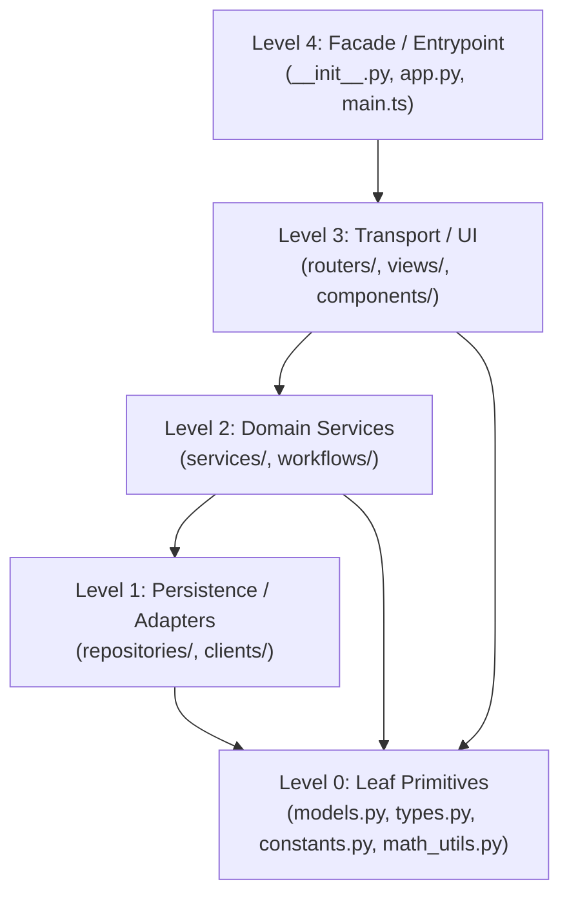

# Universal Decomposition Patterns for Monolithic Files & God Classes

This reference provides project-agnostic, language-transferable blueprints for decomposing oversized files (>350–500 lines) and God classes (>10–12 methods) while guaranteeing **zero breaking imports** for existing callers and tests.

---

## Table of Contents
1. [Pattern 1: The Package Facade Conversion (Zero Breaking Imports)](#1-pattern-1-the-package-facade-conversion-zero-breaking-imports)
2. [Pattern 2: Web & API Monolith Decomposition (Routers + Services)](#2-pattern-2-web--api-monolith-decomposition-routers--services)
3. [Pattern 3: God Class Decomposition (Composition vs. Cohesive Mixins)](#3-pattern-3-god-class-decomposition-composition-vs-cohesive-mixins)
4. [Pattern 4: Frontend Script & Stylesheet Decomposition](#4-pattern-4-frontend-script--stylesheet-decomposition)
5. [Circular Dependency Prevention Rules](#5-circular-dependency-prevention-rules)
6. [Performance Guards, Mid-Flight Escalation & Safe Revert ("Do No Harm")](#6-performance-guards-mid-flight-escalation--safe-revert-do-no-harm)

---

## 1. Pattern 1: The Package Facade Conversion (Zero Breaking Imports)

When a standalone module `pkg/core.py` (or `src/core.ts`) grows to 1,500 lines and dozens of external files import from `pkg.core`, you can split it transparently by converting the file into a directory package with the exact same import path:

### Before (Monolith)
```text
pkg/
└── core.py                # 1,500 lines (models, math, validators, runners)
```

### After (Modular Package with Re-Export Facade)
```text
pkg/
└── core/
    ├── __init__.py        # ~35 lines: Re-exports public API so `from pkg.core import X` never breaks
    ├── models.py          # ~180 lines: Data structures, DTOs, enums
    ├── math_ops.py        # ~220 lines: Pure mathematical & geometric calculations
    ├── validators.py      # ~140 lines: Input validation & schema checks
    └── runner.py          # ~250 lines: Execution coordinator
```

```python
# pkg/core/__init__.py — Backward-Compatible Facade
from .models import Config, ExecutionResult
from .math_ops import compute_distance, normalize_vector
from .validators import validate_payload
from .runner import PipelineRunner

__all__ = [
    "Config",
    "ExecutionResult",
    "compute_distance",
    "normalize_vector",
    "validate_payload",
    "PipelineRunner",
]
```

> [!TIP]
> **Why this works**: Python resolves `import pkg.core` and `from pkg.core import PipelineRunner` identically whether `core` is a `.py` file or a directory containing `__init__.py`. Every existing unit test and caller continues working with zero edits.

---

## 2. Pattern 2: Web & API Monolith Decomposition (Routers + Services)

Web entrypoints (`app.py`, `server.ts`, `main.go`) frequently balloon past 1,500 lines when route registration, request validation, business orchestration, and database queries are mixed inside endpoint functions.

### Architectural Target
```text
web_app/
├── app.py                 # ~60 lines: App factory, middleware, router mounting
├── dependencies.py        # ~50 lines: Shared dependency injection / auth guards
├── routers/               # Transport Layer ONLY (5-15 lines per endpoint)
│   ├── __init__.py
│   ├── health.py          # /api/health, /api/metrics
│   ├── resources.py       # /api/resources/* CRUD
│   └── views.py           # HTML template or SPA routes
└── services/              # Domain & Business Logic (zero HTTP/request coupling)
    ├── __init__.py
    ├── resource_service.py
    └── telemetry_service.py
```

### Thin Controller Rule
Route handlers must never exceed 15–25 lines. Extract all multi-step orchestration into a service class or function:

```python
# web_app/routers/resources.py
@router.post("/resources/{item_id}/archive")
async def archive_resource(
    item_id: str,
    service: ResourceService = Depends(get_resource_service),
):
    """Thin transport handler: delegates business logic to ResourceService."""
    record = await service.archive_by_id(item_id)
    return {"status": "archived", "item": record}
```

---

## 3. Pattern 3: God Class Decomposition (Composition vs. Cohesive Mixins)

When a single class (`DataStore`, `EngineManager`, `AppController`) accumulates 25–50+ methods across 2,000 lines, choose between **Composition** (preferred for new callers) and **Cohesive Mixin Facade** (when hundreds of existing call sites invoke `instance.method_name()` directly).

### Option A: Explicit Composition (Preferred for Clean Boundaries)
Delegate distinct domain areas to focused sub-components:
```python
class EngineManager:
    """Coordinator facade (<120 lines) delegating to focused collaborators."""
    def __init__(self, config: EngineConfig) -> None:
        self.registry = WorkerRegistry(config)
        self.health = HealthMonitor(self.registry)
        self.evictor = ProcessEvictor(self.registry)
```

### Option B: Cohesive Domain Mixins (100% Backward-Compatible Method Signatures)
When legacy code calls `store.create_user()`, `store.log_event()`, and `store.get_metrics()` on a single `DataStore` instance and you cannot change call sites yet, split the class across focused domain mixin modules:

```text
storage/
├── __init__.py            # Re-exports DataStore
├── base.py                # ~120 lines: Connection pool, transactions, schema init
├── user_queries.py        # ~180 lines: UserQueryMixin (<= 10 methods)
├── event_queries.py       # ~210 lines: EventQueryMixin (<= 10 methods)
└── metrics_queries.py     # ~160 lines: MetricsQueryMixin (<= 10 methods)
```

```python
# storage/__init__.py
from .base import BaseStore
from .user_queries import UserQueryMixin
from .event_queries import EventQueryMixin
from .metrics_queries import MetricsQueryMixin


class DataStore(
    BaseStore,
    UserQueryMixin,
    EventQueryMixin,
    MetricsQueryMixin,
):
    """Unified facade preserving all existing DataStore.<method>() signatures."""
    pass


__all__ = ["DataStore"]
```

---

## 4. Pattern 4: Frontend Script & Stylesheet Decomposition

### A. Monolithic JavaScript / TypeScript (`app.js` $\rightarrow$ ES Modules)
Split 1,000+ line browser scripts by responsibility using native ES modules (`type="module"`):
- `static/js/api/client.js`: Centralized `fetch` wrapper, error normalization, and timeout handling.
- `static/js/state/store.js`: Shared reactive state and pub/sub listeners.
- `static/js/components/<feature>.js`: Focused DOM/UI controllers (<250 lines each).
- `static/js/main.js`: Lightweight bootstrapper (~50 lines) that initializes components on `DOMContentLoaded`.

### B. Monolithic Stylesheets (`styles.css` $\rightarrow$ Scoped Layers)
Split multi-thousand-line CSS files into logical partials:
- `static/css/tokens.css`: CSS custom properties (`--color-*`, `--space-*`, `--radius-*`).
- `static/css/layout.css`: Grid, page shell, navigation, and responsive breakpoints.
- `static/css/components/<component>.css`: Scoped component rules (strictly avoiding `!important`).
- Keep `styles.css` Either as an `@import` manifest or bundle step so HTML `<link>` tags remain unchanged.

---

## 5. Circular Dependency Prevention Rules

Whenever splitting a file into multiple submodules, enforce a strict **Directed Acyclic Graph (DAG)** of imports:



1. **Lower layers never import from higher layers**: A Level 1 repository or Level 0 utility must **never** import from `app.py` or `__init__.py`.
2. **Extract Shared Types to Level 0**: If Module A and Module B both need a shared class, enum, or constant, place that definition in a Level 0 leaf file (`types.py` or `constants.py`).

---

## 6. Performance Guards, Mid-Flight Escalation & Safe Revert ("Do No Harm")

Modularity should never degrade runtime performance, memory locality, or reliability. Apply these guards before and during every extraction slice:

### A. When Splitting Hurts Performance (Warn & Pivot Strategy)
- **Tight Hot Loops & Vectorized Buffers**: Splitting a tightly coupled inner loop (e.g., per-frame computer vision kernels, audio DSP buffers, NumPy/SIMD array mutations, or high-frequency frame parsers) across multiple classes or files can introduce function-call overhead, object allocation churn, or loss of inlining/JIT locality.
- **Excessive Serialization / Wrapper Indirection**: Converting direct in-memory state sharing into deep multi-layer DTO copying on a critical latency path degrades throughput.
- **Required Action**:
  1. **Warn the user explicitly** before forcing an artificial split that would produce a slower or worse implementation.
  2. **Propose a Hot/Cold Split**: Keep the latency-critical hot path cohesive inside a single focused engine module, and extract only the **cold paths** (configuration loading, CLI parsing, file I/O, logging, report formatting, and error diagnostics).

### B. Anti-Thrash Revert & Strategy Pivot (On Repeated Failures or Deadlocks)
- If a slice extraction fails verification $\ge 2$ times or uncovers deep cyclic state coupling:
  1. **Halt and Advise Revert**: Do not layer speculative workarounds onto broken state. Advise reverting the failed slice (`git checkout -- <modified_files>` or removing the partial submodule) to restore the last verified green state.
  2. **Isolate & Escalate**: Summarize why the current strategy failed (e.g., shared mutable state, dynamic monkeypatching, or import-time side effects) and either use a planning/interview workflow (`/plan`, `/grill-me`, or the user's preferred architectural skill) or present concrete alternative strategies for user sign-off.
